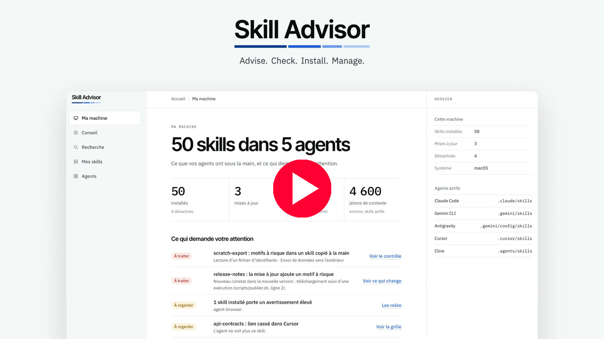

<div align="center">

# Skill Advisor

**ابحث عن Agent Skills لوكلاء البرمجة بالذكاء الاصطناعي، وافحصها، وثبّتها، وأدرها.**

[English](README.md) · [Français](README.fr.md) · [Español](README.es.md) · **العربية**


[](https://www.youtube.com/watch?v=hjwuJ8zlqQc)

*انقر على الصورة لمشاهدة الفيديو على YouTube.*

</div>

---

## ما هو Skill Advisor

الـ Agent Skill مجلد يحتوي على ملف `SKILL.md`. يعلّم هذا الملف وكيل الذكاء الاصطناعي كيف ينجز مهمة واحدة بإتقان. يعرض الفهرس العام skills.sh عدد 92,899 منها. Skill Advisor تطبيق محلي: يعمل على جهازك، في متصفحك، ويجيب عن ثلاثة أسئلة.

1. **أي skills تناسب مشروعي؟** تختار هدفًا من 17 هدفًا، وتجيب عن بضعة أسئلة، فتحصل على قائمة مرتبة.
2. **هل أثق بهذه الـ skill؟** لكل skill درجة من 100. ينزّلها Skill Advisor ويجري عليها فحصًا أمنيًا ثابتًا قبل أن يكتب أي شيء على قرصك.
3. **ما الذي ثُبّت على جهازي؟** شاشة واحدة تعرض كل skill في كل وكيل، مع التحديثات والتحذيرات والنسخ الاحتياطية.

الواجهة بالفرنسية. يذكر هذا الدليل معنى اسم كل شاشة بالعربية.

## البدء السريع

### التثبيت بسكربت واحد

سكربت واحد ينزّل Skill Advisor، ويثبّت اعتمادياته، ويفحصه، ثم يشغّل التطبيق في متصفحك. يسألك عن اللغة: الفرنسية أو الإنجليزية. لا يثبّت أي برنامج في النظام ولا يطلب صلاحيات المدير. تحتاج إلى [Node.js](https://nodejs.org) الإصدار 22.20 أو أحدث، مع npm.

على macOS و Linux:

```bash
curl -fsSLO https://raw.githubusercontent.com/warezfr/skill-advisor/main/install.sh
bash install.sh
```

على Windows، في PowerShell:

```powershell
irm https://raw.githubusercontent.com/warezfr/skill-advisor/main/install.ps1 -OutFile install.ps1
powershell -ExecutionPolicy Bypass -File install.ps1
```

اقرأ السكربت قبل تشغيله. خياراته موجودة في [الدليل](docs/install/INSTALL.ar.md).


*ينتهي السكربت بعنوان التطبيق. هنا شُغّل مع الخيار `--no-open`، فلم يُفتح المتصفح.*

### التشغيل والإيقاف والتحديث وإزالة التثبيت

<div dir="rtl">

| الإجراء | ما تفعله |
|---|---|
| الإيقاف | اضغط Ctrl+C في الطرفية التي يعمل فيها التطبيق. |
| التشغيل من جديد | ادخل مجلد التثبيت (`~/skill-advisor`، أو `skill-advisor` في ملفك الشخصي على Windows) وشغّل `npm start`. على Windows، شغّل `npm.cmd start`. |
| التحديث | شغّل سكربت التثبيت من جديد. النسخة المثبتة بـ git تُحدَّث. النسخة المثبتة دون git تبقى كما هي، والسكربت يقول ذلك: احذف مجلدها أولًا، ثم شغّل السكربت، أو ثبّت في مجلد آخر بـ `--dir`. |
| إزالة التثبيت | فعّل الـ skills المعطّلة وصدّر النسخ الاحتياطية التي تريد الاحتفاظ بها. ثم احذف مجلد التثبيت والمجلد `~/.skill-advisor`. |

</div>

على Windows، استعمل `npm.cmd start`، كما يقول سكربت التثبيت: قد ترفض سياسة التنفيذ الافتراضية في PowerShell الأمر `npm start`، لأنها تمنع `npm.ps1`.

الـ skills التي ثبّتّها تبقى في وكلائك بعد إزالة Skill Advisor. أزلها أولًا من التطبيق إن لم تعد تريدها.

### الخيارات

ضعها بعد `npm start --`، مثلًا `npm start -- --port 4317`.

<div dir="rtl">

| الخيار | الأثر |
|---|---|
| `--port <n>` | الاستماع على هذا المنفذ. دونه يختار النظام منفذًا حرًا. |
| `--no-open` | عدم فتح المتصفح. يُطبع العنوان مع ذلك. |
| `--project <folder>` | استعمال هذا المجلد مجلدًا للمشروع. |
| `--home <folder>` | للاختبارات فقط: استعمال هذا المجلد مجلدًا شخصيًا. |
| `--version` | عرض رقم الإصدار، ثم التوقف. |
| `--help` | عرض المساعدة، بالفرنسية، ثم التوقف. |

</div>

### يدويًا

```bash
git clone https://github.com/warezfr/skill-advisor.git
cd skill-advisor
npm ci --omit=dev
npm start
```

**الدليل خطوة بخطوة: [docs/install/INSTALL.ar.md](docs/install/INSTALL.ar.md).**

## جولة في التطبيق

كل اللقطات تعرض التطبيق الحقيقي على جهاز اختبار فيه أربعة وكلاء: Claude Code و Cursor و Gemini CLI و Windsurf.

### 1. جهازي

تعدّ شاشة "Ma machine" (جهازي) الـ skills والوكلاء، والتحديثات، والـ skills التي تحتاج إلى مراجعة، والسياق الذي تكلّفه. والقائمة أسفلها تقول ما يحتاج إلى انتباهك أولًا.


### 2. النصيحة: هدف، ثم بضعة أسئلة

تعرض "Conseil" (النصيحة) 17 هدفًا: موقع ويب، تطبيق، تحليل بيانات، واجهة خلفية، اختبارات، أمان، مستندات وغيرها. ثم تطرح بضعة أسئلة قصيرة عن مشروعك. واللوحة على اليمين تحفظ إجاباتك.

<div dir="rtl">

| الهدف | الأسئلة |
|---|---|
|  |  |

</div>

### 3. توصيات مرتبة

الـ skills التي تطابق إجاباتك، مرتبة حسب الدرجة. تقول كل بطاقة لماذا تناسبك وتعرض أي تحذير. أفضلها محدَّد مسبقًا. يشرح "Voir le détail" (عرض التفاصيل) الدرجة: الشعبية 40، سمعة المصدر 25، الحداثة 15، الأمان 20.


### 4. تحقّق قبل الكتابة

تعرض "Vérifiez avant d'écrire" (تحقّق قبل الكتابة) ما سيُنشأ، وفي أي مجلدات، لكل المشاريع أو لمشروع واحد. عندما تؤكد، ينزّل Skill Advisor كل skill إلى مجلد مؤقت ويجري الفحص الأمني أولًا.

- **skill محجوزة.** الـ skill التي فيها نمط عالي الخطورة تُحجز: لا يُكتب لها شيء حتى تختار "Installer malgré l'avertissement" (التثبيت رغم التحذير).
- **تعارض.** عندما توجد skill بالاسم نفسه، منسوخة يدويًا أو من مصدر آخر، لا يُكتب شيء. تختار أن تُبقيها أو أن تستبدلها: عندها يصنع Skill Advisor نسخة احتياطية أولًا.
- **المجلد المشترك.** "Dossier partagé" (المجلد المشترك) هو `~/.agents/skills`. يقرؤه عدة وكلاء، مثل Cursor و Gemini CLI و Codex. تذكر الشاشة القرّاء الموجودين على جهازك. الـ skill الموضوعة فيه تصلهم جميعًا، وكل وكيل آخر مختار يحصل على رابط إليها. دون المجلد المشترك، يحصل كل وكيل مختار على نسخته الخاصة.


### 5. الـ skills الخاصة بي

تعرض "Mes skills" (الـ skills الخاصة بي) كل skill مع وكلائها وحالتها ونتيجة فحصها وكلفتها في السياق. وتعرض لوحة التفاصيل الدرجة والتحذيرات.

- **التحديث.** يسأل "Rechercher les mises à jour" (البحث عن التحديثات) مصدر كل skill. للـ skill التي لها تحديث، يعرض "Ce qui change" (ما الذي يتغير) الملفات المضافة والمحذوفة والمعدّلة، وفحص النسخة الجديدة. التحديث الذي فيه نمط عالي الخطورة يُحجز حتى تفرضه. بعد التحديث، يرى الـ skill الوكلاء أنفسهم: لا يكسبها أي وكيل جديد.
- **التعطيل والتفعيل.** ينقل المفتاح الـ skill إلى `~/.skill-advisor/disabled` ويعيدها. ولا يعود الوكيل يحمّلها.
- **إزالة التثبيت.** يعرض التأكيد "Garder une sauvegarde" (الاحتفاظ بنسخة احتياطية)، وهو محدَّد افتراضيًا.


### 6. النسخ الاحتياطية

تحفظ "Sauvegardes" (النسخ الاحتياطية) نسخًا من الـ skills كما كانت، مع وكلائها ونتيجة فحصها، في `~/.skill-advisor/backups`.

- **عند الطلب.** حدّد skills في "Mes skills" واختر "Sauvegarder" (نسخ احتياطي). أضف اسمًا من 80 حرفًا وملاحظة من 500 حرف على الأكثر.
- **الاستعادة.** تعود كل نسخة إلى مكانها. وإذا كان في ذلك المكان شيء، لا يُكتب شيء.
- **التصدير والاستيراد.** صدّر نسخة احتياطية في ملف واحد `.tar.gz`. وعلى جهاز آخر، استورده: تُفحص كل skill من جديد وتُحفظ نسخةً احتياطية جديدة. ولا يُثبَّت شيء بعد.
- **التطبيق على وكلاء آخرين.** انسخ skills نسخة احتياطية إلى أي وكيل معروف أو إلى وكيل أضفته يدويًا. الـ skill الموجودة بالمحتوى نفسه تُتخطّى. وللنسخة المختلفة تختار "Passer" (تخطٍّ) أو "Remplacer" (استبدال): الاستبدال يصنع نسخة احتياطية من النسخة الموجودة أولًا.

<div dir="rtl">

| النسخ الاحتياطية | التطبيق على وكلاء آخرين |
|---|---|
|  |  |

</div>

### 7. الوكلاء

يعرف Skill Advisor ثمانية وسبعين (78) وكيلًا، ويجد المثبَّت منها على جهازك. اختر الوكلاء الذين يتلقّون التثبيتات، وأضف وكيلًا يدويًا مع مجلد الـ skills الخاص به، وأخفِ وكيلًا، أو أفرغ وكيلًا من كل الـ skills، مع نسخة احتياطية اختيارية. المجلد المشترك سطر واحد، وتحته قرّاؤه.


### 8. البحث، بالوضع الفاتح أو الداكن

تبحث "Recherche" (البحث) بين الـ 1,551 skill الأكثر تثبيتًا، مع مرشحات حسب نوع المشروع وعدد التثبيتات والتحذيرات. تعرض الشاشة تاريخ القاعدة ومصدرها: "Base du 12/11/2026 · copie fournie" تعني النسخة المرفقة بالتطبيق. وزر القمر ينقلك إلى الوضع الداكن.

<div dir="rtl">

| البحث | الوضع الداكن |
|---|---|
|  |  |

</div>

## مجلد المشروع

افتراضيًا، يثبّت Skill Advisor لكل مشاريعك. للتثبيت لمشروع واحد فقط، أعطِ مجلد المشروع: شغّل `npm start -- --project <folder>`، أو اكتبه في الحقل "Dossier du projet" (مجلد المشروع) في شاشة التثبيت أو في شاشة الوكلاء. عندها تظهر skills ذلك المشروع في "Mes skills". أدرها من مجلد المشروع: إجراءات التطبيق لا تغيّر إلا الـ skills المثبتة لكل المشاريع.

## الأمان والخصوصية

- يستمع التطبيق على `127.0.0.1` فقط. لا تستطيع الأجهزة الأخرى الوصول إليه.
- عند كل تشغيل يطبع عنوانًا للاستعمال مرة واحدة. يعمل العنوان مرة واحدة، خلال 10 دقائق. علامة التبويب التي فتحته تحتفظ بالجلسة، وإعادة تحميلها تعمل. وأي علامة تبويب أخرى تعرض "Session expirée" (انتهت الجلسة): أوقف التطبيق بـ Ctrl+C وشغّل `npm start` من جديد. لا تشارك هذا العنوان.
- لا ملفات تعريف ارتباط (cookies). إعداداتك تبقى في `~/.skill-advisor`، ولا يقرؤها غيرك على macOS و Linux.
- لا يُرسل أي شيء عنك إلى أي مكان. لا يتصل التطبيق بالإنترنت إلا لتنزيل الـ skills التي تثبّتها والبحث عن تحديثاتها، من مصدرها (GitHub لكل الـ skills تقريبًا)، ولقراءة فهرس على الإنترنت إذا ضبطت واحدًا. وتحمّل الصفحة خطوطها من Google Fonts. وقياس الاستخدام (telemetry) في أداة `skills` معطّل.

## الفحص الأمني

يجري التطبيق الفحص بدلًا منك. ويمكنك أيضًا تشغيله على أي مجلد يحتوي على مجلد فرعي لكل skill. يقرأ الملفات نصًا ولا يشغّلها أبدًا.

```bash
node tools/skill-scan.mjs examples/skills
```


<div dir="rtl">

| الحكم | في الواجهة | المعنى |
|---|---|---|
| `vert` (أخضر) | Aucun motif connu (لا نمط معروف) | لم يُعثر على أي نمط معروف. |
| `vert-remarques` (أخضر مع ملاحظات) | Remarques (ملاحظات) | ملاحظات منخفضة الخطورة فقط. |
| `orange` (برتقالي) | À regarder (للمراجعة) | ملاحظة واحدة متوسطة الخطورة على الأقل. |
| `rouge` (أحمر) | Motif à risque (نمط خطر) | ملاحظة عالية الخطورة، أو ملفات اعتماد مع إرسال بيانات إلى الخارج. |

</div>

تبحث القواعد الإحدى عشرة عن: أوامر تنزّل ثم تشغّل، شيفرة مخفية، حقن تعليمات، نص غير مرئي، ملفات اعتماد، إرسال بيانات إلى الخارج، أوامر بصلاحيات عالية أو مدمّرة، عناوين مريبة، سكربتات تتصل بالشبكة، طلبات تثبيت برامج، وملفات `.env` أو مفاتيح API.

> [!WARNING]
> الحكم الأخضر يعني "لم يُعثر على نمط معروف". ولا يعني "آمن". اقرأ الـ skill قبل أن تثق بها.

## الفهرس

- 242 skill مقيَّمة، في 16 نوع مشروع، تغذّي النصيحة. لكل منها درجة، وعدد تثبيتات، ونجوم مستودعها، وتحذيراتها. التحذير لا يحذف skill من القائمة أبدًا: يُعرض، وأنت تقرر.
- يغطي البحث الـ 1,551 skill الأكثر تثبيتًا من بين 92,899 يعرضها skills.sh.
- القاعدة نسخة بتاريخ 12 نوفمبر 2026، مرفقة بالتطبيق.
- اقرأه هنا: [catalog/CATALOGUE.md](catalog/CATALOGUE.md) (بالفرنسية). البيانات الخام: [catalog/catalog.json](catalog/catalog.json).

## الأنظمة المختبرة

يعمل التكامل المستمر عند كل دفع (push) إلى `main`، وعند كل طلب دمج (pull request)، وعند الطلب.

<div dir="rtl">

| النظام | Node.js | ما الذي يُشغَّل |
|---|---|---|
| macOS | 22.20.0 و 26 | كل الاختبارات دون شبكة، واختبارات من البداية إلى النهاية في Chrome دون نافذة |
| Ubuntu | 22.20.0 و 26 | كل الاختبارات دون شبكة، واختبارات من البداية إلى النهاية في Chrome دون نافذة، وفحوص `install.sh` |
| Windows | 22.20.0 و 26 | كل الاختبارات دون شبكة، واختبارات من البداية إلى النهاية في Chrome دون نافذة، وتحليل `install.ps1` بـ Windows PowerShell 5.1 |

</div>

## بنية المشروع

```text
app/           التطبيق المحلي: خادم على 127.0.0.1 وإجراءات على الـ skills الخاصة بك
prototype/     الواجهة (HTML و CSS و JavaScript، دون إطار عمل)
catalog/       الفهرس، ولقطة البيانات، والسكربتات التي تبنيه
tools/         skill-scan.mjs، الفحص الأمني الثابت
examples/      مثالان من الـ skills للفحص: واحد سليم، وآخر مكتوب ليفشل
test/          اختبارات من البداية إلى النهاية ومشغّل الاختبارات
docs/          دليل التثبيت، ولقطات الشاشة، وتقارير الدراسة
install.sh     سكربت التثبيت لـ macOS و Linux
install.ps1    سكربت التثبيت لـ Windows
```

## الإبلاغ عن مشكلة

- الأخطاء والأسئلة: [GitHub issues](https://github.com/warezfr/skill-advisor/issues).
- مشكلات الأمان: لا تفتح issue علنية. افتح [تنبيهًا أمنيًا خاصًا](https://github.com/warezfr/skill-advisor/security/advisories/new) على GitHub.

راجع [CHANGELOG.md](CHANGELOG.md) (بالإنجليزية) لتغييرات كل إصدار.

## الترخيص

Skill Advisor مرخّص بترخيص [MIT](LICENSE). يستعمل حزمتين يثبّتهما npm:

- [`skills`](https://www.npmjs.com/package/skills): MIT.
- [`tar`](https://www.npmjs.com/package/tar): BlueOak-1.0.0.

اعتمادياتهما تحتفظ بتراخيصها (BlueOak-1.0.0 و MIT و ISC). ومحتوى كل skill ملك لمؤلفيه ويحتفظ بترخيصه الخاص.

## روابط

- الموقع: [span.observer](https://span.observer)
- فهرس الـ skills: [skills.sh](https://skills.sh)
