<div align="center">

# Skill Advisor

**ابحث عن Agent Skills لوكلاء البرمجة بالذكاء الاصطناعي، وافحصها، وثبّتها، وأدرها.**

[English](README.md) · [Français](README.fr.md) · [Español](README.es.md) · **العربية**


[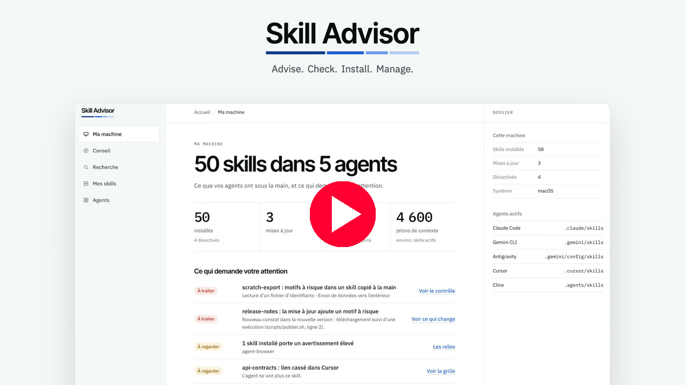](https://www.youtube.com/watch?v=hjwuJ8zlqQc)

*انقر على الصورة لمشاهدة الفيديو على YouTube.*

</div>

---

## ما هو Skill Advisor

الـ Agent Skill مجلد يحتوي على ملف `SKILL.md`. يعلّم هذا الملف وكيل الذكاء الاصطناعي كيف ينجز مهمة واحدة بإتقان. يعرض الفهرس العام skills.sh عدد 92,899 منها. يجيب Skill Advisor عن ثلاثة أسئلة:

1. **أي skills تناسب مشروعي؟** تجيب عن أربعة أسئلة، فتحصل على قائمة مرتبة.
2. **هل أثق بهذه الـ skill؟** لكل skill درجة من 100 وفحص أمني ثابت يمكنك قراءته سطرًا سطرًا.
3. **ما الذي ثُبّت على جهازي؟** شاشة واحدة تعرض كل skill في كل وكيل، مع التحديثات والتحذيرات.

> [!IMPORTANT]
> **هذا الإصدار نموذج أولي (prototype).** تعمل الواجهة على جهاز تجريبي ولا تكتب شيئًا على قرصك. الفهرس والفحص الأمني وأوامر التثبيت حقيقية وقابلة للاستخدام اليوم. التطبيق المحلي الذي يكتشف وكلاءك ويثبّت عنك هو الخطوة التالية. راجع **ما الذي يعمل اليوم** أدناه.

## ما الذي يعمل اليوم

<div dir="rtl">

| الجزء | الحالة | ما الذي يمكنك فعله |
|---|---|---|
| الواجهة (`prototype/`) | عرض تجريبي | اتبع الرحلة كاملة في متصفحك. فهرس حقيقي وجهاز تجريبي. |
| الفهرس (`catalog/`) | بيانات حقيقية | تصفّح 242 skill مقيَّمة في 16 نوع مشروع. لقطة بتاريخ 12 نوفمبر 2026. |
| الفحص الأمني (`tools/skill-scan.mjs`) | يعمل | افحص أي مجلد skill وفق 11 قاعدة قبل تثبيته. |
| التثبيت | يعمل عبر أداة `skills` | ثبّت الـ skills واعرضها وحدّثها واحذفها بأوامر جُرّبت على ثلاثة أنظمة. |
| التطبيق المحلي | لم يُبنَ بعد | اكتشاف وكلائك والتثبيت من الواجهة. |

</div>

## البدء السريع

### سكربت واحد

سكربت واحد ينزّل Skill Advisor ويفحصه ويفتحه في متصفحك. يسألك عن اللغة: الفرنسية أو الإنجليزية. لا يثبّت أي برنامج في النظام ولا يطلب صلاحيات المدير.

على macOS و Linux:

```bash
curl -fsSLO https://raw.githubusercontent.com/warezfr/skill-advisor/main/install.sh
bash install.sh
```

على Windows، في PowerShell:

```powershell
irm https://raw.githubusercontent.com/warezfr/skill-advisor/main/install.ps1 -OutFile install.ps1
powershell -ExecutionPolicy Bypass -File install.ps1
```

اقرأ أي سكربت قبل تشغيله. الخيارات مذكورة في [الدليل](docs/install/INSTALL.ar.md).

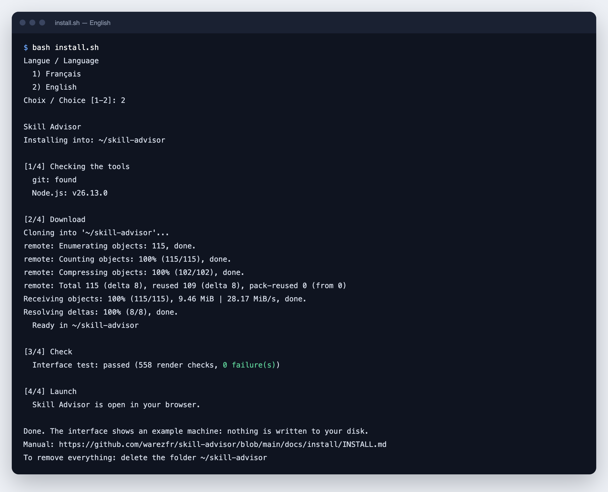

### يدويًا

تحتاج إلى متصفح ويب. وللأوامر تحتاج أيضًا إلى [Node.js](https://nodejs.org) الإصدار 22 أو أحدث (جُرّب مع Node.js 26).

```bash
git clone https://github.com/warezfr/skill-advisor.git
cd skill-advisor
```

افتح الملف `prototype/dist/preview.html` في متصفحك. هذا هو العرض التجريبي كاملًا: بلا خادم وبلا تثبيت.

بعد ذلك افحص الـ skills التجريبية الاثنتين:

```bash
node tools/skill-scan.mjs examples/skills
```

**الدليل خطوة بخطوة، مع لقطة شاشة لكل خطوة: [docs/install/INSTALL.ar.md](docs/install/INSTALL.ar.md).**

## جولة بلقطات الشاشة

الواجهة بالفرنسية حاليًا. يشرح كل تعليق وظيفة الشاشة.

### 1. جهازي

كل skill في كل وكيل على شاشة واحدة: 50 skill في 5 وكلاء، و3 تحديثات، و8 skills تحتاج إلى مراجعة. تعرض القائمة أدناه ما يحتاج إلى انتباهك أولًا.

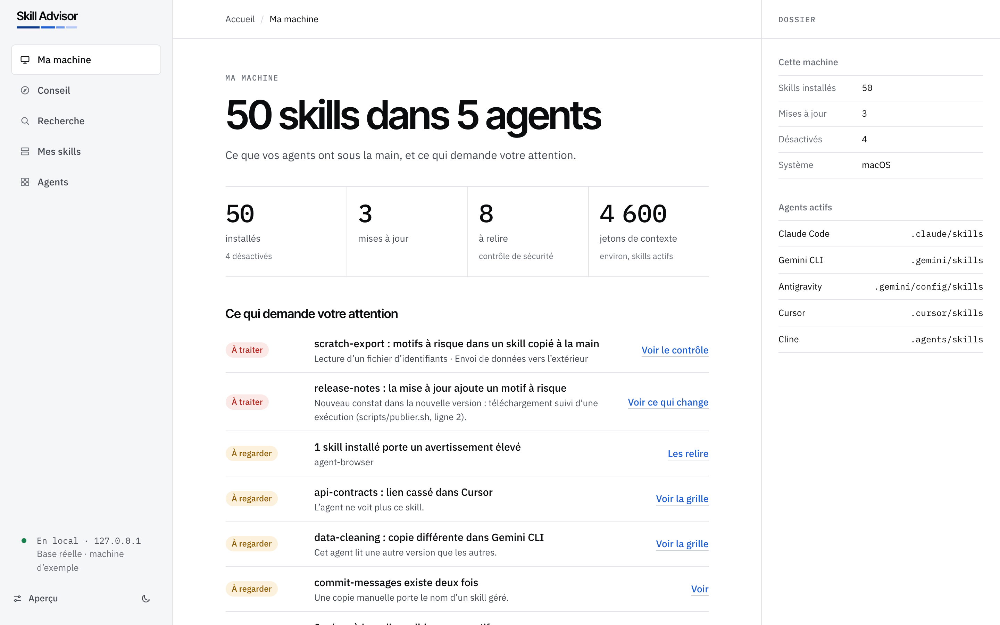

### 2. أخبره بما تبني

اختر هدفًا: موقع ويب أو تطبيقًا أو تحليل بيانات. ثم أجب عن أربعة أسئلة قصيرة حول مشروعك.

<div dir="rtl">

| الهدف | الأسئلة |
|---|---|
| 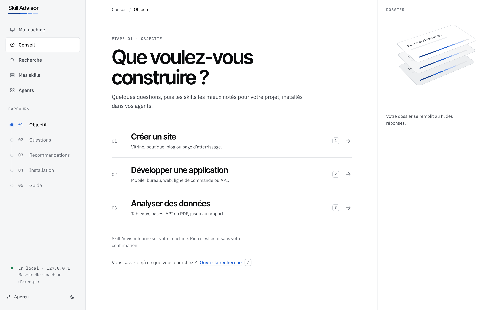 | 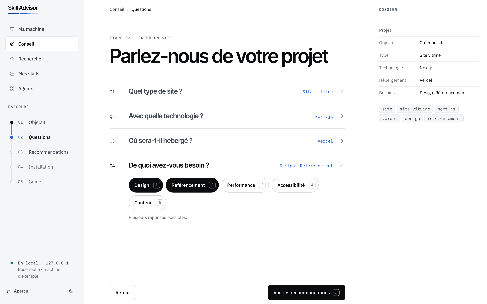 |

</div>

### 3. توصيات مرتبة

اثنتا عشرة skill لمشروعك، مرتبة حسب الدرجة. تذكر كل بطاقة سبب مطابقتها لإجاباتك وتعرض أي تحذير.

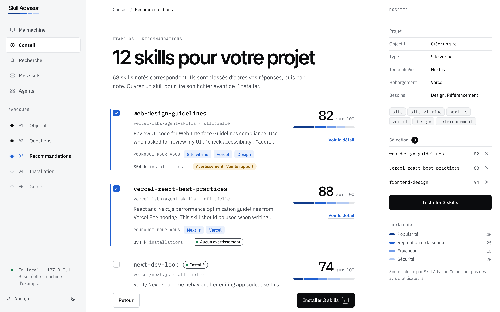

### 4. درجة يمكنك قراءتها

الدرجة من 100: الشعبية 40، وسمعة المصدر 25، والحداثة 15، والأمان 20. تعرض لوحة التفاصيل كل جزء، وملف الـ skill، ونتيجة كل فحص.

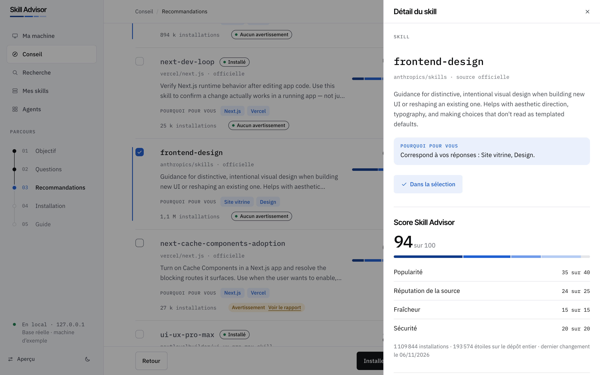

### 5. تحقق قبل كتابة أي شيء

تعرض شاشة التثبيت بدقة ما سيُنشأ، وفي أي وكلاء، ولكل المشاريع أو لمشروع واحد فقط. لا يُكتب شيء قبل أن تؤكد.

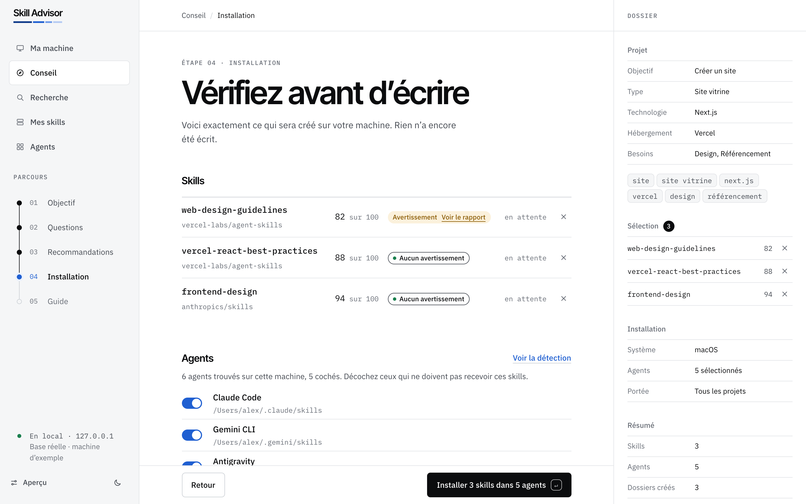

### 6. دليل لكل skill مثبتة

بعد التثبيت، تحصل كل skill على دليل قصير: متى يستخدمها الوكيل وكيف تستدعيها.

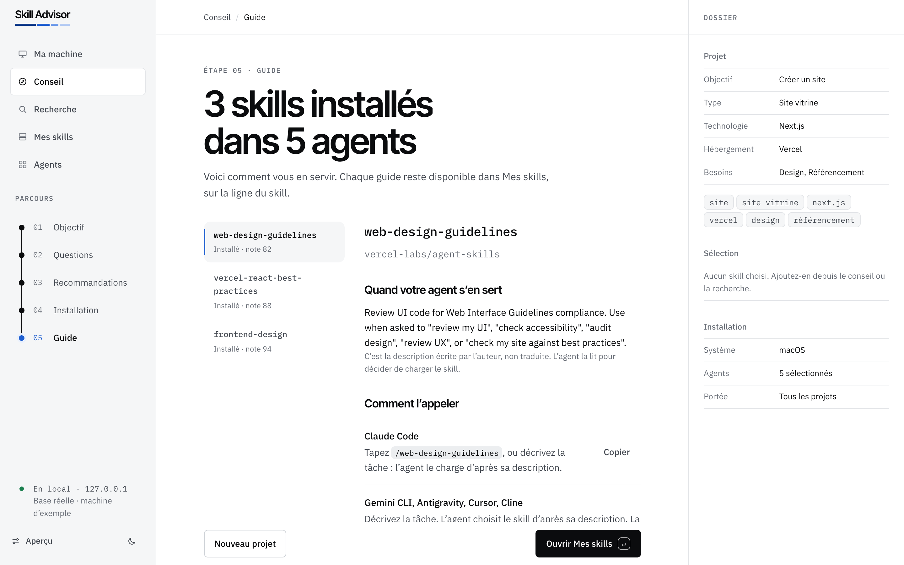

### 7. أدر ما ثبّتَّه

حدّث، أو عطّل، أو احذف. رشّح حسب الحالة. اعرف كم تكلّف كل skill من السياق.

<div dir="rtl">

| skills الخاصة بي | الوكلاء الموجودون على الجهاز |
|---|---|
| 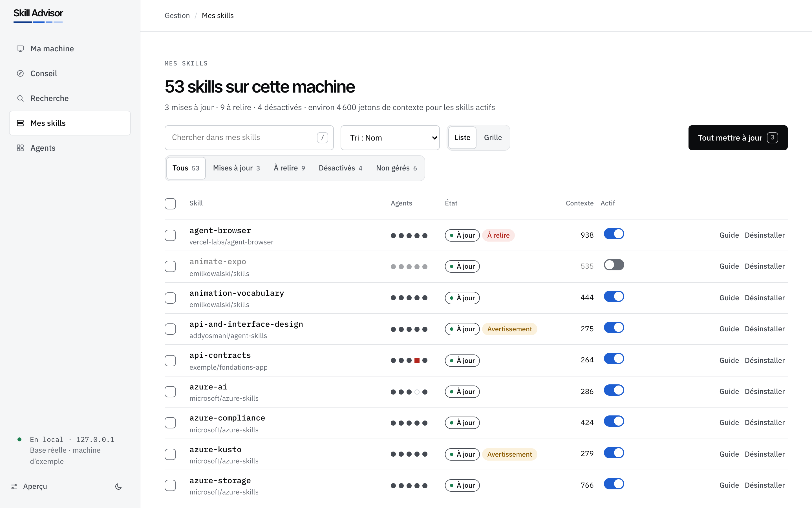 | 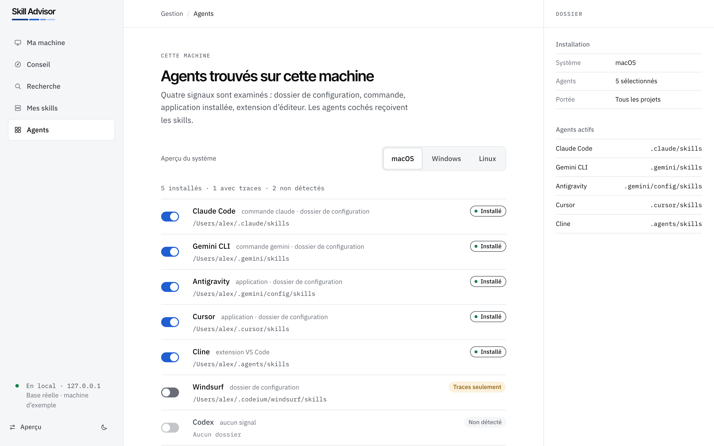 |

</div>

### 8. ابحث في القاعدة كلها، بالمظهر الفاتح أو الداكن

<div dir="rtl">

| البحث | المظهر الداكن |
|---|---|
| 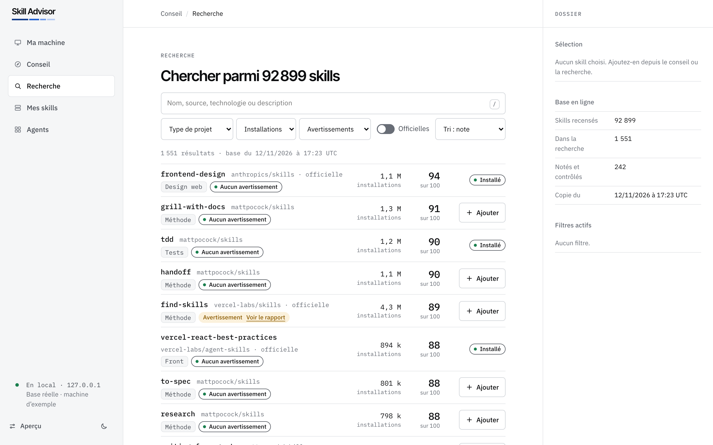 | 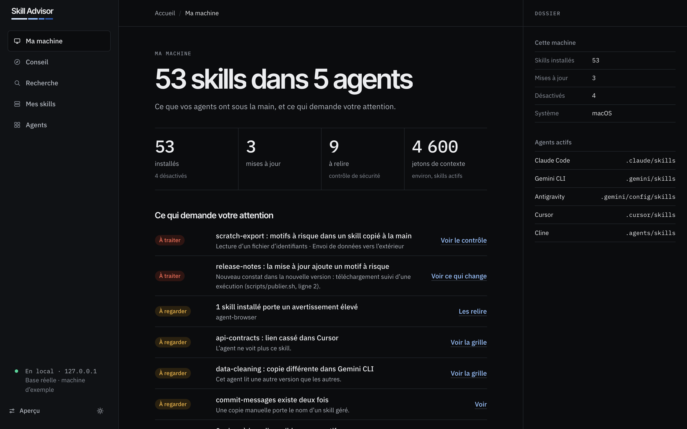 |

</div>

## الفحص الأمني

يقرأ `tools/skill-scan.mjs` ملفات الـ skill كنصوص. ولا ينفذها أبدًا.

```bash
node tools/skill-scan.mjs examples/skills
```

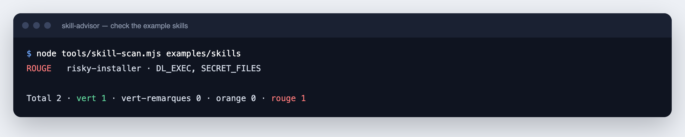

<div dir="rtl">

| الحكم | المعنى |
|---|---|
| `vert` (أخضر) | لم يُعثر على أي نمط معروف. |
| `vert-remarques` (أخضر مع ملاحظات) | نتائج منخفضة الخطورة فقط. |
| `orange` | نتيجة واحدة على الأقل متوسطة الخطورة. |
| `rouge` (أحمر) | نتيجة عالية الخطورة، أو ملفات اعتماد مع بيانات تُرسل إلى الخارج. |

</div>

تبحث القواعد الإحدى عشرة عن: أوامر التنزيل والتشغيل، والشيفرة المخفية، وحقن التعليمات (prompt injection)، والنص غير المرئي، وملفات الاعتماد، والبيانات المرسلة إلى الخارج، والأوامر ذات الصلاحيات العالية أو المدمرة، والعناوين المشبوهة، والسكربتات التي تتصل بالشبكة، وطلبات تثبيت البرامج، وملفات `.env` ومفاتيح API.

> [!WARNING]
> الحكم الأخضر يعني "لم يُعثر على أي نمط معروف". ولا يعني "آمن". اقرأ الـ skill قبل أن تثق بها.

## الفهرس

- 242 skill في 16 نوع مشروع، اختيرت من 92,899 skill مدرجة في skills.sh.
- لكل skill درجة وعدد تثبيتات ونجوم مستودعها (repository) وتحذيراتها.
- التحذير لا يحذف skill من القائمة أبدًا. يظهر التحذير وأنت تقرر.
- اقرأه هنا: [catalog/CATALOGUE.md](catalog/CATALOGUE.md) (بالفرنسية). البيانات الخام: [catalog/catalog.json](catalog/catalog.json).

## الأنظمة التي جُرّبت

أُعيد تشغيل أوامر التثبيت بسكربت على ثلاثة أنظمة، وكلها بمعالجات arm64.

<div dir="rtl">

| النظام | النتيجة |
|---|---|
| Windows 11 | 17 فحصًا من 17 |
| Debian 12 (حاوية) | 17 فحصًا من 17 |
| macOS | 17 فحصًا من 17 |

</div>

لم تُجرَّب بعد: معالجات x64 وWSL. التقارير في [docs/etude/](docs/etude/) (بالفرنسية).

## بنية المشروع

```text
prototype/     Interface of the demonstration (HTML, CSS, JavaScript, no dependency)
catalog/       Catalogue, data snapshot and the scripts that build it
tools/         skill-scan.mjs, the static security check
examples/      Two example skills for the check: one safe, one written to fail
essais/        Test scripts and raw results for Windows, Linux and macOS
docs/          Installation manual, screenshots and test reports
install.sh    Installation script for macOS and Linux
install.ps1   Installation script for Windows
```

## خارطة الطريق

- تطبيق محلي يبدأ بأمر واحد، ويكتشف الوكلاء على جهازك.
- التثبيت والتحديث والتعطيل والحذف من الواجهة.
- اختبارات على معالجات x64 وWSL.

## الترخيص

[MIT](LICENSE). الـ skills المدرجة في الفهرس ملك لمؤلفيها وتحتفظ بتراخيصها الخاصة.

## روابط

- الموقع: [span.observer](https://span.observer)
- فهرس الـ skills: [skills.sh](https://skills.sh)
