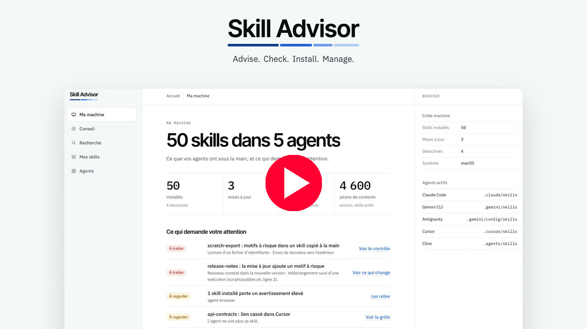

<div align="center">

# Skill Advisor

**Encuentre, verifique, instale y gestione Agent Skills para sus agentes de programación con IA.**

[English](README.md) · [Français](README.fr.md) · **Español** · [العربية](README.ar.md)


[](https://www.youtube.com/watch?v=hjwuJ8zlqQc)

*Haga clic en la imagen para ver el vídeo en YouTube.*

</div>

---

## Qué es

Un Agent Skill es una carpeta con un archivo `SKILL.md`. Ese archivo enseña a un agente de IA a hacer bien una tarea concreta. El índice público skills.sh enumera 92 899. Skill Advisor responde a tres preguntas:

1. **¿Qué skills encajan con mi proyecto?** Usted responde cuatro preguntas y recibe una lista ordenada.
2. **¿Puedo confiar en esta skill?** Cada skill tiene una puntuación sobre 100 y una verificación de seguridad estática que se puede leer línea por línea.
3. **¿Qué hay instalado en mi máquina?** Una sola pantalla muestra todas las skills, en todos los agentes, con actualizaciones y avisos.

> [!IMPORTANT]
> **Esta versión es un prototipo.** El script de instalación ahora inicia la aplicación local real. Lee y cambia las skills reales de sus agentes. La demostración funciona con una máquina de ejemplo y no escribe nada en su disco: sigue disponible con `--demo`. Las capturas de pantalla de abajo aún muestran la demostración. Consulte **Qué funciona hoy** más abajo.

## Qué funciona hoy

| Parte | Estado | Qué se puede hacer |
|---|---|---|
| Interfaz (`prototype/`) | Demostración | Recorra el trayecto completo en su navegador. Catálogo real, máquina de ejemplo. |
| Catálogo (`catalog/`) | Datos reales | Explore 242 skills valoradas en 16 tipos de proyecto. Instantánea del 12 de noviembre de 2026. |
| Verificación de seguridad (`tools/skill-scan.mjs`) | Funciona | Compruebe cualquier carpeta de skill con 11 reglas antes de instalarla. |
| Instalación | Funciona con la CLI `skills` | Instale, liste, actualice y elimine skills con comandos probados en tres sistemas. |
| Aplicación local (`app/`) | Nueva | Detecte sus agentes y después instale, actualice, desactive y elimine skills desde la interfaz. Requiere Node.js 22.20 o posterior. |

## Inicio rápido

### Un solo script

Un script descarga Skill Advisor, instala su única dependencia, lo comprueba e inicia la aplicación local en su navegador. Sin Node.js 22.20 o posterior, abre la demostración en su lugar. Pregunta su idioma, francés o inglés. No instala ningún software del sistema y no pide permisos de administrador.

macOS y Linux:

```bash
curl -fsSLO https://raw.githubusercontent.com/warezfr/skill-advisor/main/install.sh
bash install.sh
```

Windows, en PowerShell:

```powershell
irm https://raw.githubusercontent.com/warezfr/skill-advisor/main/install.ps1 -OutFile install.ps1
powershell -ExecutionPolicy Bypass -File install.ps1
```

Lea un script antes de ejecutarlo. Las opciones están en el [manual](docs/install/INSTALL.es.md).


*Esta captura muestra una versión anterior del script, que abría la demostración.*

### Volver a iniciarla

La aplicación funciona en la terminal hasta que pulse Ctrl+C. Para volver a iniciarla más tarde, vaya a la carpeta de instalación y ejecute `npm start`:

```bash
cd ~/skill-advisor
npm start
```

En Windows, la carpeta es `skill-advisor` en su perfil de usuario. Para la demostración sola, ejecute el script con `--demo` (`-Demo` en Windows): no instala nada y no inicia nada.

### A mano

Necesita un navegador web. Para los comandos necesita además [Node.js](https://nodejs.org) 22 o posterior (probado con Node.js 26). La aplicación local requiere Node.js 22.20 o posterior.

```bash
git clone https://github.com/warezfr/skill-advisor.git
cd skill-advisor
```

Abra `prototype/dist/preview.html` en su navegador. Eso es toda la demostración: sin servidor y sin instalación.

Para iniciar la aplicación local desde esta carpeta, ejecute `npm ci --omit=dev` y después `npm start`.

Después, verifique las dos skills de ejemplo:

```bash
node tools/skill-scan.mjs examples/skills
```

**El manual paso a paso, con una captura de pantalla por cada paso: [docs/install/INSTALL.es.md](docs/install/INSTALL.es.md).**

## La aplicación local

El script inicia `node app/server.mjs`. La aplicación trabaja en su máquina real: lo que instala, elimina o desactiva cambia las carpetas de skills de sus agentes. Muestra su dirección y la abre en su navegador.

Qué hace:

- **Instalar** skills del catálogo, para todos sus proyectos o para uno solo, en los agentes que usted elija.
- **Eliminar** skills. Antes de eliminar, puede guardar una copia de seguridad. Vea **Copias de seguridad** más abajo.
- **Actualizar** skills. Una actualización cuya nueva versión recibe el veredicto `rouge` queda retenida hasta que usted la fuerce.
- **Desactivar y activar** skills. Una skill desactivada pasa a `~/.skill-advisor/disabled` y vuelve cuando la activa.
- **Gestionar 78 agentes.** Añada un agente a mano con su carpeta de skills, oculte un agente, vacíe un agente de sus skills y elija qué agentes reciben las instalaciones.

Seguridad:

- La aplicación escucha solo en `127.0.0.1`. Las otras máquinas no pueden alcanzarla.
- La dirección que muestra lleva un código de un solo uso, válido 10 minutos. Para volver a abrir la interfaz más tarde, detenga la aplicación con Ctrl+C y ejecute `npm start` de nuevo.
- No se envía nada a otro sitio, salvo las descargas de skills desde GitHub y del catálogo. La telemetría de la herramienta `skills` está desactivada. La página carga sus fuentes desde internet.
- Sus ajustes se guardan en `~/.skill-advisor/settings.json`.

## Copias de seguridad

Una copia de seguridad guarda una o varias skills tal como estaban, con los agentes que las usaban y el veredicto de su verificación de seguridad. Las copias se guardan en `~/.skill-advisor/backups`.

- **A petición.** Elija una o varias skills y haga una copia de seguridad. Puede añadir un título de 80 caracteres como máximo y una nota de 500 caracteres como máximo.
- **Al desinstalar.** La confirmación ofrece la casilla "Garder une sauvegarde" (Guardar una copia). Márquela para guardar una copia de la skill antes de eliminarla. La misma casilla aparece cuando vacía un agente.
- **Restaurar o borrar.** Restaurar devuelve cada copia a su lugar de origen. Si algo ya ocupa uno de esos lugares, se niega y no cambia nada.
- **Exportar.** Guarde una copia de seguridad en un solo archivo `.tar.gz`.
- **Importar.** En otra máquina, importe ese archivo. Skill Advisor verifica de nuevo cada skill y la guarda como una nueva copia de seguridad. Todavía no instala nada. Rechaza un archivo que contenga algo distinto de archivos y carpetas, una ruta que salga de la copia, más de 200 MB o más de 100 000 entradas. También rechaza un archivo sin un manifiesto válido de Skill Advisor o con un nombre de skill no válido.
- **Aplicar.** Copie las skills de una copia de seguridad a otros agentes: cualquier agente conocido, o un agente añadido a mano. Si un agente ya tiene el mismo contenido, nada cambia. Si tiene otra versión, usted elige: **Omitir** la deja en su sitio, **Reemplazar** primero la guarda en una copia y luego la reemplaza.
- **Skills rojas.** Una skill cuyo veredicto es `rouge` solo se aplica después de que usted lo confirme.

El paso 9 del [manual](docs/install/INSTALL.es.md) le guía en cada acción.

## Un recorrido en capturas de pantalla

Por ahora la interfaz está en francés. Cada pie de imagen explica qué hace la pantalla. Estas capturas aún muestran la demostración, con una máquina de ejemplo.

### 1. Mi máquina

Todas las skills de todos los agentes, en una sola pantalla: 50 skills en 5 agentes, 3 actualizaciones, 8 skills por revisar. La lista inferior muestra primero lo que requiere su atención.


### 2. Cuente qué construye

Elija un objetivo: un sitio web, una aplicación o un análisis de datos. Después responda cuatro preguntas breves sobre su proyecto.

| Objetivo | Preguntas |
|---|---|
|  |  |

### 3. Recomendaciones ordenadas

Doce skills para su proyecto, ordenadas por puntuación. Cada tarjeta explica por qué encaja con sus respuestas y muestra los avisos.


### 4. Una puntuación legible

La puntuación es sobre 100: popularidad 40, reputación de la fuente 25, actualidad 15, seguridad 20. El panel de detalle muestra cada parte, el archivo de la skill y el resultado de cada verificación.


### 5. Verifique antes de escribir nada

La pantalla de instalación enumera exactamente qué se creará, en qué agentes, para todos los proyectos o para uno solo. No se escribe nada antes de que usted confirme.


### 6. Una guía para cada skill instalada

Tras la instalación, cada skill recibe una guía breve: cuándo la usa el agente y cómo invocarla.


### 7. Gestione lo instalado

Actualice, desactive, elimine. Filtre por estado. Vea cuánto contexto consume cada skill.

| Mis skills | Agentes encontrados en la máquina |
|---|---|
|  |  |

### 8. Busque en toda la base, en tema claro u oscuro

| Búsqueda | Tema oscuro |
|---|---|
|  |  |

## La verificación de seguridad

`tools/skill-scan.mjs` lee los archivos de una skill como texto. Nunca los ejecuta.

```bash
node tools/skill-scan.mjs examples/skills
```


| Veredicto | Significado |
|---|---|
| `vert` (verde) | No se encontró ningún patrón conocido. |
| `vert-remarques` (verde con notas) | Solo hallazgos de gravedad baja. |
| `orange` (naranja) | Al menos un hallazgo de gravedad media. |
| `rouge` (rojo) | Un hallazgo de gravedad alta, o archivos de credenciales junto con datos enviados al exterior. |

Las 11 reglas buscan: comandos que descargan y ejecutan, código oculto, inyección de instrucciones, texto invisible, archivos de credenciales, datos enviados al exterior, comandos privilegiados o destructivos, direcciones sospechosas, scripts que llaman a la red, peticiones de instalar programas, y archivos `.env` o claves de API.

> [!WARNING]
> Un veredicto verde significa "no se encontró ningún patrón conocido". No significa "seguro". Lea una skill antes de confiar en ella.

## El catálogo

- 242 skills, en 16 tipos de proyecto, seleccionadas entre las 92 899 que enumera skills.sh.
- Cada skill tiene una puntuación, un número de instalaciones, las estrellas de su repositorio y sus avisos.
- Un aviso nunca retira una skill de la lista. Se muestra y usted decide.
- Léalo aquí: [catalog/CATALOGUE.md](catalog/CATALOGUE.md) (en francés). Datos sin procesar: [catalog/catalog.json](catalog/catalog.json).

## Sistemas probados

Los comandos de instalación se repitieron mediante un script en tres sistemas, todos con procesadores arm64.

| Sistema | Resultado |
|---|---|
| Windows 11 | 17 comprobaciones de 17 |
| Debian 12 (contenedor) | 17 comprobaciones de 17 |
| macOS | 17 comprobaciones de 17 |

Aún sin probar: procesadores x64 y WSL. Los informes están en [docs/etude/](docs/etude/) (en francés).

## Estructura del proyecto

```text
app/           Local application: server on 127.0.0.1 and actions on your skills
prototype/     Interface of the demonstration (HTML, CSS, JavaScript, no dependency)
catalog/       Catalogue, data snapshot and the scripts that build it
tools/         skill-scan.mjs, the static security check
examples/      Two example skills for the check: one safe, one written to fail
essais/        Test scripts and raw results for Windows, Linux and macOS
docs/          Installation manual, screenshots and test reports
install.sh    Installation script for macOS and Linux
install.ps1   Installation script for Windows
```

## Hoja de ruta

- Capturas de pantalla de la aplicación local.
- Pruebas de la aplicación local en Windows 11 y Linux.
- Pruebas en procesadores x64 y WSL.

## Licencia

[MIT](LICENSE). Las skills del catálogo pertenecen a sus autores y conservan sus propias licencias.

## Enlaces

- Sitio web: [span.observer](https://span.observer)
- Índice de skills: [skills.sh](https://skills.sh)
