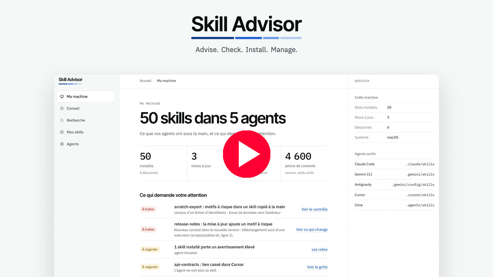
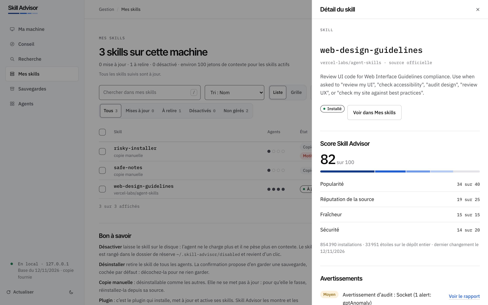
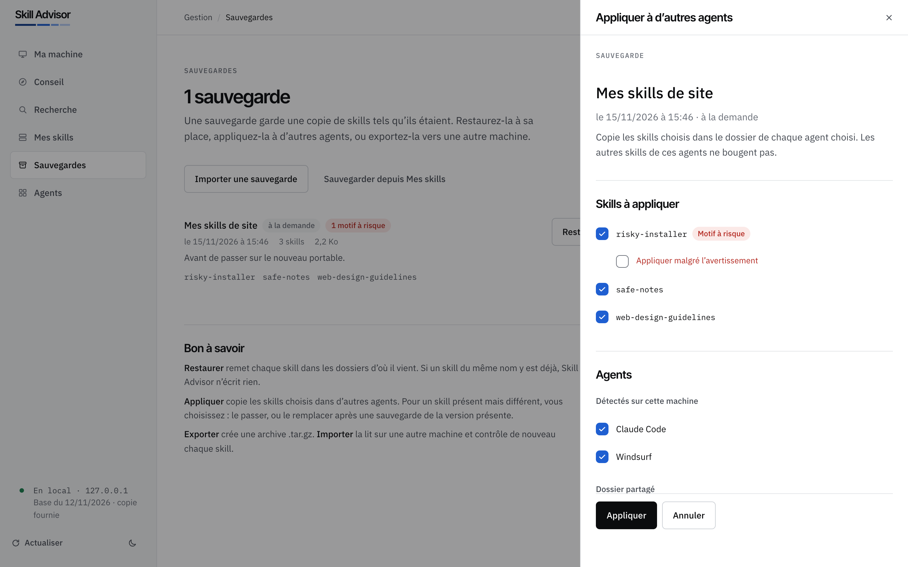

<div align="center">

# Skill Advisor

**Encuentre, verifique, instale y gestione Agent Skills para sus agentes de programación con IA.**

[English](README.md) · [Français](README.fr.md) · **Español** · [العربية](README.ar.md)


[](https://www.youtube.com/watch?v=hjwuJ8zlqQc)

*Haga clic en la imagen para ver el vídeo en YouTube.*

</div>

---

## Qué es

Una Agent Skill es una carpeta con un archivo `SKILL.md` que enseña a un agente de IA a hacer bien una tarea concreta. El índice público skills.sh enumera 92 899. Skill Advisor es una aplicación local: funciona en su máquina, en su navegador, y responde a tres preguntas.

1. **¿Qué skills encajan con mi proyecto?** Usted elige uno de los 17 objetivos, responde a unas preguntas y recibe una lista ordenada.
2. **¿Puedo confiar en esta skill?** Cada skill tiene una puntuación sobre 100. Skill Advisor la descarga y ejecuta una verificación de seguridad estática antes de escribir nada en su disco.
3. **¿Qué hay instalado en mi máquina?** Una sola pantalla muestra todas las skills, en todos los agentes, con actualizaciones, avisos y copias de seguridad.

La interfaz está en francés. Esta guía da el significado en español del nombre de cada pantalla.

## Inicio rápido

### Instalar con un script

Un script descarga Skill Advisor, instala sus dependencias, lo comprueba e inicia la aplicación en su navegador. Le pregunta el idioma, francés o inglés. No instala ningún software del sistema ni pide permisos de administrador. Necesita [Node.js](https://nodejs.org) 22.20 o posterior, con npm.

macOS y Linux:

```bash
curl -fsSLO https://raw.githubusercontent.com/warezfr/skill-advisor/main/install.sh
bash install.sh
```

Windows, en PowerShell:

```powershell
irm https://raw.githubusercontent.com/warezfr/skill-advisor/main/install.ps1 -OutFile install.ps1
powershell -ExecutionPolicy Bypass -File install.ps1
```

Lea un script antes de ejecutarlo. Sus opciones están en el [manual](docs/install/INSTALL.es.md).


*El script termina con la dirección de la aplicación. Aquí se ejecutó con `--no-open`, así que el navegador no se abrió.*

### Iniciar, detener, actualizar, desinstalar

| Acción | Qué hacer |
|---|---|
| Detener | Pulse Ctrl+C en el terminal donde se ejecuta la aplicación. |
| Volver a iniciar | Vaya a la carpeta de instalación (`~/skill-advisor`, o `skill-advisor` en su perfil de usuario en Windows) y ejecute `npm start`. En Windows, ejecute `npm.cmd start`. |
| Actualizar | Vuelva a ejecutar el script de instalación. Una copia instalada con git se actualiza. Una copia instalada sin git se conserva tal cual, y el script lo dice: borre antes su carpeta y después ejecute el script, o instale en otra carpeta con `--dir`. |
| Desinstalar | Active sus skills desactivadas y exporte las copias de seguridad que quiera conservar. Después borre la carpeta de instalación y la carpeta `~/.skill-advisor`. |

En Windows, use `npm.cmd start`, como indica el script de instalación: la directiva de ejecución por defecto de PowerShell puede rechazar `npm start`, porque bloquea `npm.ps1`.

Las skills que instaló siguen en sus agentes después de desinstalar Skill Advisor. Desinstálelas antes en la aplicación si ya no las quiere.

### Opciones

Póngalas después de `npm start --`, por ejemplo `npm start -- --port 4317`.

| Opción | Efecto |
|---|---|
| `--port <n>` | Escuchar en este puerto. Sin ella, el sistema elige un puerto libre. |
| `--no-open` | No abrir el navegador. La dirección se muestra igualmente. |
| `--project <carpeta>` | Usar esta carpeta como carpeta del proyecto. |
| `--home <carpeta>` | Solo para pruebas: usar esta carpeta como carpeta personal. |
| `--version` | Mostrar la versión y detenerse. |
| `--help` | Mostrar la ayuda, en francés, y detenerse. |

### A mano

```bash
git clone https://github.com/warezfr/skill-advisor.git
cd skill-advisor
npm ci --omit=dev
npm start
```

**El manual paso a paso: [docs/install/INSTALL.es.md](docs/install/INSTALL.es.md).**

## Recorrido por la aplicación

Todas las capturas muestran la aplicación real en una máquina de prueba con cuatro agentes: Claude Code, Cursor, Gemini CLI y Windsurf.

### 1. Mi máquina

"Ma machine" (Mi máquina) cuenta sus skills y agentes, las actualizaciones, las skills que revisar y el contexto que cuestan. La lista de abajo indica qué requiere primero su atención.


### 2. Consejo: un objetivo y unas preguntas

"Conseil" (Consejo) ofrece 17 objetivos: un sitio web, una aplicación, análisis de datos, un backend, pruebas, seguridad, documentos y más. Después hace unas preguntas cortas sobre su proyecto. El panel de la derecha guarda sus respuestas.

| Objetivo | Preguntas |
|---|---|
|  |  |

### 3. Recomendaciones ordenadas

Las skills que encajan con sus respuestas, ordenadas por puntuación. Cada tarjeta dice por qué encaja y muestra sus avisos. Las mejores aparecen marcadas. "Voir le détail" (Ver el detalle) explica la puntuación: popularidad 40, reputación de la fuente 25, actualidad 15, seguridad 20.


### 4. Verificar antes de escribir

"Vérifiez avant d'écrire" (Verifique antes de escribir) enumera lo que se creará, en qué carpetas, para todos los proyectos o para un solo proyecto. Cuando usted confirma, Skill Advisor descarga cada skill en una carpeta temporal y ejecuta primero la verificación de seguridad.

- **Skill retenida.** Una skill con un patrón de riesgo alto queda retenida: no se escribe nada para ella hasta que usted elige "Installer malgré l'avertissement" (Instalar pese al aviso).
- **Conflicto.** Cuando ya hay una skill con el mismo nombre, copiada a mano o de otra fuente, no se escribe nada. Usted elige conservarla o reemplazarla: Skill Advisor hace antes una copia de seguridad.
- **Carpeta compartida.** "Dossier partagé" (Carpeta compartida) es `~/.agents/skills`. Varios agentes la leen, por ejemplo Cursor, Gemini CLI y Codex. La pantalla nombra los lectores encontrados en su máquina. Una skill colocada ahí les llega a todos, y cada otro agente elegido recibe un enlace a ella. Sin la carpeta compartida, cada agente elegido recibe su propia copia.


### 5. Mis skills

"Mes skills" (Mis skills) enumera cada skill con sus agentes, su estado, el resultado de su verificación y su coste en contexto. El panel de detalle muestra la puntuación y los avisos.

- **Actualizar.** "Rechercher les mises à jour" (Buscar actualizaciones) consulta la fuente de cada skill. Para una skill con actualización, "Ce qui change" (Qué cambia) enumera los archivos añadidos, quitados y modificados, y la verificación de la nueva versión. Una actualización con un patrón de riesgo alto queda retenida hasta que usted la fuerce. Después de una actualización, los mismos agentes ven la skill: ningún agente la gana.
- **Desactivar y activar.** El interruptor mueve la skill a `~/.skill-advisor/disabled` y la devuelve. El agente deja de cargarla.
- **Desinstalar.** La confirmación ofrece "Garder une sauvegarde" (Guardar una copia de seguridad), marcada por defecto.



### 6. Copias de seguridad

"Sauvegardes" (Copias de seguridad) guarda copias de skills tal como estaban, con sus agentes y el resultado de su verificación, en `~/.skill-advisor/backups`.

- **Bajo demanda.** Marque skills en "Mes skills" y elija "Sauvegarder" (Guardar copia). Añada un nombre de 80 caracteres y una nota de 500 caracteres como máximo.
- **Restaurar.** Cada copia vuelve a su sitio. Cuando ya hay algo en ese sitio, no se escribe nada.
- **Exportar e importar.** Exporte una copia de seguridad como un solo archivo `.tar.gz`. En otra máquina, impórtelo: cada skill se verifica de nuevo y se guarda como una nueva copia. Todavía no se instala nada.
- **Aplicar a otros agentes.** Copie las skills de una copia de seguridad a cualquier agente conocido o a un agente añadido a mano. Una skill que ya está con el mismo contenido se omite. Para una versión distinta usted elige "Passer" (Omitir) o "Remplacer" (Reemplazar): Reemplazar hace antes una copia de la versión presente.

| Copias de seguridad | Aplicar a otros agentes |
|---|---|
|  |  |

### 7. Agentes

Skill Advisor conoce 78 agentes y encuentra los que están instalados en su máquina. Elija cuáles reciben las instalaciones, añada un agente a mano con su carpeta de skills, oculte un agente, o vacíe un agente de todas sus skills, con una copia de seguridad opcional. La carpeta compartida ocupa una línea, con sus lectores debajo.


### 8. Búsqueda, en claro u oscuro

"Recherche" (Búsqueda) busca entre las 1551 skills más instaladas, con filtros por tipo de proyecto, instalaciones y avisos. La pantalla muestra la fecha y la fuente de la base: "Base du 12/11/2026 · copie fournie" indica la copia incluida con la aplicación. El botón con forma de luna cambia al tema oscuro.

| Búsqueda | Tema oscuro |
|---|---|
|  |  |

## La carpeta del proyecto

Por defecto, Skill Advisor instala para todos sus proyectos. Para instalar solo para un proyecto, indique su carpeta: inicie con `npm start -- --project <carpeta>`, o escríbala en el campo "Dossier du projet" (Carpeta del proyecto) de la pantalla de instalación o de la pantalla de agentes. Las skills de ese proyecto aparecen entonces en "Mes skills". Gestiónelas desde la carpeta del proyecto: las acciones de la aplicación solo cambian skills instaladas para todos los proyectos.

## Seguridad y privacidad

- La aplicación escucha solo en `127.0.0.1`. Otras máquinas no pueden alcanzarla.
- En cada inicio muestra una dirección de un solo uso. La dirección funciona una vez, en los 10 minutos siguientes. La pestaña que la abrió conserva la sesión, y recargar esa pestaña sigue funcionando. Otra pestaña muestra "Session expirée" (Sesión caducada): detenga la aplicación con Ctrl+C y vuelva a ejecutar `npm start`. No comparta esa dirección.
- Sin cookies. Su configuración queda en `~/.skill-advisor`, legible solo por usted en macOS y Linux.
- No se envía nada sobre usted a ningún sitio. La aplicación solo se conecta a internet para descargar las skills que usted instala y buscar sus actualizaciones, desde su fuente (GitHub para casi todas las skills), y para leer un catálogo en línea si usted configura uno. La página carga sus fuentes desde Google Fonts. La telemetría de la herramienta `skills` está desactivada.

## La verificación de seguridad

La aplicación ejecuta la verificación por usted. También puede ejecutarla sobre cualquier carpeta que contenga una subcarpeta por skill. Lee los archivos como texto y nunca los ejecuta.

```bash
node tools/skill-scan.mjs examples/skills
```


| Veredicto | En la interfaz | Significado |
|---|---|---|
| `vert` (verde) | Aucun motif connu (Ningún patrón conocido) | No se encontró ningún patrón conocido. |
| `vert-remarques` (verde con notas) | Remarques (Notas) | Solo hallazgos de gravedad baja. |
| `orange` (naranja) | À regarder (Para revisar) | Al menos un hallazgo de gravedad media. |
| `rouge` (rojo) | Motif à risque (Patrón de riesgo) | Un hallazgo grave, o archivos de credenciales junto con un envío de datos al exterior. |

Las 11 reglas buscan: comandos que descargan y ejecutan, código oculto, inyección de instrucciones, texto invisible, archivos de credenciales, envío de datos al exterior, comandos privilegiados o destructivos, direcciones sospechosas, scripts que llaman a la red, peticiones de instalar programas, y archivos `.env` o claves de API.

> [!WARNING]
> Un veredicto verde significa "ningún patrón conocido encontrado". No significa "segura". Lea una skill antes de confiar en ella.

## El catálogo

- 242 skills puntuadas, en 16 tipos de proyecto, alimentan el consejo. Cada una tiene una puntuación, un número de instalaciones, las estrellas de su repositorio y sus avisos. Un aviso nunca quita una skill de la lista: se muestra, y usted decide.
- La búsqueda cubre las 1551 skills más instaladas de las 92 899 que enumera skills.sh.
- La base es una copia del 12 de noviembre de 2026, incluida con la aplicación.
- Léalo aquí: [catalog/CATALOGUE.md](catalog/CATALOGUE.md) (en francés). Datos en bruto: [catalog/catalog.json](catalog/catalog.json).

## Sistemas probados

La integración continua se ejecuta en cada envío a `main`, en cada solicitud de fusión y bajo demanda.

| Sistema | Node.js | Qué se ejecuta |
|---|---|---|
| macOS | 22.20.0 y 26 | Todas las pruebas sin red, pruebas de extremo a extremo en Chrome sin ventana |
| Ubuntu | 22.20.0 y 26 | Todas las pruebas sin red, pruebas de extremo a extremo en Chrome sin ventana, comprobaciones de `install.sh` |
| Windows | 22.20.0 y 26 | Todas las pruebas sin red, pruebas de extremo a extremo en Chrome sin ventana, análisis de `install.ps1` con Windows PowerShell 5.1 |

## Estructura del proyecto

```text
app/           La aplicación local: servidor en 127.0.0.1 y acciones sobre sus skills
prototype/     La interfaz (HTML, CSS, JavaScript, sin framework)
catalog/       Catálogo, instantánea de datos y los scripts que lo construyen
tools/         skill-scan.mjs, la verificación de seguridad estática
examples/      Dos skills de ejemplo para la verificación: una segura, otra escrita para fallar
test/          Pruebas de extremo a extremo y el lanzador de pruebas
docs/          Manual de instalación, capturas e informes de estudio
install.sh     Script de instalación para macOS y Linux
install.ps1    Script de instalación para Windows
```

## Informar de un problema

- Errores y preguntas: [issues de GitHub](https://github.com/warezfr/skill-advisor/issues).
- Problemas de seguridad: no abra un issue público. Abra un [aviso de seguridad privado](https://github.com/warezfr/skill-advisor/security/advisories/new) en GitHub.

Consulte [CHANGELOG.md](CHANGELOG.md) (en inglés) para los cambios de cada versión.

## Licencia

Skill Advisor tiene licencia [MIT](LICENSE). Usa dos paquetes, instalados por npm:

- [`skills`](https://www.npmjs.com/package/skills): MIT.
- [`tar`](https://www.npmjs.com/package/tar): BlueOak-1.0.0.

Sus propias dependencias conservan sus licencias (BlueOak-1.0.0, MIT, ISC). El contenido de cada skill pertenece a sus autores y conserva su propia licencia.

## Enlaces

- Sitio web: [span.observer](https://span.observer)
- Índice de skills: [skills.sh](https://skills.sh)
