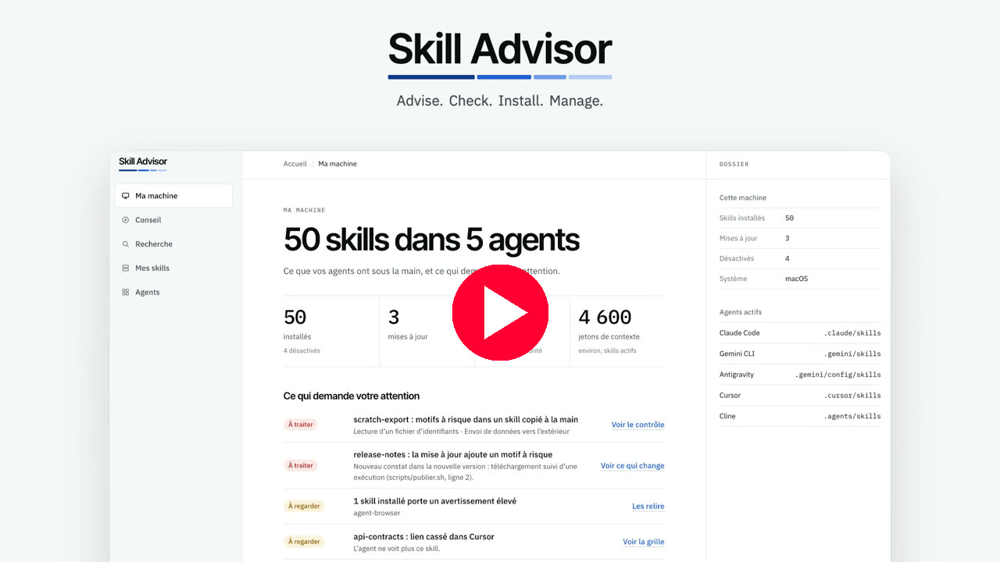
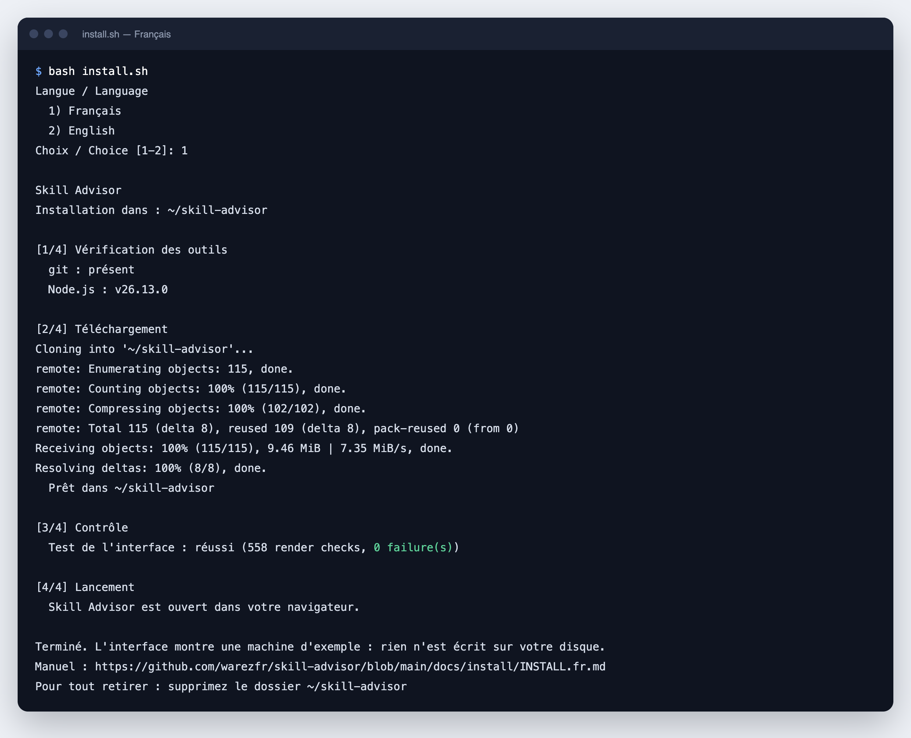

<div align="center">

# Skill Advisor

**Trouvez, vérifiez, installez et gérez des Agent Skills pour vos agents de code IA.**

[English](README.md) · **Français** · [Español](README.es.md) · [العربية](README.ar.md)


[](https://www.youtube.com/watch?v=hjwuJ8zlqQc)

*Cliquez sur l'image pour voir la vidéo sur YouTube.*

</div>

---

## De quoi s'agit-il

Un Agent Skill est un dossier avec un fichier `SKILL.md`. Il apprend à un agent IA à bien faire une tâche précise. L'index public skills.sh en recense 92 899. Skill Advisor répond à trois questions :

1. **Quels skills conviennent à mon projet ?** Vous répondez à quatre questions et vous obtenez une liste classée.
2. **Puis-je faire confiance à ce skill ?** Chaque skill a une note sur 100 et un contrôle de sécurité statique que vous pouvez lire ligne par ligne.
3. **Qu'est-ce qui est installé sur ma machine ?** Un seul écran montre chaque skill, dans chaque agent, avec les mises à jour et les alertes.

> [!IMPORTANT]
> **Cette version est un prototype.** Le script d'installation lance maintenant la vraie application locale. Elle lit et modifie les vrais skills de vos agents. La démonstration fonctionne sur une machine d'exemple et n'écrit rien sur votre disque : elle reste disponible avec `--demo`. Les captures d'écran ci-dessous montrent encore la démonstration. Voir **Ce qui fonctionne aujourd'hui** ci-dessous.

## Ce qui fonctionne aujourd'hui

| Élément | État | Ce que vous pouvez faire |
|---|---|---|
| Interface (`prototype/`) | Démonstration | Parcourez tout le trajet dans votre navigateur. Catalogue réel, machine d'exemple. |
| Catalogue (`catalog/`) | Données réelles | Parcourez 242 skills notés, répartis en 16 types de projet. Instantané du 12 novembre 2026. |
| Contrôle de sécurité (`tools/skill-scan.mjs`) | Fonctionne | Vérifiez n'importe quel dossier de skill avec 11 règles avant de l'installer. |
| Installation | Fonctionne via le CLI `skills` | Installez, listez, mettez à jour et supprimez des skills avec des commandes testées sur trois systèmes. |
| Application locale (`app/`) | Nouvelle | Détectez vos agents, puis installez, mettez à jour, désactivez et supprimez des skills depuis l'interface. Demande Node.js 22.20 ou plus récent. |

## Démarrage rapide

### Un seul script

Un script télécharge Skill Advisor, installe sa seule dépendance, le contrôle et lance l'application locale dans votre navigateur. Sans Node.js 22.20 ou plus récent, il ouvre la démonstration à la place. Il demande votre langue, français ou anglais. Il n'installe aucun logiciel système et ne demande aucun droit d'administrateur.

macOS et Linux :

```bash
curl -fsSLO https://raw.githubusercontent.com/warezfr/skill-advisor/main/install.sh
bash install.sh
```

Windows, dans PowerShell :

```powershell
irm https://raw.githubusercontent.com/warezfr/skill-advisor/main/install.ps1 -OutFile install.ps1
powershell -ExecutionPolicy Bypass -File install.ps1
```

Lisez un script avant de le lancer. Les options sont dans le [manuel](docs/install/INSTALL.fr.md).



*Cette capture montre une version précédente du script, qui ouvrait la démonstration.*

### Relancer l'application

L'application tourne dans le terminal jusqu'à ce que vous appuyiez sur Ctrl+C. Pour la relancer plus tard, allez dans le dossier d'installation et lancez `npm start` :

```bash
cd ~/skill-advisor
npm start
```

Sous Windows, le dossier est `skill-advisor` dans votre profil utilisateur. Pour la démonstration seule, lancez le script avec `--demo` (`-Demo` sous Windows) : il n'installe rien et ne lance rien.

### À la main

Il vous faut un navigateur web. Pour les commandes, il faut aussi [Node.js](https://nodejs.org) 22 ou plus récent (testé avec Node.js 26). L'application locale demande Node.js 22.20 ou plus récent.

```bash
git clone https://github.com/warezfr/skill-advisor.git
cd skill-advisor
```

Ouvrez `prototype/dist/preview.html` dans votre navigateur. C'est toute la démonstration : pas de serveur, pas d'installation.

Pour lancer l'application locale depuis ce dossier, lancez `npm ci --omit=dev`, puis `npm start`.

Ensuite, vérifiez les deux skills d'exemple :

```bash
node tools/skill-scan.mjs examples/skills
```

**Le manuel pas à pas, avec une capture d'écran pour chaque étape : [docs/install/INSTALL.fr.md](docs/install/INSTALL.fr.md).**

## L'application locale

Le script lance `node app/server.mjs`. L'application travaille sur votre vraie machine : ce que vous installez, supprimez ou désactivez change les dossiers de skills de vos agents. Elle affiche son adresse et l'ouvre dans votre navigateur.

Ce qu'elle fait :

- **Installer** des skills du catalogue, pour tous vos projets ou pour un seul, dans les agents que vous choisissez.
- **Supprimer** des skills. Avant de supprimer, elle peut garder une sauvegarde. Voir **Sauvegardes** plus bas.
- **Mettre à jour** des skills. Une mise à jour dont la nouvelle version reçoit le verdict `rouge` est retenue jusqu'à ce que vous la forciez.
- **Désactiver et réactiver** des skills. Un skill désactivé part dans `~/.skill-advisor/disabled` et revient quand vous le réactivez.
- **Gérer 78 agents.** Ajoutez un agent à la main avec son dossier de skills, masquez un agent, videz un agent de ses skills, et choisissez les agents qui reçoivent les installations.

Sécurité :

- L'application écoute sur `127.0.0.1` seulement. Les autres machines ne peuvent pas l'atteindre.
- L'adresse affichée porte un code à usage unique, valable 10 minutes. Pour rouvrir l'interface plus tard, arrêtez l'application avec Ctrl+C et relancez `npm start`.
- Rien n'est envoyé ailleurs, sauf les téléchargements des skills depuis GitHub et du catalogue. La télémétrie de l'outil `skills` est coupée. La page charge ses polices depuis Internet.
- Vos réglages sont gardés dans `~/.skill-advisor/settings.json`.

## Sauvegardes

Une sauvegarde garde un ou plusieurs skills tels qu'ils étaient, avec les agents qui les utilisaient et le verdict de leur contrôle de sécurité. Skill Advisor range les sauvegardes dans `~/.skill-advisor/backups`.

- **À la demande.** Choisissez un ou plusieurs skills et faites-en une sauvegarde. Vous pouvez ajouter un titre de 80 caractères au plus et une note de 500 caractères au plus.
- **À la désinstallation.** La confirmation propose la case « Garder une sauvegarde ». Cochez-la pour garder une copie du skill avant sa suppression. La même case apparaît quand vous videz un agent.
- **Restaurer ou effacer.** La restauration remet chaque copie à sa place d'origine. Si quelque chose occupe déjà l'une de ces places, elle refuse et ne change rien.
- **Exporter.** Enregistrez une sauvegarde dans un seul fichier `.tar.gz`.
- **Importer.** Sur une autre machine, importez ce fichier. Skill Advisor vérifie de nouveau chaque skill et le range dans une nouvelle sauvegarde. Il n'installe encore rien. Il refuse un fichier qui contient autre chose que des fichiers et des dossiers, un chemin qui sort de la sauvegarde, plus de 200 Mo ou plus de 100 000 entrées. Il refuse aussi un fichier sans manifeste Skill Advisor valide ou avec un nom de skill invalide.
- **Appliquer.** Copiez les skills d'une sauvegarde vers d'autres agents : n'importe quel agent connu, ou un agent ajouté à la main. Si un agent a déjà le même contenu, rien ne change. S'il a une autre version, vous choisissez : **Passer** la laisse en place, **Remplacer** la sauvegarde d'abord, puis la remplace.
- **Skills rouges.** Skill Advisor applique un skill dont le verdict est `rouge` seulement après votre confirmation.

L'étape 9 du [manuel](docs/install/INSTALL.fr.md) vous guide dans chaque action.

## Visite en captures d'écran

L'interface est en français : chaque légende explique le rôle de l'écran. Ces captures montrent encore la démonstration, sur une machine d'exemple.

### 1. Ma machine

Chaque skill de chaque agent sur un seul écran : 50 skills dans 5 agents, 3 mises à jour, 8 skills à examiner. La liste du dessous montre ce qui demande votre attention en premier.


### 2. Dites ce que vous construisez

Choisissez un objectif : un site web, une application ou une analyse de données. Répondez ensuite à quatre courtes questions sur votre projet.

| Objectif | Questions |
|---|---|
|  |  |

### 3. Recommandations classées

Douze skills pour votre projet, classés par note. Chaque carte explique pourquoi le skill correspond à vos réponses et affiche les alertes éventuelles.


### 4. Une note que vous pouvez lire

La note est sur 100 : popularité 40, réputation de la source 25, fraîcheur 15, sécurité 20. Le panneau de détail montre chaque part, le fichier du skill et le résultat de chaque contrôle.


### 5. Vérifiez avant que rien ne soit écrit

L'écran d'installation liste exactement ce qui sera créé, dans quels agents, pour tous les projets ou pour un seul. Rien n'est écrit avant votre confirmation.


### 6. Un guide pour chaque skill installé

Après l'installation, chaque skill reçoit un court guide : quand l'agent l'utilise et comment l'appeler.


### 7. Gérez ce qui est installé

Mettez à jour, désactivez, supprimez. Filtrez par état. Voyez combien de contexte coûte chaque skill.

| Mes skills | Agents trouvés sur la machine |
|---|---|
|  |  |

### 8. Cherchez dans toute la base, en clair ou en sombre

| Recherche | Thème sombre |
|---|---|
|  |  |

## Le contrôle de sécurité

`tools/skill-scan.mjs` lit les fichiers d'un skill comme du texte. Il ne les exécute jamais.

```bash
node tools/skill-scan.mjs examples/skills
```


| Verdict | Signification |
|---|---|
| `vert` | Aucun motif connu trouvé. |
| `vert-remarques` (vert avec remarques) | Seulement des constats de gravité faible. |
| `orange` | Au moins un constat de gravité moyenne. |
| `rouge` | Un constat de gravité élevée, ou des fichiers d'identifiants avec des données envoyées à l'extérieur. |

Les 11 règles recherchent : les commandes qui téléchargent puis exécutent, le code caché, l'injection de prompt, le texte invisible, les fichiers d'identifiants, les données envoyées à l'extérieur, les commandes privilégiées ou destructrices, les adresses suspectes, les scripts qui appellent le réseau, les demandes d'installation de programmes, et les fichiers `.env` ou clés d'API.

> [!WARNING]
> Un verdict vert signifie « aucun motif connu trouvé ». Il ne signifie pas « sûr ». Lisez un skill avant de lui faire confiance.

## Le catalogue

- 242 skills, répartis en 16 types de projet, choisis parmi les 92 899 skills recensés par skills.sh.
- Chaque skill a une note, un nombre d'installations, les étoiles de son dépôt et ses alertes.
- Une alerte ne retire jamais un skill de la liste. Elle est affichée et vous décidez.
- Lisez-le ici : [catalog/CATALOGUE.md](catalog/CATALOGUE.md). Données brutes : [catalog/catalog.json](catalog/catalog.json).

## Systèmes testés

Les commandes d'installation ont été rejouées par script sur trois systèmes, tous avec des processeurs arm64.

| Système | Résultat |
|---|---|
| Windows 11 | 17 contrôles sur 17 |
| Debian 12 (conteneur) | 17 contrôles sur 17 |
| macOS | 17 contrôles sur 17 |

Pas encore testés : les processeurs x64 et WSL. Les rapports sont dans [docs/etude/](docs/etude/).

## Organisation du projet

```text
app/           Application locale : serveur sur 127.0.0.1 et actions sur vos skills
prototype/     Interface de la démonstration (HTML, CSS, JavaScript, sans dépendance)
catalog/       Catalogue, instantané des données et scripts qui le construisent
tools/         skill-scan.mjs, le contrôle de sécurité statique
examples/      Deux skills d'exemple pour le contrôle : un sûr, un écrit pour échouer
essais/        Scripts de test et résultats bruts pour Windows, Linux et macOS
docs/          Manuel d'installation, captures d'écran et rapports de test
install.sh    Script d'installation pour macOS et Linux
install.ps1   Script d'installation pour Windows
```

## Feuille de route

- Captures d'écran de l'application locale.
- Tests de l'application locale sur Windows 11 et Linux.
- Tests sur les processeurs x64 et WSL.

## Licence

[MIT](LICENSE). Les skills listés dans le catalogue appartiennent à leurs auteurs et gardent leurs propres licences.

## Liens

- Site web : [span.observer](https://span.observer)
- Index des skills : [skills.sh](https://skills.sh)
