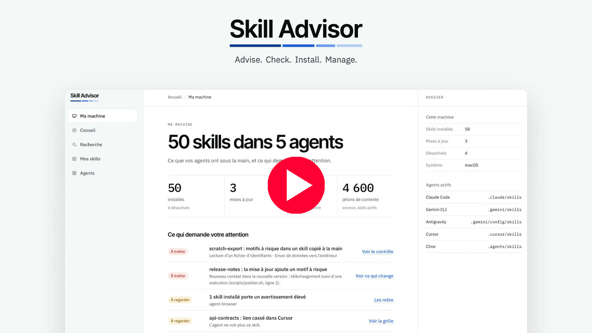
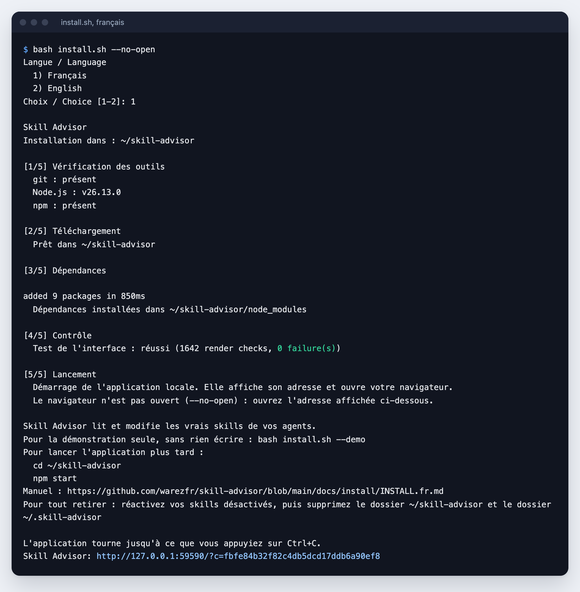
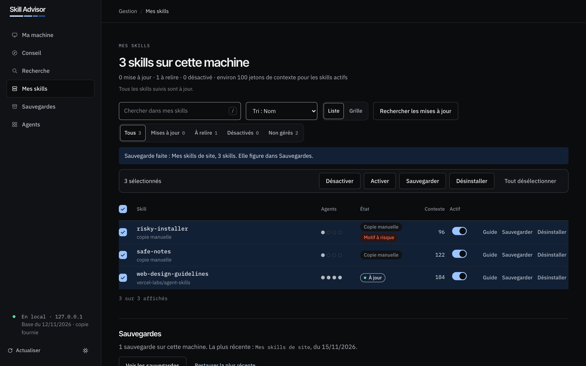

<div align="center">

# Skill Advisor

**Trouver, contrôler, installer et gérer les Agent Skills de vos agents de code IA.**

[English](README.md) · **Français** · [Español](README.es.md) · [العربية](README.ar.md)


[](https://www.youtube.com/watch?v=hjwuJ8zlqQc)

*Cliquez sur l'image pour voir la vidéo sur YouTube.*

</div>

---

## Ce que c'est

Un Agent Skill est un dossier avec un fichier `SKILL.md` qui apprend à un agent IA à bien faire un travail précis. L'index public skills.sh en recense 92 899. Skill Advisor est une application locale : elle tourne sur votre machine, dans votre navigateur, et répond à trois questions.

1. **Quels skills conviennent à mon projet ?** Vous choisissez un des 17 objectifs, vous répondez à quelques questions et vous obtenez une liste classée.
2. **Puis-je faire confiance à ce skill ?** Chaque skill a une note sur 100. Skill Advisor le télécharge et lance un contrôle de sécurité statique avant d'écrire quoi que ce soit sur votre disque.
3. **Qu'est-ce qui est installé sur ma machine ?** Un seul écran montre chaque skill, dans chaque agent, avec les mises à jour, les avertissements et les sauvegardes.

L'interface est en français. Ce guide reprend le nom de chaque écran tel qu'il s'affiche.

## Démarrage rapide

### Installer avec un script

Un script télécharge Skill Advisor, installe ses dépendances, le contrôle et lance l'application dans votre navigateur. Il vous demande votre langue, français ou anglais. Il n'installe aucun logiciel système et ne demande aucun droit d'administrateur. Il vous faut [Node.js](https://nodejs.org) 22.20 ou plus récent, avec npm.

macOS et Linux :

```bash
curl -fsSLO https://raw.githubusercontent.com/warezfr/skill-advisor/main/install.sh
bash install.sh
```

Windows, dans PowerShell :

```powershell
irm https://raw.githubusercontent.com/warezfr/skill-advisor/main/install.ps1 -OutFile install.ps1
powershell -ExecutionPolicy Bypass -File install.ps1
```

Lisez un script avant de le lancer. Ses options sont dans le [manuel](docs/install/INSTALL.fr.md).



*Le script se termine par l'adresse de l'application. Ici, il a été lancé avec `--no-open` : le navigateur ne s'est pas ouvert.*

### Lancer, arrêter, mettre à jour, désinstaller

| Action | Ce qu'il faut faire |
|---|---|
| Arrêter | Appuyez sur Ctrl+C dans le terminal où tourne l'application. |
| Relancer | Allez dans le dossier d'installation (`~/skill-advisor`, ou `skill-advisor` dans votre profil utilisateur sous Windows) et lancez `npm start`. Sous Windows, lancez `npm.cmd start`. |
| Mettre à jour | Relancez le script d'installation. Une copie installée avec git est mise à jour. Une copie installée sans git est gardée telle quelle, et le script le dit : supprimez d'abord son dossier, puis lancez le script, ou installez dans un autre dossier avec `--dir`. |
| Désinstaller | Réactivez vos skills désactivés et exportez les sauvegardes à garder. Puis supprimez le dossier d'installation et le dossier `~/.skill-advisor`. |

Sous Windows, lancez `npm.cmd start`, comme l'indique le script d'installation : la stratégie d'exécution par défaut de PowerShell peut refuser `npm start`, car elle bloque `npm.ps1`.

Les skills que vous avez installés restent dans vos agents après la désinstallation de Skill Advisor. Désinstallez-les d'abord dans l'application si vous n'en voulez plus.

### Options

Passez-les après `npm start --`, par exemple `npm start -- --port 4317`.

| Option | Effet |
|---|---|
| `--port <n>` | Écouter sur ce port. Sans elle, le système choisit un port libre. |
| `--no-open` | Ne pas ouvrir le navigateur. L'adresse est quand même affichée. |
| `--project <dossier>` | Prendre ce dossier comme dossier du projet. |
| `--home <dossier>` | Pour les tests seulement : prendre ce dossier comme dossier personnel. |
| `--version` | Afficher la version, puis s'arrêter. |
| `--help` | Afficher l'aide, puis s'arrêter. |

### À la main

```bash
git clone https://github.com/warezfr/skill-advisor.git
cd skill-advisor
npm ci --omit=dev
npm start
```

**Le manuel pas à pas : [docs/install/INSTALL.fr.md](docs/install/INSTALL.fr.md).**

## Visite de l'application

Toutes les captures montrent la vraie application sur une machine d'essai avec quatre agents : Claude Code, Cursor, Gemini CLI et Windsurf.

### 1. Ma machine

« Ma machine » compte vos skills et vos agents, les mises à jour, les skills à relire et le contexte qu'ils coûtent. La liste dessous dit ce qui demande d'abord votre attention.


### 2. Conseil : un objectif, puis quelques questions

« Conseil » propose 17 objectifs : un site, une application, l'analyse de données, un backend, les tests, la sécurité, les documents et d'autres. Puis il pose quelques questions courtes sur votre projet. Le volet de droite garde vos réponses.

| Objectif | Questions |
|---|---|
|  |  |

### 3. Des recommandations classées

Les skills qui correspondent à vos réponses, classés par note. Chaque carte dit pourquoi il convient et montre ses avertissements. Les meilleurs sont cochés pour vous. « Voir le détail » explique la note : popularité 40, réputation de la source 25, fraîcheur 15, sécurité 20.


### 4. Vérifier avant d'écrire

« Vérifiez avant d'écrire » liste ce qui sera créé, dans quels dossiers, pour tous les projets ou pour un seul projet. Quand vous confirmez, Skill Advisor télécharge chaque skill dans un dossier temporaire et lance d'abord le contrôle de sécurité.

- **Skill retenu.** Un skill qui contient un motif à risque élevé est retenu : rien n'est écrit pour lui tant que vous ne choisissez pas « Installer malgré l'avertissement ».
- **Conflit.** Quand un skill du même nom est déjà là, copié à la main ou venu d'une autre source, rien n'est écrit. Vous choisissez de le garder, ou de le remplacer : Skill Advisor fait alors d'abord une sauvegarde.
- **Dossier partagé.** Le « Dossier partagé » est `~/.agents/skills`. Plusieurs agents le lisent, par exemple Cursor, Gemini CLI et Codex. L'écran nomme les lecteurs trouvés sur votre machine. Un skill placé là les atteint tous, et chaque autre agent choisi reçoit un lien vers lui. Sans le dossier partagé, chaque agent choisi reçoit sa propre copie.


### 5. Mes skills

« Mes skills » liste chaque skill avec ses agents, son état, le résultat de son contrôle et son coût en contexte. Le volet de détail montre la note et les avertissements.

- **Mettre à jour.** « Rechercher les mises à jour » interroge la source de chaque skill. Pour un skill qui a une mise à jour, « Ce qui change » liste les fichiers ajoutés, retirés et modifiés, et le contrôle de la nouvelle version. Une mise à jour qui contient un motif à risque élevé est retenue jusqu'à ce que vous la forciez. Après une mise à jour, les mêmes agents voient le skill : aucun agent ne le gagne.
- **Désactiver et activer.** L'interrupteur range le skill dans `~/.skill-advisor/disabled` et l'en ressort. L'agent ne le charge plus.
- **Désinstaller.** La confirmation propose « Garder une sauvegarde », cochée par défaut.


### 6. Sauvegardes

« Sauvegardes » garde des copies de skills tels qu'ils étaient, avec leurs agents et le résultat de leur contrôle, dans `~/.skill-advisor/backups`.

- **À la demande.** Cochez des skills dans « Mes skills » et choisissez « Sauvegarder ». Ajoutez un nom de 80 caractères et une note de 500 caractères au plus.
- **Restaurer.** Chaque copie revient d'où elle vient. Quand quelque chose est déjà à cet endroit, rien n'est écrit.
- **Exporter et importer.** Exportez une sauvegarde en un seul fichier `.tar.gz`. Sur une autre machine, importez-le : chaque skill est contrôlé de nouveau et rangé dans une nouvelle sauvegarde. Rien n'est encore installé.
- **Appliquer à d'autres agents.** Copiez les skills d'une sauvegarde vers n'importe quel agent connu ou vers un agent ajouté à la main. Un skill déjà présent avec le même contenu est passé. Pour une version différente, vous choisissez « Passer » ou « Remplacer » : Remplacer sauvegarde d'abord la version présente.

| Sauvegardes | Appliquer à d'autres agents |
|---|---|
|  |  |

### 7. Agents

Skill Advisor connaît 78 agents et trouve ceux qui sont installés sur votre machine. Choisissez ceux qui reçoivent les installations, ajoutez un agent à la main avec son dossier de skills, masquez un agent, ou retirez tous les skills d'un agent, avec une sauvegarde au choix. Le dossier partagé tient sur une ligne, avec ses lecteurs dessous.


### 8. Recherche, en clair ou en sombre

« Recherche » cherche parmi les 1 551 skills les plus installés, avec des filtres par type de projet, installations et avertissements. L'écran montre la date et la source de la base : « Base du 12/11/2026 · copie fournie » désigne la copie livrée avec l'application. Le bouton en forme de lune passe au thème sombre.

| Recherche | Thème sombre |
|---|---|
|  |  |

## Le dossier du projet

Par défaut, Skill Advisor installe pour tous vos projets. Pour installer pour un seul projet, donnez le dossier du projet : lancez `npm start -- --project <dossier>`, ou tapez-le dans le champ « Dossier du projet » de l'écran d'installation ou de l'écran Agents. Les skills de ce projet apparaissent alors dans « Mes skills ». Gérez-les depuis le dossier du projet : les actions de l'application ne modifient que les skills installés pour tous les projets.

## Sécurité et vie privée

- L'application écoute sur `127.0.0.1` seulement. Les autres machines ne peuvent pas l'atteindre.
- À chaque lancement, elle affiche une adresse à usage unique. L'adresse marche une fois, dans les 10 minutes. L'onglet qui l'a ouverte garde la session, et le recharger marche encore. Un autre onglet affiche « Session expirée » : arrêtez l'application avec Ctrl+C et relancez `npm start`. Ne partagez pas cette adresse.
- Aucun cookie. Vos réglages restent dans `~/.skill-advisor`, lisible par vous seul sous macOS et Linux.
- Rien sur vous n'est envoyé nulle part. L'application ne va sur Internet que pour télécharger les skills que vous installez et chercher leurs mises à jour, depuis leur source (GitHub pour presque tous les skills), et pour lire un catalogue en ligne si vous en configurez un. La page charge ses polices depuis Google Fonts. La télémétrie de l'outil `skills` est coupée.

## Le contrôle de sécurité

L'application lance le contrôle pour vous. Vous pouvez aussi le lancer sur tout dossier qui contient un sous-dossier par skill. Il lit les fichiers comme du texte et ne les exécute jamais.

```bash
node tools/skill-scan.mjs examples/skills
```


| Verdict | Dans l'interface | Sens |
|---|---|---|
| `vert` | Aucun motif connu | Aucun motif connu trouvé. |
| `vert-remarques` | Remarques | Seulement des constats de faible gravité. |
| `orange` | À regarder | Au moins un constat de gravité moyenne. |
| `rouge` | Motif à risque | Un constat grave, ou des fichiers d'identifiants avec un envoi de données vers l'extérieur. |

Les 11 règles cherchent : les commandes qui téléchargent puis exécutent, le code masqué, l'injection de consignes, le texte invisible, les fichiers d'identifiants, l'envoi de données vers l'extérieur, les commandes à privilèges ou destructrices, les adresses suspectes, les scripts qui appellent le réseau, les demandes d'installer des programmes, et les fichiers `.env` ou les clés d'API.

> [!WARNING]
> Un verdict vert veut dire « aucun motif connu trouvé ». Il ne veut pas dire « sans risque ». Lisez un skill avant de lui faire confiance.

## Le catalogue

- 242 skills notés, dans 16 types de projets, nourrissent le conseil. Chacun a une note, un nombre d'installations, les étoiles de son dépôt et ses avertissements. Un avertissement ne retire jamais un skill de la liste : il est montré, et vous décidez.
- La recherche couvre les 1 551 skills les plus installés parmi les 92 899 recensés par skills.sh.
- La base est une copie datée du 12 novembre 2026, livrée avec l'application.
- À lire ici : [catalog/CATALOGUE.md](catalog/CATALOGUE.md). Données brutes : [catalog/catalog.json](catalog/catalog.json).

## Systèmes testés

L'intégration continue tourne à chaque envoi sur `main`, à chaque demande de fusion et à la demande.

| Système | Node.js | Ce qui tourne |
|---|---|---|
| macOS | 22.20.0 et 26 | Tous les tests sans réseau, les essais de bout en bout dans Chrome sans fenêtre |
| Ubuntu | 22.20.0 et 26 | Tous les tests sans réseau, les essais de bout en bout dans Chrome sans fenêtre, les contrôles de `install.sh` |
| Windows | 22.20.0 et 26 | Tous les tests sans réseau, les essais de bout en bout dans Chrome sans fenêtre, l'analyse de `install.ps1` par Windows PowerShell 5.1 |

## Organisation du dépôt

```text
app/           L'application locale : serveur sur 127.0.0.1 et actions sur vos skills
prototype/     L'interface (HTML, CSS, JavaScript, sans framework)
catalog/       Catalogue, instantané des données et scripts qui le construisent
tools/         skill-scan.mjs, le contrôle de sécurité statique
examples/      Deux skills d'exemple pour le contrôle : un sain, un écrit pour échouer
test/          Essais de bout en bout et lanceur des tests
docs/          Manuel d'installation, captures et rapports d'étude
install.sh     Script d'installation pour macOS et Linux
install.ps1    Script d'installation pour Windows
```

## Signaler un problème

- Bogues et questions : [tickets GitHub](https://github.com/warezfr/skill-advisor/issues).
- Problèmes de sécurité : n'ouvrez pas de ticket public. Ouvrez un [avis de sécurité privé](https://github.com/warezfr/skill-advisor/security/advisories/new) sur GitHub.

Voir [CHANGELOG.md](CHANGELOG.md) (en anglais) pour les changements de chaque version.

## Licence

Skill Advisor est sous licence [MIT](LICENSE). Il utilise deux paquets, installés par npm :

- [`skills`](https://www.npmjs.com/package/skills) : MIT.
- [`tar`](https://www.npmjs.com/package/tar) : BlueOak-1.0.0.

Leurs propres dépendances gardent leurs licences (BlueOak-1.0.0, MIT, ISC). Le contenu de chaque skill appartient à ses auteurs et garde sa propre licence.

## Liens

- Site : [span.observer](https://span.observer)
- Index des skills : [skills.sh](https://skills.sh)
