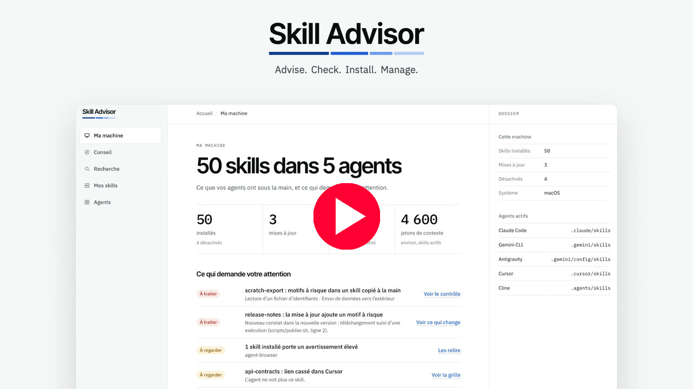
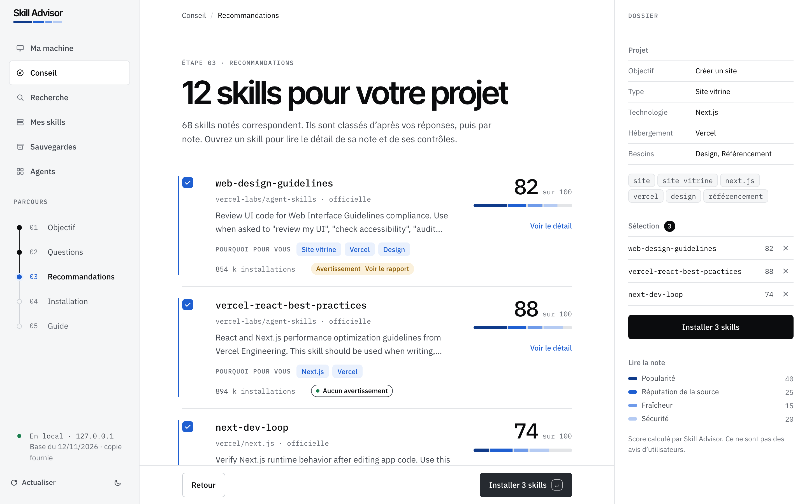

<div align="center">

# Skill Advisor

**Find, check, install and manage Agent Skills for your AI coding agents.**

**English** · [Français](README.fr.md) · [Español](README.es.md) · [العربية](README.ar.md)


[](https://www.youtube.com/watch?v=hjwuJ8zlqQc)

*Click the image to watch the video on YouTube.*

</div>

---

## What it is

An Agent Skill is a folder with a `SKILL.md` file that teaches an AI agent how to do one job well. The public index skills.sh lists 92,899 of them. Skill Advisor is a local application: it runs on your machine, in your browser, and answers three questions.

1. **Which skills fit my project?** You choose one of 17 goals, answer a few questions and get a ranked list.
2. **Can I trust this skill?** Each skill has a score out of 100. Skill Advisor downloads it and runs a static security check before it writes anything to your disk.
3. **What is installed on my machine?** One screen shows every skill, in every agent, with updates, warnings and backups.

The interface is in French. This guide gives the English meaning of each screen name.

## Quick start

### Install with one script

One script downloads Skill Advisor, installs its dependencies, checks it and starts the application in your browser. It asks for your language, French or English. It installs no system software and needs no administrator rights. You need [Node.js](https://nodejs.org) 22.20 or later, with npm.

macOS and Linux:

```bash
curl -fsSLO https://raw.githubusercontent.com/warezfr/skill-advisor/main/install.sh
bash install.sh
```

Windows, in PowerShell:

```powershell
irm https://raw.githubusercontent.com/warezfr/skill-advisor/main/install.ps1 -OutFile install.ps1
powershell -ExecutionPolicy Bypass -File install.ps1
```

Read a script before you run it. Its options are in the [manual](docs/install/INSTALL.md).


*The script ends with the address of the application. Here it was run with `--no-open`, so the browser did not open.*

### Start, stop, update, uninstall

| Action | What to do |
|---|---|
| Stop | Press Ctrl+C in the terminal where the application runs. |
| Start again | Go to the installation folder (`~/skill-advisor`, or `skill-advisor` in your user profile on Windows) and run `npm start`. On Windows, run `npm.cmd start`. |
| Update | Run the installation script again. A copy installed with git is updated. A copy installed without git is kept as it is, and the script says so: delete its folder first, then run the script, or install into another folder with `--dir`. |
| Uninstall | Enable your disabled skills and export the backups you want to keep. Then delete the installation folder and the folder `~/.skill-advisor`. |

On Windows, use `npm.cmd start`, as the installation script says: the default execution policy of PowerShell can refuse `npm start`, because it blocks `npm.ps1`.

The skills that you installed stay in your agents after you uninstall Skill Advisor. Remove them in the application first if you do not want them.

### Options

Pass them after `npm start --`, for example `npm start -- --port 4317`.

| Option | Effect |
|---|---|
| `--port <n>` | Listen on this port. Without it, the system chooses a free port. |
| `--no-open` | Do not open the browser. The address is still printed. |
| `--project <folder>` | Use this folder as the project folder. |
| `--home <folder>` | For tests only: use this folder as the home folder. |
| `--version` | Print the version, then stop. |
| `--help` | Print the help, in French, then stop. |

### By hand

```bash
git clone https://github.com/warezfr/skill-advisor.git
cd skill-advisor
npm ci --omit=dev
npm start
```

**The step-by-step manual: [docs/install/INSTALL.md](docs/install/INSTALL.md).**

## A tour of the application

All screenshots show the real application on a test machine with four agents: Claude Code, Cursor, Gemini CLI and Windsurf.

### 1. My machine

"Ma machine" counts your skills and agents, the updates, the skills to review and the context they cost. The list below says what needs your attention first.


### 2. Advice: a goal, then a few questions

"Conseil" (Advice) offers 17 goals: a website, an application, data analysis, a backend, tests, security, documents and more. Then it asks a few short questions about your project. The panel on the right keeps your answers.

| Goal | Questions |
|---|---|
|  |  |

### 3. Ranked recommendations

The skills that match your answers, ranked by score. Each card says why it fits and shows any warning. The best ones are ticked for you. "Voir le détail" (See the detail) explains the score: popularity 40, reputation of the source 25, freshness 15, security 20.



### 4. Check before writing

"Vérifiez avant d'écrire" (Check before writing) lists what will be created, in which folders, for all projects or for one project. When you confirm, Skill Advisor downloads each skill into a temporary folder and runs the security check first.

- **Held skill.** A skill with a high-risk pattern is held: nothing is written for it until you choose "Installer malgré l'avertissement" (Install despite the warning).
- **Conflict.** When a skill of the same name is already there, copied by hand or from another source, nothing is written. You choose to keep it, or to replace it: Skill Advisor then makes a backup first.
- **Shared folder.** "Dossier partagé" (Shared folder) is `~/.agents/skills`. Several agents read it, for example Cursor, Gemini CLI and Codex. The screen names the readers found on your machine. A skill placed there reaches all of them, and each other chosen agent gets a link to it. Without the shared folder, each chosen agent gets its own copy.


### 5. My skills

"Mes skills" (My skills) lists every skill with its agents, its state, its check result and its cost in context. The detail panel shows the score and the warnings.

- **Update.** "Rechercher les mises à jour" (Check for updates) asks the source of each skill. For a skill with an update, "Ce qui change" (What changes) lists the added, removed and changed files and the check of the new version. An update with a high-risk pattern is held until you force it. After an update, the same agents see the skill: no agent gains it.
- **Disable and enable.** The switch moves the skill to `~/.skill-advisor/disabled` and back. The agent no longer loads it.
- **Uninstall.** The confirmation offers "Garder une sauvegarde" (Keep a backup), ticked by default.


### 6. Backups

"Sauvegardes" (Backups) keeps copies of skills as they were, with their agents and their check result, in `~/.skill-advisor/backups`.

- **On demand.** Select skills in "Mes skills" and choose "Sauvegarder" (Back up). Add a label of 80 characters and a note of 500 characters at most.
- **Restore.** Each copy goes back where it came from. When something already sits there, nothing is written.
- **Export and import.** Export a backup as one `.tar.gz` file. On another machine, import it: every skill is checked again and stored as a new backup. Nothing is installed yet.
- **Apply to other agents.** Copy the skills of a backup to any known agent or to an agent you added by hand. A skill that is already there with the same content is skipped. For a different version you choose "Passer" (Skip) or "Remplacer" (Replace): Replace backs up the present version first.

| Backups | Apply to other agents |
|---|---|
|  |  |

### 7. Agents

Skill Advisor knows 78 agents and finds the ones installed on your machine. Choose which ones receive the installations, add an agent by hand with its skills folder, hide an agent, or empty an agent of all its skills, with an optional backup. The shared folder is one line, with its readers under it.


### 8. Search, in light or dark

"Recherche" (Search) looks among the 1,551 most installed skills, with filters by project type, installs and warnings. The screen shows the date and the source of the base: "Base du 12/11/2026 · copie fournie" means the copy shipped with the application. The moon button switches to the dark theme.

| Search | Dark theme |
|---|---|
|  |  |

## The project folder

By default, Skill Advisor installs for all your projects. To install for one project only, give the project folder: start with `npm start -- --project <folder>`, or type it in the field "Dossier du projet" (Project folder) on the installation screen or on the Agents screen. The skills of that project then appear in "Mes skills". Manage them from the project folder: the actions of the application change skills installed for all projects only.

## Safety and privacy

- The application listens on `127.0.0.1` only. Other machines cannot reach it.
- At each start it prints a one-time address. The address works once, within 10 minutes. The browser tab that opened it keeps the session, and a reload of that tab still works. Another tab shows "Session expirée" (Session expired): stop the application with Ctrl+C and run `npm start` again. Do not share that address.
- No cookie. Your settings stay in `~/.skill-advisor`, readable by you only on macOS and Linux.
- Nothing about you is sent anywhere. The application goes online only to download the skills you install and check their updates, from their source (GitHub for almost every skill), and to read an online catalogue when you configure one. The page loads its fonts from Google Fonts. The telemetry of the `skills` tool is off.

## The security check

The application runs the check for you. You can also run it on any folder that holds one sub-folder per skill. It reads the files as text and never runs them.

```bash
node tools/skill-scan.mjs examples/skills
```


| Verdict | In the interface | Meaning |
|---|---|---|
| `vert` (green) | Aucun motif connu (No known pattern) | No known pattern found. |
| `vert-remarques` (green with notes) | Remarques (Notes) | Low-severity findings only. |
| `orange` | À regarder (To review) | At least one medium-severity finding. |
| `rouge` (red) | Motif à risque (Risky pattern) | A high-severity finding, or credential files together with data sent outside. |

The 11 rules look for: download-and-run commands, hidden code, prompt injection, invisible text, credential files, data sent outside, privileged or destructive commands, suspicious addresses, scripts that call the network, requests to install programs, and `.env` files or API keys.

> [!WARNING]
> A green verdict means "no known pattern found". It does not mean "safe". Read a skill before you trust it.

## The catalogue

- 242 rated skills in 16 project types feed the advice. Each has a score, an install count, the stars of its repository and its warnings. A warning never removes a skill from the list: it is shown, and you decide.
- The search covers the 1,551 most installed skills of the 92,899 listed by skills.sh.
- The base is a copy dated 12 November 2026, shipped with the application.
- Read it here: [catalog/CATALOGUE.md](catalog/CATALOGUE.md) (in French). Raw data: [catalog/catalog.json](catalog/catalog.json).

## Tested systems

Continuous integration runs on pushes to `main`, on pull requests and on demand.

| System | Node.js | What runs |
|---|---|---|
| macOS | 22.20.0 and 26 | All tests without network, end-to-end tests in headless Chrome |
| Ubuntu | 22.20.0 and 26 | All tests without network, end-to-end tests in headless Chrome, checks of `install.sh` |
| Windows | 22.20.0 and 26 | All tests without network, end-to-end tests in headless Chrome, parse check of `install.ps1` in Windows PowerShell 5.1 |

## Project layout

```text
app/           The local application: server on 127.0.0.1 and actions on your skills
prototype/     The interface (HTML, CSS, JavaScript, no framework)
catalog/       Catalogue, data snapshot and the scripts that build it
tools/         skill-scan.mjs, the static security check
examples/      Two example skills for the check: one safe, one written to fail
test/          End-to-end tests and the test runner
docs/          Installation manual, screenshots and study reports
install.sh     Installation script for macOS and Linux
install.ps1    Installation script for Windows
```

## Report a problem

- Bugs and questions: [GitHub issues](https://github.com/warezfr/skill-advisor/issues).
- Security problems: do not open a public issue. Open a [private security advisory](https://github.com/warezfr/skill-advisor/security/advisories/new) on GitHub.

See [CHANGELOG.md](CHANGELOG.md) for the changes of each version.

## Licence

Skill Advisor is under the [MIT](LICENSE) licence. It uses two packages, installed by npm:

- [`skills`](https://www.npmjs.com/package/skills): MIT.
- [`tar`](https://www.npmjs.com/package/tar): BlueOak-1.0.0.

Their own dependencies keep their own licences (BlueOak-1.0.0, MIT, ISC). The content of each skill belongs to its authors and keeps its own licence.

## Links

- Website: [span.observer](https://span.observer)
- Skills index: [skills.sh](https://skills.sh)
