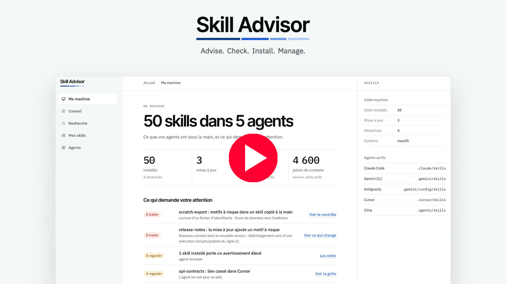

<div align="center">

# Skill Advisor

**Find, check, install and manage Agent Skills for your AI coding agents.**

**English** · [Français](README.fr.md) · [Español](README.es.md) · [العربية](README.ar.md)


[](https://www.youtube.com/watch?v=hjwuJ8zlqQc)

*Click the image to watch the video on YouTube.*

</div>

---

## What it is

An Agent Skill is a folder with a `SKILL.md` file that teaches an AI agent how to do one job well. The public index skills.sh lists 92,899 of them. Skill Advisor answers three questions:

1. **Which skills fit my project?** You answer four questions and get a ranked list.
2. **Can I trust this skill?** Each skill carries a score out of 100 and a static security check that you can read line by line.
3. **What is installed on my machine?** One screen shows every skill, in every agent, with updates and warnings.

> [!IMPORTANT]
> **This release is a prototype.** The installation script now starts the real local application. It reads and changes the real skills of your agents. The demonstration runs on an example machine and writes nothing to your disk: it stays available with `--demo`. The screenshots below still show the demonstration. See **What works today** below.

## What works today

| Part | State | What you can do |
|---|---|---|
| Interface (`prototype/`) | Demonstration | Walk through the full journey in your browser. Real catalogue, example machine. |
| Catalogue (`catalog/`) | Real data | Browse 242 rated skills in 16 project types. Snapshot of 12 November 2026. |
| Security check (`tools/skill-scan.mjs`) | Works | Check any skill folder against 11 rules before you install it. |
| Installation | Works through the `skills` CLI | Install, list, update and remove skills with commands tested on three systems. |
| Local application (`app/`) | New | Detect your agents, then install, update, disable and remove skills from the interface. Needs Node.js 22.20 or later. |

## Quick start

### One script

One script downloads Skill Advisor, installs its one dependency, checks it and starts the local application in your browser. Without Node.js 22.20 or later, it opens the demonstration instead. It asks for your language, French or English. It installs no system software and needs no administrator rights.

macOS and Linux:

```bash
curl -fsSLO https://raw.githubusercontent.com/warezfr/skill-advisor/main/install.sh
bash install.sh
```

Windows, in PowerShell:

```powershell
irm https://raw.githubusercontent.com/warezfr/skill-advisor/main/install.ps1 -OutFile install.ps1
powershell -ExecutionPolicy Bypass -File install.ps1
```

Read a script before you run it. The options are in the [manual](docs/install/INSTALL.md).


*This screenshot shows an earlier version of the script, which opened the demonstration.*

### Start it again

The application runs in the terminal until you press Ctrl+C. To start it again later, go to the installation folder and run `npm start`:

```bash
cd ~/skill-advisor
npm start
```

On Windows, the folder is `skill-advisor` in your user profile. For the demonstration only, run the script with `--demo` (`-Demo` on Windows): it installs nothing and starts nothing.

### By hand

You need a web browser. For the commands you also need [Node.js](https://nodejs.org) 22 or later (tested with Node.js 26). The local application needs Node.js 22.20 or later.

```bash
git clone https://github.com/warezfr/skill-advisor.git
cd skill-advisor
```

Open `prototype/dist/preview.html` in your browser. That is the whole demonstration: no server, no install.

To start the local application from this folder, run `npm ci --omit=dev`, then `npm start`.

Then check the two example skills:

```bash
node tools/skill-scan.mjs examples/skills
```

**The step-by-step manual, with a screenshot for every step: [docs/install/INSTALL.md](docs/install/INSTALL.md).**

## The local application

The script starts `node app/server.mjs`. The application works on your real machine: what you install, remove or disable changes the skill folders of your agents. It prints its address and opens it in your browser.

What it does:

- **Install** skills from the catalogue, for all your projects or for one project, in the agents you choose.
- **Remove** skills. Before it removes, it can keep a backup. See **Backups** below.
- **Update** skills. An update whose new version gets the verdict `rouge` is held back until you force it.
- **Disable and enable** skills. A disabled skill moves to `~/.skill-advisor/disabled` and comes back when you enable it.
- **Manage 78 agents.** Add an agent by hand with its skills folder, hide an agent, empty an agent of its skills, and choose which agents receive the installations.

Safety:

- The application listens on `127.0.0.1` only. Other machines cannot reach it.
- The address it prints holds a one-time code, valid 10 minutes. To open the interface again later, stop the application with Ctrl+C and run `npm start` again.
- Nothing is sent elsewhere, except the downloads of skills from GitHub and of the catalogue. The telemetry of the `skills` tool is off. The page loads its fonts from the internet.
- Your settings are kept in `~/.skill-advisor/settings.json`.

## Backups

A backup keeps one or more skills as they were, with the agents that used them and the verdict of their security check. Backups live in `~/.skill-advisor/backups`.

- **On demand.** Choose one or more skills and make a backup. You can add a label of 80 characters at most and a note of 500 characters at most.
- **At uninstall.** The confirmation offers the checkbox "Garder une sauvegarde" (Keep a backup). Tick it to keep a copy of the skill before it is removed. The same checkbox appears when you empty an agent.
- **Restore or delete.** Restore puts each copy back where it came from. When something already sits at one of those places, it refuses and changes nothing.
- **Export.** Save a backup as one `.tar.gz` file.
- **Import.** On another machine, import that file. Skill Advisor checks every skill again and stores it as a new backup. It installs nothing yet. It refuses a file that holds anything other than files and folders, a path that leaves the backup, more than 200 MB or more than 100,000 entries. It also refuses a file without a valid Skill Advisor manifest or with an invalid skill name.
- **Apply.** Copy the skills of a backup to other agents: any known agent, or an agent you added by hand. When an agent already holds the same content, nothing changes. When it holds a different version, you choose: **Skip** leaves it in place, **Replace** first backs it up, then replaces it.
- **Red skills.** A skill whose verdict is `rouge` is applied only after you confirm it.

Step 9 of the [manual](docs/install/INSTALL.md) walks you through each action.

## A tour in screenshots

The interface is in French for now. Each caption says what the screen does. These screenshots still show the demonstration, on an example machine.

### 1. My machine

Every skill in every agent, on one screen: 50 skills in 5 agents, 3 updates, 8 skills to review. The list below shows what needs your attention first.


### 2. Tell it what you build

Choose a goal: a website, an application or a data analysis. Then answer four short questions about your project.

| Goal | Questions |
|---|---|
|  |  |

### 3. Ranked recommendations

Twelve skills for your project, ranked by score. Each card says why it matches your answers and shows any warning.


### 4. A score you can read

The score is out of 100: popularity 40, reputation of the source 25, freshness 15, security 20. The detail panel shows each part, the file of the skill and the result of every check.


### 5. Verify before anything is written

The installation screen lists exactly what will be created, in which agents, for all projects or for one project only. Nothing is written before you confirm.


### 6. A guide for each installed skill

After installation, each skill gets a short guide: when the agent uses it and how to call it.


### 7. Manage what is installed

Update, disable, remove. Filter by state. See how much context each skill costs.

| My skills | Agents found on the machine |
|---|---|
|  |  |

### 8. Search the whole base, in light or dark

| Search | Dark theme |
|---|---|
|  |  |

## The security check

`tools/skill-scan.mjs` reads the files of a skill as text. It never runs them.

```bash
node tools/skill-scan.mjs examples/skills
```


| Verdict | Meaning |
|---|---|
| `vert` (green) | No known pattern found. |
| `vert-remarques` (green with notes) | Low-severity findings only. |
| `orange` | At least one medium-severity finding. |
| `rouge` (red) | A high-severity finding, or credential files together with data sent outside. |

The 11 rules look for: download-and-run commands, hidden code, prompt injection, invisible text, credential files, data sent outside, privileged or destructive commands, suspicious addresses, scripts that call the network, requests to install programs, and `.env` files or API keys.

> [!WARNING]
> A green verdict means "no known pattern found". It does not mean "safe". Read a skill before you trust it.

## The catalogue

- 242 skills, in 16 project types, selected from the 92,899 skills listed by skills.sh.
- Each skill has a score, an install count, the stars of its repository and its warnings.
- A warning never removes a skill from the list. It is shown, and you decide.
- Read it here: [catalog/CATALOGUE.md](catalog/CATALOGUE.md) (in French). Raw data: [catalog/catalog.json](catalog/catalog.json).

## Tested systems

The installation commands were replayed by script on three systems, all on arm64 processors.

| System | Result |
|---|---|
| Windows 11 | 17 checks out of 17 |
| Debian 12 (container) | 17 checks out of 17 |
| macOS | 17 checks out of 17 |

Not tested yet: x64 processors and WSL. The reports are in [docs/etude/](docs/etude/) (in French).

## Project layout

```text
app/           Local application: server on 127.0.0.1 and actions on your skills
prototype/     Interface of the demonstration (HTML, CSS, JavaScript, no dependency)
catalog/       Catalogue, data snapshot and the scripts that build it
tools/         skill-scan.mjs, the static security check
examples/      Two example skills for the check: one safe, one written to fail
essais/        Test scripts and raw results for Windows, Linux and macOS
docs/          Installation manual, screenshots and test reports
install.sh    Installation script for macOS and Linux
install.ps1   Installation script for Windows
```

## Roadmap

- Screenshots of the local application.
- Tests of the local application on Windows 11 and Linux.
- Tests on x64 processors and WSL.

## License

[MIT](LICENSE). Skills listed in the catalogue belong to their authors and keep their own licenses.

## Links

- Website: [span.observer](https://span.observer)
- Skills index: [skills.sh](https://skills.sh)
