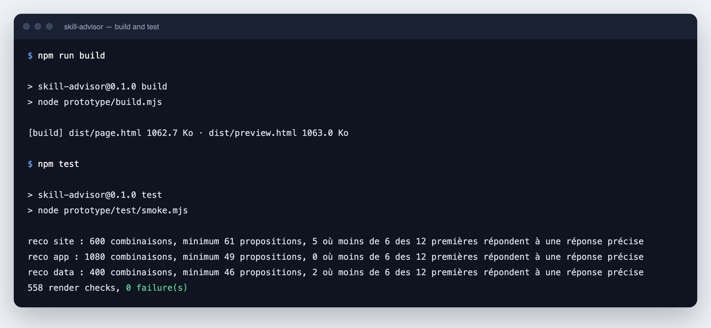
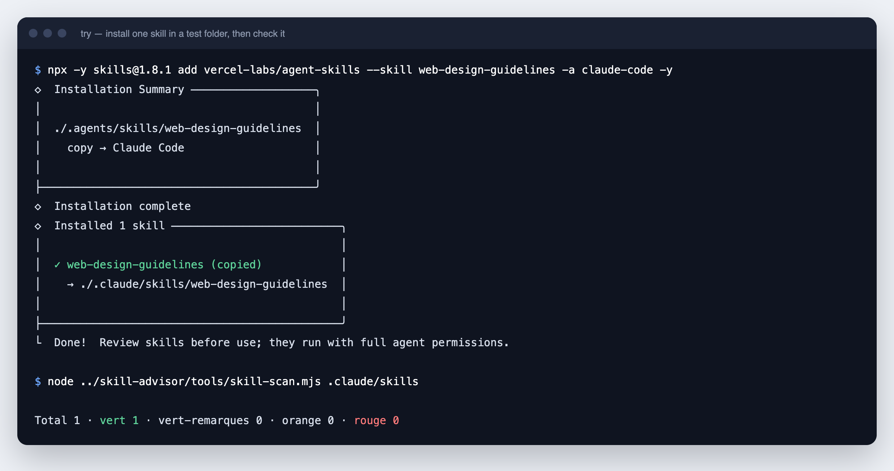

# دليل التثبيت

[English](INSTALL.md) · [Français](INSTALL.fr.md) · [Español](INSTALL.es.md) · **العربية**

يأخذك هذا الدليل من الصفر إلى skill مفحوصة ومثبتة في وكيلك. لكل خطوة إجراء واحد ونتيجة متوقعة واحدة. يمكنك التوقف عند أي خطوة: الخطوات من 1 إلى 4 تحتاج إلى متصفح ويب فقط.

> [!IMPORTANT]
> Skill Advisor نموذج أولي (prototype). تعرض الواجهة جهازًا تجريبيًا ولا تكتب شيئًا على قرصك. الخطوتان 7 و8 تستخدمان أوامر حقيقية تكتب ملفات حقيقية. وتذكر كل خطوة منهما ذلك.

## المحتويات

<div dir="rtl">

| الخطوة | ما تفعله | المدة | ما تحتاجه |
|---|---|---|---|
| 1 | تحقق مما تحتاجه | دقيقتان | - |
| 2 | نزّل Skill Advisor | دقيقة | متصفح أو git |
| 3 | افتح العرض التجريبي | دقيقة | متصفح |
| 4 | اتبع الرحلة كاملة | 5 دقائق | متصفح |
| 5 | ابنِ واختبر (اختياري) | دقيقة | Node.js |
| 6 | افحص skill | دقيقتان | Node.js |
| 7 | جرّب skill حقيقية في مجلد اختبار | 3 دقائق | Node.js، إنترنت |
| 8 | ثبّت skill لكل مشاريعك | دقيقتان | Node.js، إنترنت |

</div>

---

## الطريق السريع · سكربت التثبيت

السكربت ينفّذ الخطوات من 1 إلى 3 بدلًا منك: يتحقق من أدواتك وينزّل Skill Advisor ويفتح العرض التجريبي. يسألك عن اللغة: الفرنسية أو الإنجليزية. لا يثبّت أي برنامج في النظام ولا يطلب صلاحيات المدير. اقرأه قبل تشغيله: [install.sh](../../install.sh) و [install.ps1](../../install.ps1).

على macOS و Linux:

```bash
curl -fsSLO https://raw.githubusercontent.com/warezfr/skill-advisor/main/install.sh
bash install.sh
```

على Windows، في PowerShell:

```powershell
irm https://raw.githubusercontent.com/warezfr/skill-advisor/main/install.ps1 -OutFile install.ps1
powershell -ExecutionPolicy Bypass -File install.ps1
```

الخيار `-ExecutionPolicy Bypass` يسري على هذا التشغيل فقط. ولا يغيّر إعدادات نظامك.

**النتيجة المتوقعة:** أربع خطوات مرقّمة في الطرفية، ثم شاشة "Ma machine" (جهازي) في متصفحك.


<div dir="rtl">

| على macOS و Linux | على Windows | الأثر |
|---|---|---|
| الخيار `--lang fr` أو `--lang en` | الخيار `-Lang fr` أو `-Lang en` | اختيار اللغة دون السؤال |
| الخيار `--dir <folder>` | الخيار `-Dir <folder>` | التثبيت في مجلد آخر. المجلد الافتراضي هو `skill-advisor` في مجلدك الشخصي |
| الخيار `--no-git` | الخيار `-NoGit` | تنزيل الأرشيف حتى لو كان git مثبّتًا |
| الخيار `--no-open` | الخيار `-NoOpen` | عدم فتح المتصفح في النهاية |

</div>

ما الذي يفعله السكربت:

1. يتحقق من وجود git و Node.js. لا يُشترط أيٌّ منهما.
2. ينزّل Skill Advisor عبر git، أو كأرشيف إذا لم يكن git موجودًا.
3. يشغّل اختبار الواجهة إذا وُجد Node.js الإصدار 22 أو أحدث.
4. يفتح الملف `prototype/dist/preview.html` في متصفحك.

جُرّب السكربت على macOS و Debian 12 و Windows 11. شغّله مرة أخرى لتحديث نسخة مثبّتة عبر git. ثم تابع من الخطوة 4.

---

## الخطوة 1 · تحقق مما تحتاجه

<div dir="rtl">

| الأداة | لماذا تلزم | كيف تتحقق | من أين تحصل عليها |
|---|---|---|---|
| متصفح ويب | الخطوتان 3 و4 | - | موجود على جهازك |
| الإصدار 22 أو أحدث من Node.js | الخطوات من 5 إلى 8 | `node -v` | [nodejs.org](https://nodejs.org) |
| أداة git | الخطوة 2 (الخيار B). موصى بها للخطوتين 7 و8 | `git --version` | [git-scm.com](https://git-scm.com) |

</div>

افتح الطرفية (terminal): تطبيق Terminal على macOS وLinux، وPowerShell على Windows. ثم شغّل:

```bash
node -v
git --version
```

**النتيجة المتوقعة:** رقما إصدار. يبدأ رقم Node.js بـ 22 أو أكثر. جُرّبت أوامر هذا الدليل مع Node.js 26. جُرّبت أوامر الخطوات من 5 إلى 7 على macOS. وجُرّبت أوامر التثبيت في الخطوة 8 على Windows 11 و Linux و macOS.

سبب التوصية بـ git: بدونه يتوقف التثبيت عندما يحدّ GitHub من التنزيلات المجهولة (60 طلبًا في الساعة لكل عنوان عام). ومع git يستمر التثبيت.

## الخطوة 2 · نزّل Skill Advisor

اختر خيارًا واحدًا.

**الخيار A، بدون git.** نزّل ملف ZIP ثم فك ضغطه:

<https://github.com/warezfr/skill-advisor/archive/refs/heads/main.zip>

اسم المجلد بعد فك الضغط `skill-advisor-main`. غيّر اسمه إلى `skill-advisor`.

**الخيار B، مع git.**

```bash
git clone https://github.com/warezfr/skill-advisor.git
```

بعد ذلك ادخل إلى المجلد:

```bash
cd skill-advisor
```

**النتيجة المتوقعة:** مجلد `skill-advisor` يحتوي على `prototype` و`catalog` و`tools` و`README.md`.

## الخطوة 3 · افتح العرض التجريبي

افتح الملف `prototype/dist/preview.html` في متصفحك. انقر عليه نقرًا مزدوجًا، أو استخدم الأمر الخاص بنظامك.

على macOS:

```bash
open prototype/dist/preview.html
```

على Windows:

```powershell
start prototype\dist\preview.html
```

على Linux:

```bash
xdg-open prototype/dist/preview.html
```

**النتيجة المتوقعة:** شاشة "Ma machine" (جهازي). تقول الزاوية السفلية اليسرى "machine d'exemple" (جهاز تجريبي): الـ skills الخمسون المعروضة أمثلة وليست skills الخاصة بك.


ملاحظات:

- لا تحتاج الصفحة إلى خادم ولا إلى حساب. وهي تحمّل خطوطها من الإنترنت.
- الواجهة بالفرنسية حاليًا. تعطي الخطوة 4 الاسم العربي لكل شاشة.

## الخطوة 4 · اتبع الرحلة كاملة

**4.1 اختر هدفًا.** انقر على "Conseil" (نصيحة) في القائمة اليسرى، ثم على "Créer un site" (إنشاء موقع).


**4.2 أجب عن أربعة أسئلة.** نوع الموقع، والتقنية، والاستضافة، والاحتياجات. تمتلئ اللوحة اليمنى أثناء إجابتك. انقر على "Voir les recommandations" (عرض التوصيات).


**4.3 اقرأ التوصيات.** لكل skill درجة من 100 وسطر "Pourquoi pour vous" (لماذا تناسبك). حدّد الـ skills التي تريدها. الـ skills المثبتة سابقًا تحمل علامة "Installé".


**4.4 افتح تفاصيل skill.** انقر على "Voir le détail" (عرض التفاصيل). سترى كيف تُحسب الدرجة: الشعبية 40، وسمعة المصدر 25، والحداثة 15، والأمان 20.


**4.5 تحقق قبل الكتابة.** انقر على "Installer 3 skills". تعرض شاشة "Vérifiez avant d'écrire" (تحقق قبل الكتابة) الـ skills، والوكلاء الذين سيستلمونها، والنطاق: كل المشاريع أو هذا المشروع فقط.


**4.6 اقرأ الدليل.** أكّد. في النموذج الأولي لا يُكتب شيء على القرص. يشرح الدليل متى يستخدم الوكيل كل skill وكيف تستدعيها.


**4.7 أدر.** "Mes skills" (skills الخاصة بي) يعرض ما ثُبّت، مع التحديثات والتحذيرات وتكلفة السياق. "Agents" (الوكلاء) يعرض الوكلاء الموجودين على الجهاز والمكان الذي يحفظ فيه كل وكيل skills الخاصة به.


**4.8 ابحث.** "Recherche" (بحث) يبحث في القاعدة كلها، مع مرشحات حسب نوع المشروع وعدد التثبيتات والتحذيرات.


**4.9 جرّب الحالات الأخرى.** يعرض الزر "Aperçu" (معاينة) في الأسفل على اليسار الشاشات نفسها في حالات أخرى، مثل جهاز فارغ. وتبدّل أيقونة القمر إلى المظهر الداكن.


**النتيجة المتوقعة:** رأيت الرحلة كاملة، من الهدف إلى skill مثبتة ومُدارة.

## الخطوة 5 · ابنِ واختبر (اختياري)

ملف `preview.html` مبني مسبقًا. نفّذ هذه الخطوة فقط إذا غيّرت الملفات في `prototype/src/`.

```bash
npm run build
npm test
```

**النتيجة المتوقعة:** يطبع البناء حجم ملفين، وينتهي الاختبار بالسطر `558 render checks, 0 failure(s)`.



هذان الأمران لا يثبّتان شيئًا: ليس للمشروع أي اعتماديات (dependencies).

## الخطوة 6 · افحص skill

يقرأ الفحص ملفات الـ skill كنصوص ويبحث عن 11 نمطًا خطرًا. ولا ينفذ الـ skill أبدًا. يحتوي المجلد `examples/skills` على skill تجريبيتين: واحدة آمنة وأخرى كُتبت لتفشل.

```bash
node tools/skill-scan.mjs examples/skills
```

**النتيجة المتوقعة:** سطر أحمر واحد لـ `risky-installer`، وإجمالي 2 skill: واحدة `vert` وواحدة `rouge`.


<div dir="rtl">

| الحكم | المعنى | ما يجب فعله |
|---|---|---|
| `vert` (أخضر) | لم يُعثر على أي نمط معروف | اقرأ الـ skill ثم قرر |
| `vert-remarques` (أخضر مع ملاحظات) | نتائج منخفضة الخطورة فقط | اقرأ الملاحظات |
| `orange` | نتيجة واحدة على الأقل متوسطة الخطورة | اقرأ كل نتيجة قبل التثبيت |
| `rouge` (أحمر) | نتيجة عالية الخطورة | لا تثبّت إلا إذا فهمت كل سطر |

</div>

لعرض كل نتيجة مع ملفها ورقم سطرها، أضف `--json`:

```bash
node tools/skill-scan.mjs examples/skills --json
```

لفحص skills الخاصة بك، أعطِ المجلد الذي يحتوي على مجلد فرعي لكل skill. تُحفظ الـ skills المثبتة بأداة `skills` في `.agents/skills` داخل مجلدك الشخصي:

```bash
node tools/skill-scan.mjs ~/.agents/skills
```

في Windows PowerShell اكتب `$HOME\.agents\skills` بدلًا من `~/.agents/skills`.

يتجاهل الفحص المجلدات المرتبطة بروابط. أعطه المجلد الذي يحتوي على الملفات الحقيقية.

> [!WARNING]
> الحكم الأخضر يعني "لم يُعثر على أي نمط معروف". ولا يعني "آمن". الفحص يجد الأنماط المعروفة فقط.

## الخطوة 7 · جرّب skill حقيقية في مجلد اختبار

تكتب هذه الخطوة ملفات، لكن داخل مجلد اختبار فقط يمكنك حذفه. وهي تستخدم [`skills`](https://skills.sh)، أداة سطر الأوامر مفتوحة المصدر التي يعتمد عليها Skill Advisor في التثبيت.

أنشئ مجلد اختبار بجوار `skill-advisor` وادخل إليه:

```bash
mkdir ../try
cd ../try
```

ثبّت skill واحدة لهذا المجلد فقط، ثم افحصها:

```bash
npx -y skills@1.8.1 add vercel-labs/agent-skills --skill web-design-guidelines -a claude-code -y
node ../skill-advisor/tools/skill-scan.mjs .claude/skills
```

**النتيجة المتوقعة:** تُنسخ الـ skill إلى `.claude/skills/web-design-guidelines` داخل مجلد الاختبار، ويطبع الفحص `Total 1 · vert 1`.



معنى الخيارات:

<div dir="rtl">

| الخيار | المعنى |
|---|---|
| `vercel-labs/agent-skills` | مستودع GitHub الذي يحتوي على الـ skill |
| `--skill web-design-guidelines` | الـ skill المراد تثبيتها من ذلك المستودع |
| `-a claude-code` | الوكيل الذي يستلمها. قيم أخرى: `cursor` و`gemini-cli` |
| `-y` | لا تطلب التأكيد |

</div>

للعثور على المستودع واسم الـ skill، افتح [catalog/CATALOGUE.md](../../catalog/CATALOGUE.md): كل سطر يذكر الـ skill ومصدرها.

لإزالة كل ما أنشأته هذه الخطوة، احذف المجلد `try`.

## الخطوة 8 · ثبّت skill لكل مشاريعك

> [!WARNING]
> تكتب هذه الخطوة في مجلدات وكلائك الحقيقية، مثل `~/.claude/skills`. نفّذها فقط لـ skill فحصتها في الخطوة 7.

أضف `-g` (عام) للتثبيت لكل مشاريعك:

```bash
npx -y skills@1.8.1 add vercel-labs/agent-skills --skill web-design-guidelines -g -a claude-code -y
```

الأوامر الأربعة التي تحتاجها بعد ذلك:

<div dir="rtl">

| الإجراء | الأمر |
|---|---|
| عرض ما هو مثبت | `npx -y skills@1.8.1 list -g` |
| البحث عن تحديثات | `npx -y skills@1.8.1 check -g` |
| تحديث كل شيء | `npx -y skills@1.8.1 update -g -y` |
| حذف skill واحدة | `npx -y skills@1.8.1 remove --skill web-design-guidelines -g -y` |

</div>

**النتيجة المتوقعة:** الأمر `list -g` يعرض `web-design-guidelines`. أعد تشغيل وكيلك ليقرأ مجلد skills من جديد.

أين تذهب الملفات: تُحفظ الـ skill مرة واحدة في `~/.agents/skills/`، ويشير مجلد وكيلك إليها. على macOS وLinux المؤشر رابط رمزي (symbolic link). وعلى Windows هو وصلة (junction).

---

## إذا حدث خطأ

<div dir="rtl">

| ما تراه | السبب | ما يجب فعله |
|---|---|---|
| `node: command not found` | Node.js غير مثبت | ثبّته من [nodejs.org](https://nodejs.org)، ثم افتح طرفية جديدة |
| `[SKILLS_GIT_CLONE_FAILED] ... spawn git ENOENT` | حدّ GitHub من التنزيلات المجهولة وgit غير مثبت | ثبّت git، أو انتظر ساعة وحاول من جديد |
| `skill-scan.mjs` يطبع `ENOENT ... scandir` | المجلد الذي أعطيته غير موجود | أعطِ مجلدًا يحتوي على مجلد فرعي لكل skill |
| على Windows، يقول المثبّت "symlinked" | الأداة تستخدم كلمة واحدة للنوعين من الروابط | لا شيء يلزم: أنشأت الأداة وصلة (junction)، وتعمل بدون صلاحيات المسؤول |

</div>

## حذف Skill Advisor

لا يثبّت Skill Advisor شيئًا على نظامك. احذف المجلد `skill-advisor`. الـ skills المثبتة في الخطوة 8 تبقى في مكانها: احذفها بالأمر `remove` من الخطوة 8.

---

[العودة إلى README](../../README.ar.md) · الموقع: [span.observer](https://span.observer)
