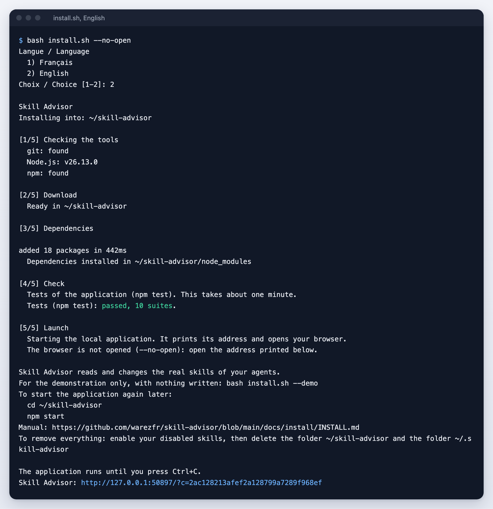
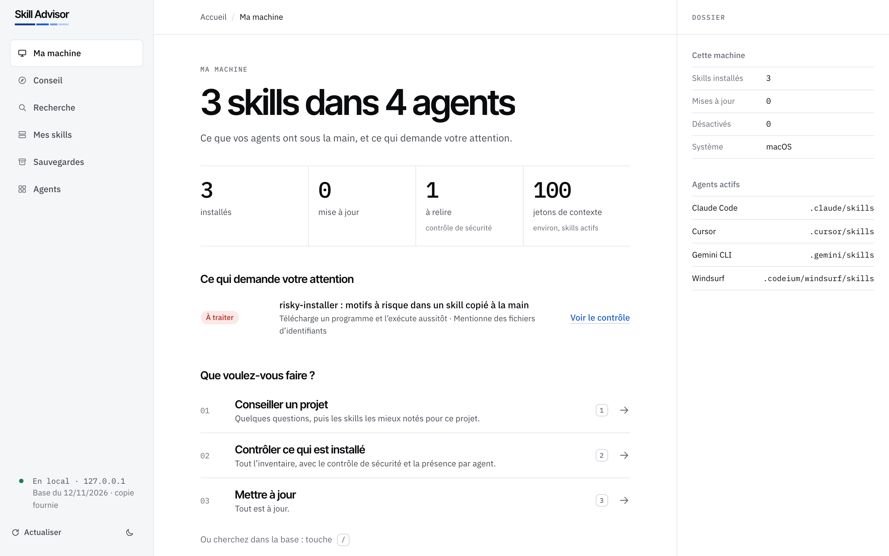
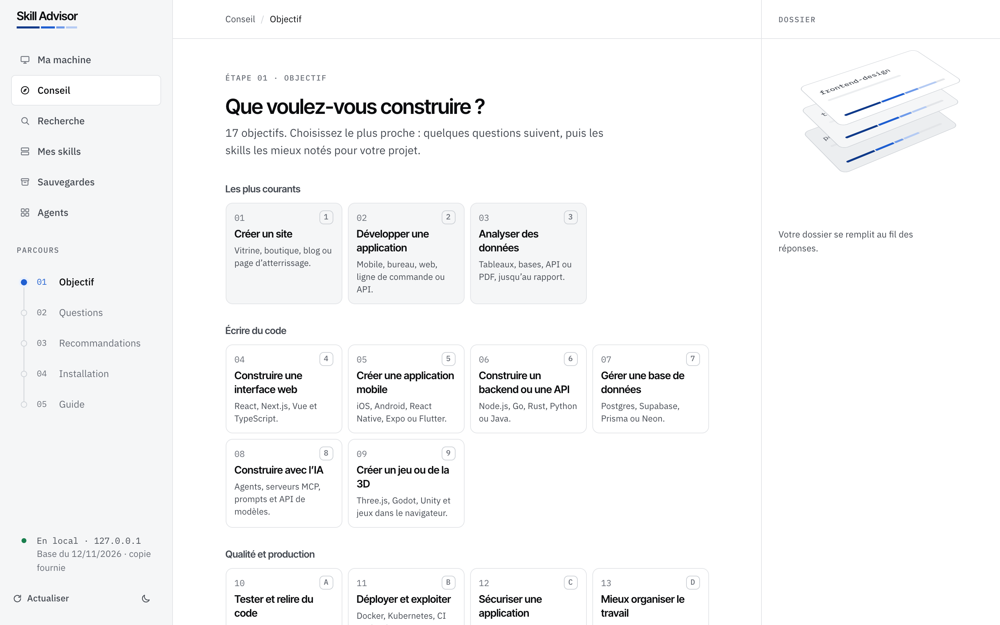
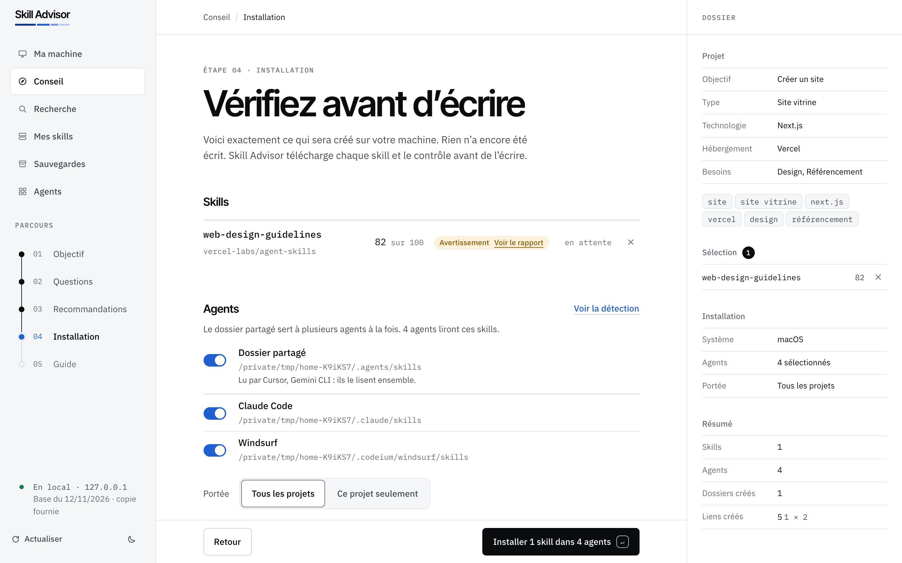
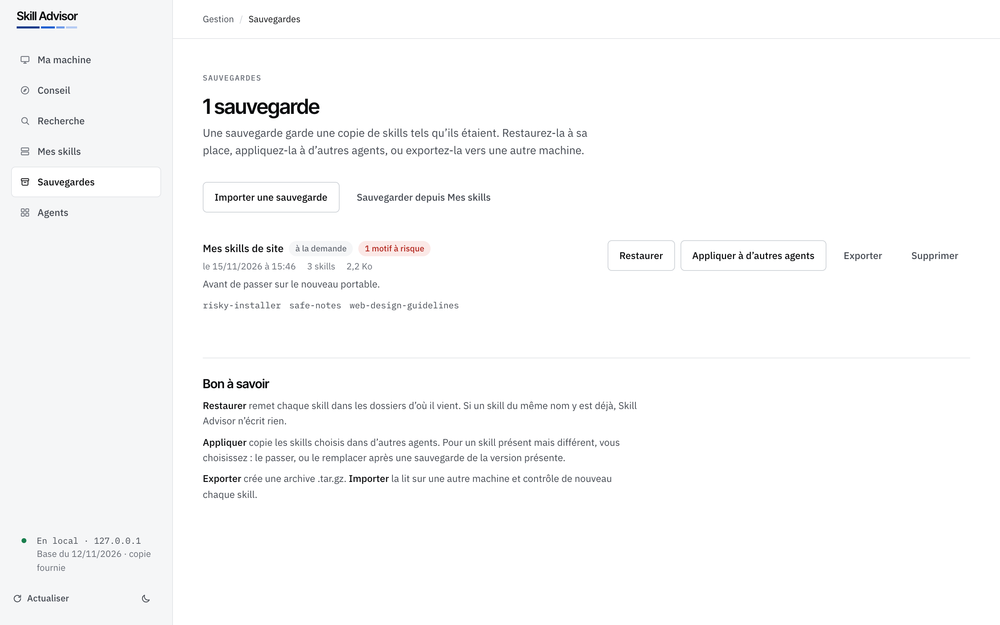
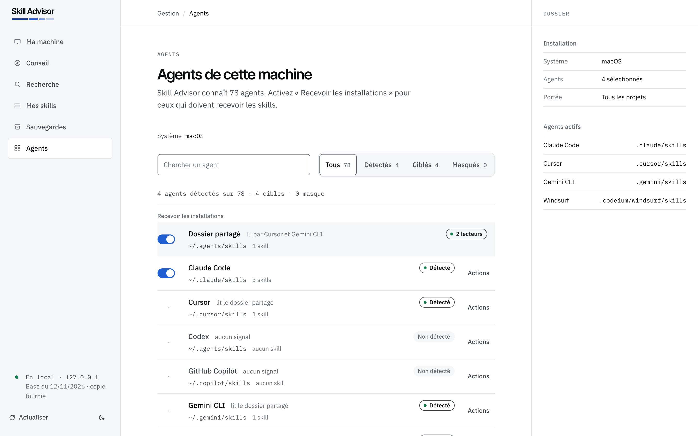

# Manual de instalación

[English](INSTALL.md) · [Français](INSTALL.fr.md) · **Español** · [العربية](INSTALL.ar.md)

Este manual le lleva desde cero hasta una skill verificada e instalada en sus agentes, y después por cada pantalla de Skill Advisor 1.0. Cada paso tiene una acción y un resultado esperado.

> [!WARNING]
> Skill Advisor trabaja sobre su máquina real. Lo que usted instala, actualiza, desactiva o desinstala en él cambia las carpetas de skills de sus agentes, por ejemplo `~/.claude/skills` y `~/.agents/skills`. Cada paso que escribe lo indica.

## Contenido

| Paso | Qué hace | Tiempo | Necesita |
|---|---|---|---|
| 1 | Comprobar lo que necesita | 2 min | Terminal |
| 2 | Instalar Skill Advisor | 2 min | Node.js, internet |
| 3 | Iniciar la aplicación | 1 min | Node.js |
| 4 | Leer "Ma machine" | 1 min | Navegador |
| 5 | Pedir consejo e instalar una skill | 5 min | Internet |
| 6 | Gestionar sus skills | 3 min | - |
| 7 | Guardar, exportar, importar y aplicar | 5 min | - |
| 8 | Gestionar sus agentes | 3 min | - |
| 9 | Buscar en la base | 2 min | - |
| 10 | Verificar una skill desde el terminal | 2 min | Node.js |

La interfaz está en francés. Cada paso da el significado en español de los nombres de la pantalla.

---

## Vía rápida · El script de instalación

El script hace los pasos 1 a 3 por usted: comprueba sus herramientas, descarga Skill Advisor, instala sus dependencias, ejecuta las pruebas e inicia la aplicación. Le pregunta el idioma, francés o inglés. No instala ningún software del sistema ni pide permisos de administrador. Léalo antes de ejecutarlo: [install.sh](../../install.sh), [install.ps1](../../install.ps1).

macOS y Linux:

```bash
curl -fsSLO https://raw.githubusercontent.com/warezfr/skill-advisor/main/install.sh
bash install.sh
```

Windows, en PowerShell:

```powershell
irm https://raw.githubusercontent.com/warezfr/skill-advisor/main/install.ps1 -OutFile install.ps1
powershell -ExecutionPolicy Bypass -File install.ps1
```

La opción `-ExecutionPolicy Bypass` vale solo para esta ejecución. No cambia la configuración de su sistema.

**Resultado esperado:** cinco pasos numerados en el terminal, después la línea `Skill Advisor: http://127.0.0.1:<port>/?c=<code>` y la pantalla "Ma machine" (Mi máquina) en su navegador. La aplicación sigue en marcha en ese terminal. Continúe en el paso 4.



*Aquí el script se ejecutó con `--no-open`: el navegador no se abrió y la dirección aparece al final.*

| macOS, Linux | Windows | Efecto |
|---|---|---|
| `--lang fr`, `--lang en` | `-Lang fr`, `-Lang en` | Elegir el idioma sin la pregunta |
| `--dir <carpeta>` | `-Dir <carpeta>` | Instalar en otra carpeta. Por defecto: `skill-advisor` en su carpeta personal |
| `--no-git` | `-NoGit` | Descargar el archivo comprimido aunque git esté instalado |
| `--no-open` | `-NoOpen` | No abrir el navegador. La aplicación muestra igualmente su dirección |
| `--no-start` | `-NoStart` | Instalar la aplicación sin iniciarla |
| `--demo` | `-Demo` | Abrir solo la demostración: una máquina de ejemplo. No se instala ninguna dependencia y no se escribe nada en sus agentes |

Qué hace el script:

1. Comprueba si git, Node.js y npm están presentes. La aplicación necesita Node.js 22.20 o posterior, con npm. git es opcional.
2. Descarga Skill Advisor con git, o como archivo comprimido cuando git no está.
3. Instala las dependencias, los paquetes `skills` y `tar`, en la carpeta `node_modules`, con `npm ci --omit=dev --no-audit --no-fund`.
4. Ejecuta las pruebas con `npm test` cuando las dependencias están instaladas. Si no, ejecuta solo la prueba de la interfaz.
5. Inicia la aplicación con `node app/server.mjs`.

Sin Node.js 22.20 o posterior y npm, el script no puede iniciar la aplicación. Abre la demostración en su lugar y le indica dónde conseguir Node.js.

---

## Paso 1 · Comprobar lo que necesita

| Herramienta | Para qué | Cómo comprobarlo | Dónde conseguirla |
|---|---|---|---|
| Node.js 22.20 o posterior, con npm | La aplicación | `node -v`, `npm -v` | [nodejs.org](https://nodejs.org) |
| git | Opcional. Actualizaciones de Skill Advisor más sencillas, e instalaciones que continúan cuando GitHub limita las descargas anónimas | `git --version` | [git-scm.com](https://git-scm.com) |
| Un navegador web | La interfaz | - | Ya está en su máquina |

Abra un terminal (Terminal en macOS y Linux, PowerShell en Windows) y ejecute:

```bash
node -v
npm -v
git --version
```

**Resultado esperado:** tres números de versión. El de Node.js es v22.20 o superior, por ejemplo `v26.13.0`.

## Paso 2 · Instalar Skill Advisor

Use el script de la vía rápida, o instale a mano:

```bash
git clone https://github.com/warezfr/skill-advisor.git
cd skill-advisor
npm ci --omit=dev
```

Sin git, descargue <https://github.com/warezfr/skill-advisor/archive/refs/heads/main.zip>, descomprímalo, cambie el nombre de la carpeta `skill-advisor-main` a `skill-advisor`, entre en ella y ejecute `npm ci --omit=dev`.

**Resultado esperado:** una carpeta `skill-advisor` que contiene `app`, `prototype`, `catalog`, `tools`, `node_modules` y `README.md`. npm muestra una línea de la forma `added 9 packages`.

## Paso 3 · Iniciar la aplicación

macOS y Linux:

```bash
cd ~/skill-advisor
npm start
```

Windows, en PowerShell:

```powershell
cd $HOME\skill-advisor
npm.cmd start
```

En Windows, use `npm.cmd start`: la directiva de ejecución por defecto de PowerShell puede rechazar `npm start`, porque bloquea `npm.ps1`. Si instaló a mano en el paso 2, vaya a la carpeta `skill-advisor` que creó `git clone`, allí donde lo ejecutó.

**Resultado esperado:** la línea `Skill Advisor: http://127.0.0.1:<port>/?c=<code>`, después la interfaz en su navegador. Si el navegador no se abre, copie esa dirección en él en los 10 minutos siguientes.

Sobre esta dirección:

- Funciona una vez. La pestaña que la abrió conserva la sesión, y recargar esa pestaña sigue funcionando.
- Otra pestaña, o la misma dirección usada otra vez, muestra "Session expirée" (Sesión caducada). Detenga la aplicación con Ctrl+C y vuelva a ejecutar `npm start`: obtiene una dirección nueva.
- La aplicación escucha solo en `127.0.0.1`. Otras máquinas no pueden alcanzarla. No comparta la dirección.

Para detener la aplicación, pulse Ctrl+C en su terminal. Las opciones de `npm start` están más abajo, en "Opciones de la aplicación".

## Paso 4 · Leer "Ma machine"

"Ma machine" (Mi máquina) cuenta sus skills y agentes, las actualizaciones disponibles, las skills que revisar y el contexto que cuestan. "Ce qui demande votre attention" (Lo que requiere su atención) enumera lo que conviene mirar primero. El panel de la derecha enumera los agentes que tienen skills.



La parte de abajo del menú indica "En local · 127.0.0.1" y la fecha de la base. "Actualiser" (Actualizar) vuelve a leer sus carpetas. La aplicación también lo hace cuando usted vuelve a su ventana.

**Resultado esperado:** las skills que sus agentes ya tienen, incluidas las que usted copió a mano ("copie manuelle").

## Paso 5 · Pedir consejo e instalar una skill

> [!WARNING]
> El paso 5.4 escribe en las carpetas reales de sus agentes.

**5.1 Elegir un objetivo.** Haga clic en "Conseil" (Consejo) en el menú de la izquierda. Elija uno de los 17 objetivos, por ejemplo "Créer un site" (Crear un sitio web).



**5.2 Responder a las preguntas.** Para un sitio web: tipo de sitio, tecnología, alojamiento, necesidades. El panel de la derecha se completa a medida que responde. Haga clic en "Voir les recommandations" (Ver las recomendaciones).


**5.3 Leer las recomendaciones.** Cada skill tiene una puntuación sobre 100 y una línea "Pourquoi pour vous" (Por qué para usted). Las mejores aparecen marcadas. Desmarque lo que no quiera. "Voir le détail" (Ver el detalle) explica la puntuación: popularidad 40, reputación de la fuente 25, actualidad 15, seguridad 20. Haga clic en "Installer" (Instalar).


**5.4 Verificar antes de escribir.** La pantalla "Vérifiez avant d'écrire" (Verifique antes de escribir) enumera las skills, los agentes que las reciben, las carpetas que se crearán y el alcance: "Tous les projets" (Todos los proyectos) o "Ce projet seulement" (Solo este proyecto). Para un proyecto, indique su carpeta en el campo "Dossier du projet" (Carpeta del proyecto). Haga clic en "Installer 1 skill dans 4 agents" (Instalar 1 skill en 4 agentes), o el mismo botón con sus números.



Adónde van los archivos:

- Con "Dossier partagé" (Carpeta compartida) activada, la skill va a `~/.agents/skills/<nombre>`. Los agentes que leen esa carpeta la ven enseguida; la pantalla los nombra, por ejemplo "Lu par Cursor, Gemini CLI" (Leída por Cursor, Gemini CLI). Cada otro agente elegido recibe un enlace a ella, una unión (junction) en Windows.
- Con la carpeta compartida desactivada, cada agente elegido recibe su propia copia, y no se escribe nada en la carpeta compartida.

Qué puede detener una skill:

| Qué pasa | Qué ve | Qué puede hacer |
|---|---|---|
| La verificación encuentra un patrón de riesgo alto | La skill queda retenida: no se escribe nada para ella | Lea el informe. "Installer malgré l'avertissement" (Instalar pese al aviso) la instala |
| Ya hay una skill con el mismo nombre, copiada a mano o de otra fuente | Un conflicto: no se escribe nada para ella | "Garder l'existant" (Conservar la existente), o "Remplacer (une sauvegarde est faite)" (Reemplazar, se hace una copia de seguridad) |
| Sin conexión, límite de GitHub, fuente no encontrada | Un mensaje en francés indica cuál | Compruebe la conexión, o espere y vuelva a intentarlo |

**5.5 Leer la guía.** Después de la instalación, la guía indica cuándo usa el agente cada skill y cómo llamarla. Sigue disponible en "Mes skills".

**Resultado esperado:** la skill aparece en "Mes skills" con el estado "À jour" (Al día). Reinicie su agente para que vuelva a leer su carpeta de skills.

## Paso 6 · Gestionar sus skills

"Mes skills" (Mis skills) enumera cada skill, con sus agentes, su estado, el resultado de su verificación y su coste en contexto. Haga clic en el nombre de una skill para abrir su detalle.


- **Actualizar.** Haga clic en "Rechercher les mises à jour" (Buscar actualizaciones). Para una skill con actualización, "Ce qui change" (Qué cambia) enumera los archivos añadidos, quitados y modificados, y la verificación de la nueva versión. Después haga clic en "Mettre à jour" (Actualizar). Una nueva versión con un patrón de riesgo alto queda retenida hasta que usted la fuerce. Después de la actualización, los mismos agentes ven la skill.
- **Desactivar y activar.** El interruptor de la columna "Actif" (Activa) mueve la skill a `~/.skill-advisor/disabled` y la devuelve. Una skill desactivada sigue en el disco, pero el agente deja de cargarla.
- **Desinstalar.** "Désinstaller" (Desinstalar) pide una confirmación. La casilla "Garder une sauvegarde" (Guardar una copia de seguridad) está marcada por defecto.
- **Varias a la vez.** Marque varias skills: la barra ofrece "Désactiver", "Activer", "Sauvegarder" y "Désinstaller" (Desactivar, Activar, Guardar copia, Desinstalar).

Una skill copiada a mano ("copie manuelle") no se actualiza: para actualizarla, vuelva a instalarla desde su fuente. Una skill instalada para un proyecto se muestra, pero se gestiona desde la carpeta del proyecto.

**Resultado esperado:** cada acción cambia las carpetas de sus agentes, y la lista muestra el nuevo estado.

## Paso 7 · Guardar, exportar, importar y aplicar

> [!WARNING]
> Restaurar y aplicar una copia de seguridad escriben en las carpetas reales de sus agentes.

**7.1 Hacer una copia de seguridad.** En "Mes skills", marque una o varias skills y haga clic en "Sauvegarder" (Guardar copia). Añada un nombre y una nota si quiere: 80 y 500 caracteres como máximo. Una desinstalación con "Garder une sauvegarde" también hace una copia de seguridad.

**7.2 Leer sus copias de seguridad.** "Sauvegardes" (Copias de seguridad) las enumera, de la más reciente a la más antigua, con su fecha, su origen, su tamaño, sus skills y los resultados de sus verificaciones. Se guardan en `~/.skill-advisor/backups`.



**7.3 Restaurar.** "Restaurer" (Restaurar) devuelve cada copia a su sitio. Cuando ya hay algo en uno de esos sitios, no se escribe nada. Una skill con un patrón de riesgo pide "Restaurer malgré tout" (Restaurar de todos modos).

**7.4 Exportar e importar.** "Exporter" (Exportar) guarda la copia de seguridad en un solo archivo llamado `skill-advisor-<id>.tar.gz`. En otra máquina, "Importer une sauvegarde" (Importar una copia de seguridad) lee ese archivo, verifica de nuevo cada skill y la guarda como una nueva copia. Todavía no se instala nada. La importación rechaza un archivo que contenga algo distinto de archivos y carpetas, una ruta que salga de la copia, más de 200 MB o más de 100 000 entradas, un archivo sin un manifiesto válido de Skill Advisor, o un nombre de skill no válido.

**7.5 Aplicar a otros agentes.** "Appliquer à d'autres agents" (Aplicar a otros agentes) abre un panel. Elija las skills y después los agentes: los agentes detectados, la carpeta compartida, o cualquier otro agente conocido, buscado por su nombre. Después elija qué pasa cuando un agente ya tiene la skill.


| Qué tiene el agente | "Passer" (Omitir) | "Remplacer" (Reemplazar) |
|---|---|---|
| Nada | La skill se copia | La skill se copia |
| El mismo contenido | No cambia nada | No cambia nada |
| Otra versión | Se queda en su sitio | Se guarda una copia y después se reemplaza |

Una skill con un patrón de riesgo solo se aplica si usted marca "Appliquer malgré l'avertissement" (Aplicar pese al aviso).

**Resultado esperado:** un mensaje como `safe-notes : 1 application faite, 0 passée, 0 échec` (1 aplicada, 0 omitidas, 0 fallos). La skill aparece en los agentes elegidos en "Mes skills". Cada versión reemplazada tiene su propia copia de seguridad nueva.

## Paso 8 · Gestionar sus agentes

"Agents" (Agentes) enumera los 78 agentes que Skill Advisor conoce. Los filtros muestran "Tous" (Todos), "Détectés" (Detectados), "Ciblés" (Destinos) y "Masqués" (Ocultos).



- **Destinos.** Los interruptores eligen los agentes que reciben las instalaciones. La carpeta compartida ocupa una línea, con los agentes que la leen.
- **Añadir un agente a mano.** "Ajouter un agent" (Añadir un agente): indique un nombre y la ruta completa de su carpeta de skills. Ese agente recibe su propia copia de cada skill. No puede recibir una instalación para un solo proyecto.
- **Ocultar un agente.** "Actions" (Acciones) y después "Masquer" (Ocultar). "Afficher" (Mostrar) lo devuelve.
- **Vaciar un agente.** "Actions" y después "Retirer tous ses skills" (Quitar todas sus skills), con una copia de seguridad opcional. Para un agente que lee la carpeta compartida, la aplicación nombra todos los agentes que la leen y ofrece "Retirer du dossier partagé pour tous ces agents" (Quitar de la carpeta compartida para todos estos agentes).
- **Carpeta del proyecto.** El campo "Dossier du projet" (Carpeta del proyecto) también está en esta pantalla.

**Resultado esperado:** el filtro "Tous" (Todos) cuenta los 78 agentes conocidos.

## Paso 9 · Buscar en la base

"Recherche" (Búsqueda) busca entre las 1551 skills más instaladas de las 92 899 que enumera skills.sh, con filtros por tipo de proyecto, instalaciones y avisos. La barra de título muestra la fecha y la fuente de la base: "Base du 12/11/2026 · copie fournie" indica la copia incluida con Skill Advisor. "Ajouter" (Añadir) pone una skill en su selección, lista para el paso 5.4.


El botón con forma de luna, abajo a la izquierda, cambia al tema oscuro. Skill Advisor recuerda su elección.


## Paso 10 · Verificar una skill desde el terminal

La aplicación ejecuta esta verificación por usted. También puede ejecutarla usted mismo, desde la carpeta `skill-advisor`. Lee los archivos de una skill como texto y busca 11 patrones de riesgo. Nunca ejecuta la skill. La carpeta `examples/skills` contiene dos skills de ejemplo: una segura, otra escrita para fallar.

```bash
node tools/skill-scan.mjs examples/skills
```

**Resultado esperado:** una línea roja para `risky-installer`, y el total `Total 2 · vert 1 · vert-remarques 0 · orange 0 · rouge 1`.


| Veredicto | En la interfaz | Qué hacer |
|---|---|---|
| `vert` (verde) | Aucun motif connu (Ningún patrón conocido) | Lea la skill y después decida |
| `vert-remarques` (verde con notas) | Remarques (Notas) | Lea las notas |
| `orange` (naranja) | À regarder (Para revisar) | Lea cada hallazgo antes de instalar |
| `rouge` (rojo) | Motif à risque (Patrón de riesgo) | No la instale salvo que entienda cada línea |

Para ver cada hallazgo con su archivo y su número de línea, añada `--json`:

```bash
node tools/skill-scan.mjs examples/skills --json
```

Para verificar las skills de la carpeta compartida:

```bash
node tools/skill-scan.mjs ~/.agents/skills
```

En PowerShell de Windows, escriba `$HOME\.agents\skills` en lugar de `~/.agents/skills`. La verificación omite las carpetas enlazadas: indíquele la carpeta que contiene los archivos reales.

> [!WARNING]
> Un veredicto verde significa "ningún patrón conocido encontrado". No significa "segura". La verificación solo encuentra patrones conocidos.

---

## Opciones de la aplicación

Póngalas después de `npm start --`, por ejemplo `npm start -- --no-open --port 4317`.

| Opción | Efecto |
|---|---|
| `--port <n>` | Escuchar en este puerto. Sin ella, el sistema elige un puerto libre |
| `--no-open` | No abrir el navegador. La dirección se muestra igualmente |
| `--project <carpeta>` | Usar esta carpeta como carpeta del proyecto |
| `--home <carpeta>` | Solo para pruebas: usar esta carpeta como carpeta personal |
| `--version` | Mostrar la versión y detenerse |
| `--help` | Mostrar la ayuda, en francés, y detenerse |

## Ejecutar las pruebas

Las pruebas necesitan las dependencias, instaladas con `npm ci`. El script y el paso 2 ya las instalan. En Windows, escriba `npm.cmd` en lugar de `npm`.

```bash
npm ci
npm test
npm run test:e2e
```

`npm test` ejecuta todas las suites con `test/run-all.mjs`, sin red: el servidor y su biblioteca, la interfaz, y la comprobación de que `prototype/dist` corresponde a sus fuentes. Las pruebas usan carpetas desechables en la carpeta temporal del sistema, nunca las carpetas de sus agentes. Sin git, las pruebas que lo necesitan se omiten.

`npm run test:e2e` ejecuta las pruebas de extremo a extremo en un navegador sin ventana. Necesita Chrome o Chromium. Si no se encuentra, indique su ruta en la variable `CHROME_PATH`. Sin navegador, estas pruebas se omiten.

**Resultado esperado:** `npm test` termina con un bloque `=== Bilan ===` (Resumen): una línea por suite, `réussi` (superada) o `ÉCHEC` (fallida), con su duración.

## Detener, actualizar, desinstalar

**Detener.** Pulse Ctrl+C en el terminal donde se ejecuta la aplicación.

**Actualizar.** Vuelva a ejecutar el script de instalación. Una copia instalada con git se actualiza con `git pull`. Una copia instalada sin git se conserva tal cual, y el script lo dice: borre antes la carpeta `skill-advisor` y después ejecute el script, o instale en otra carpeta con `--dir` (`-Dir` en Windows). Su configuración y sus copias de seguridad, en `~/.skill-advisor`, se quedan.

**Desinstalar.** Skill Advisor no instala nada en su sistema.

1. Active sus skills desactivadas, o se borrarán con `~/.skill-advisor`.
2. Exporte las copias de seguridad que quiera conservar (paso 7.4).
3. Desinstale las skills que ya no quiera (paso 6). Las demás se quedan en sus agentes.
4. Borre la carpeta de instalación y la carpeta `~/.skill-advisor`. En macOS y Linux:

```bash
rm -rf ~/skill-advisor ~/.skill-advisor
```

En Windows, borre las carpetas `skill-advisor` y `.skill-advisor` de su perfil de usuario.

## Si algo falla

| Qué ve | Causa | Qué hacer |
|---|---|---|
| `node: command not found` | Node.js no está instalado | Instálelo desde [nodejs.org](https://nodejs.org) y abra un terminal nuevo |
| `too old (22.20 or later needed for the application)` | Node.js es anterior a 22.20 | Instale un Node.js más reciente y vuelva a ejecutar el script |
| `npm failed` en el paso 3 del script | npm no llega a su registro | Compruebe la conexión a internet y vuelva a ejecutar el script |
| PowerShell rechaza `npm start` | La directiva de ejecución bloquea `npm.ps1` | Ejecute `npm.cmd start` |
| "Session expirée" (Sesión caducada) | La dirección ya se usó, o tiene más de 10 minutos | Pulse Ctrl+C, vuelva a ejecutar `npm start` y abra la nueva dirección |
| `Le port <n> est déjà pris` (El puerto ya está ocupado) | Otro programa usa ese puerto | Elija otro con `--port`, o quite la opción |
| El terminal no muestra nada más después de la dirección | La aplicación está en marcha | Es lo esperado. Pulse Ctrl+C para detenerla |
| Una instalación se detiene por un límite de GitHub | GitHub limita las descargas anónimas | Instale git, o espere una hora y vuelva a intentarlo |
| `Dossier introuvable` (Carpeta no encontrada) con `skill-scan.mjs` | La carpeta indicada no existe | Indique una carpeta que contenga una subcarpeta por skill |

## Informar de un problema

Informe de los errores en los [issues de GitHub](https://github.com/warezfr/skill-advisor/issues). Para un problema de seguridad, no abra un issue público: abra un [aviso de seguridad privado](https://github.com/warezfr/skill-advisor/security/advisories/new).

---

[Volver al README](../../README.es.md) · Sitio web: [span.observer](https://span.observer)
