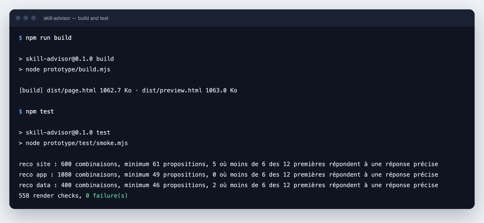
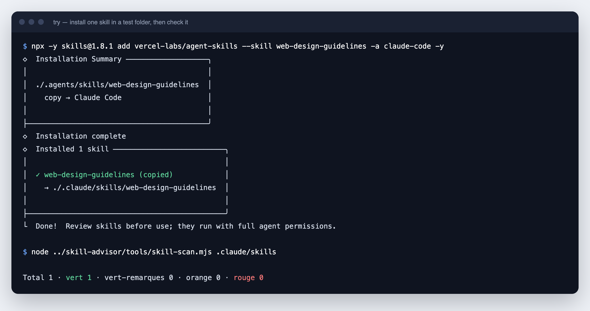

# Manual de instalación

[English](INSTALL.md) · [Français](INSTALL.fr.md) · **Español** · [العربية](INSTALL.ar.md)

Este manual le lleva desde cero hasta una skill verificada e instalada en su agente. Cada paso tiene una acción y un resultado esperado. Puede detenerse en cualquier paso: los pasos 1 a 4 solo necesitan un navegador web.

> [!IMPORTANT]
> Skill Advisor es un prototipo. El script de instalación ahora inicia la aplicación local real: lee y cambia las skills reales de sus agentes. La demostración muestra una máquina de ejemplo y no escribe nada en su disco. Sigue disponible con `--demo` (`-Demo` en Windows). Los pasos 7 y 8 usan comandos reales que escriben archivos reales, y el paso 9 los escribe con la aplicación local. Cada uno de esos pasos lo indica. Las capturas de pantalla de este manual aún muestran la demostración.

## Contenido

| Paso | Qué hace | Tiempo | Requisitos |
|---|---|---|---|
| 1 | Comprobar lo que necesita | 2 min | - |
| 2 | Descargar Skill Advisor | 1 min | Navegador o git |
| 3 | Abrir la demostración | 1 min | Navegador |
| 4 | Recorrer el trayecto | 5 min | Navegador |
| 5 | Compilar y probar (opcional) | 1 min | Node.js |
| 6 | Verificar una skill | 2 min | Node.js |
| 7 | Probar una skill real en una carpeta de prueba | 3 min | Node.js, internet |
| 8 | Instalar una skill para todos sus proyectos | 2 min | Node.js, internet |
| 9 | Hacer una copia de seguridad de una skill y aplicarla a otro agente | 5 min | Aplicación local |

---

## Vía rápida · El script de instalación

El script hace los pasos 1 a 3 por usted: comprueba sus herramientas, descarga Skill Advisor, instala su única dependencia e inicia la aplicación local. Sin Node.js 22.20 o posterior y npm, o con `--demo`, abre la demostración en su lugar. Pregunta su idioma, francés o inglés. No instala ningún software del sistema y no pide permisos de administrador. Léalo antes de ejecutarlo: [install.sh](../../install.sh), [install.ps1](../../install.ps1).

macOS y Linux:

```bash
curl -fsSLO https://raw.githubusercontent.com/warezfr/skill-advisor/main/install.sh
bash install.sh
```

Windows, en PowerShell:

```powershell
irm https://raw.githubusercontent.com/warezfr/skill-advisor/main/install.ps1 -OutFile install.ps1
powershell -ExecutionPolicy Bypass -File install.ps1
```

La opción `-ExecutionPolicy Bypass` vale solo para esta ejecución. No cambia la configuración de su sistema.

**Resultado esperado:** cinco pasos numerados en la terminal y, después, la línea `Skill Advisor: http://127.0.0.1:<port>/?c=<code>` y la pantalla "Ma machine" (Mi máquina) en su navegador.


*Esta captura muestra una versión anterior del script, con cuatro pasos, que abría la demostración.*

| macOS, Linux | Windows | Efecto |
|---|---|---|
| `--lang fr`, `--lang en` | `-Lang fr`, `-Lang en` | Elegir el idioma sin la pregunta |
| `--dir <carpeta>` | `-Dir <carpeta>` | Instalar en otra carpeta. Por defecto: `skill-advisor` en su carpeta personal |
| `--no-git` | `-NoGit` | Descargar el archivo aunque git esté instalado |
| `--no-open` | `-NoOpen` | No abrir el navegador. La aplicación muestra igualmente su dirección |
| `--demo` | `-Demo` | Abrir solo la demostración. No se instala nada y la aplicación no se inicia |
| `--no-start` | `-NoStart` | Instalar la aplicación sin iniciarla |

Qué hace el script:

1. Comprueba si git, Node.js y npm están presentes. Ninguno es obligatorio: sin Node.js 22.20 o posterior y npm, obtiene la demostración.
2. Descarga Skill Advisor con git, o como archivo si git no está.
3. Instala la única dependencia, el paquete `skills`, en la carpeta `node_modules`, con `npm ci --omit=dev --no-audit --no-fund`.
4. Ejecuta la prueba de la interfaz si hay Node.js 22 o posterior.
5. Inicia la aplicación local con `node app/server.mjs`. Sin la aplicación, abre `prototype/dist/preview.html` en su navegador.

El script se probó en macOS, Debian 12 y Windows 11, en su versión anterior que abría la demostración. Ejecútelo de nuevo para actualizar una copia instalada con git. El script no actualiza una copia descargada como archivo, sin git: borre su carpeta o elija otra carpeta con `--dir` (`-Dir` en Windows). Después continúe en el paso 4. El paso 4 describe la demostración: para seguirlo sin escribir nada, ejecute el script con `--demo`. En la aplicación local, sus propias skills sustituyen a los ejemplos.

---

## La aplicación local · Iniciar, usar, detener

> [!WARNING]
> La aplicación local trabaja en su máquina real. Lo que instala, elimina o desactiva en ella cambia las carpetas de skills de sus agentes, por ejemplo `~/.claude/skills`.

La aplicación funciona en la terminal hasta que pulse Ctrl+C. Para volver a iniciarla más tarde, vaya a la carpeta de instalación y ejecute `npm start`.

macOS y Linux:

```bash
cd ~/skill-advisor
npm start
```

Windows, en PowerShell:

```powershell
cd $HOME\skill-advisor
npm start
```

**Resultado esperado:** la línea `Skill Advisor: http://127.0.0.1:<port>/?c=<code>` y, después, la interfaz en su navegador. Si el navegador no se abre, copie esa dirección en él antes de que pasen 10 minutos.

Qué hace la aplicación:

- **Instalar** skills del catálogo, para todos sus proyectos o para uno solo, en los agentes que usted elija.
- **Eliminar** skills. Antes de eliminar, puede guardar una copia de seguridad en `~/.skill-advisor/backups`. Puede restaurar o borrar cada copia.
- **Actualizar** skills. Una actualización cuya nueva versión recibe el veredicto `rouge` queda retenida hasta que usted la fuerce.
- **Desactivar y activar** skills. Una skill desactivada pasa a `~/.skill-advisor/disabled` y vuelve cuando la activa.
- **Gestionar 78 agentes.** Añada un agente a mano con su carpeta de skills, oculte un agente, vacíe un agente de sus skills y elija qué agentes reciben las instalaciones.

Seguridad:

- La aplicación escucha solo en `127.0.0.1`. Las otras máquinas no pueden alcanzarla.
- La dirección que muestra lleva un código de un solo uso, válido 10 minutos. Una vez usado, ya no abre la interfaz: para volver a abrirla, detenga la aplicación con Ctrl+C y ejecute `npm start` de nuevo. No comparta esa dirección.
- No se envía nada a otro sitio, salvo las descargas de skills desde GitHub y del catálogo. La telemetría de la herramienta `skills` está desactivada. La página carga sus fuentes desde internet.
- Sus ajustes se guardan en `~/.skill-advisor/settings.json`.

Para detener la aplicación, pulse Ctrl+C en su terminal.

---

## Paso 1 · Compruebe lo que necesita

| Herramienta | Para qué se necesita | Cómo comprobarla | Dónde obtenerla |
|---|---|---|---|
| Un navegador web | Pasos 3 y 4 | - | Ya está en su máquina |
| Node.js 22 o posterior | Pasos 5 a 9. La aplicación local, usada en el paso 9, requiere 22.20 o posterior, con npm | `node -v` | [nodejs.org](https://nodejs.org) |
| git | Paso 2 (opción B). Recomendado para los pasos 7 y 8 | `git --version` | [git-scm.com](https://git-scm.com) |

Abra una terminal (Terminal en macOS y Linux, PowerShell en Windows) y ejecute:

```bash
node -v
git --version
```

**Resultado esperado:** dos números de versión. El número de Node.js empieza por 22 o más. Los comandos de este manual se probaron con Node.js 26. Los comandos de los pasos 5 a 7 se probaron en macOS. Los comandos de instalación del paso 8 se probaron en Windows 11, Linux y macOS.

Por qué se recomienda git: sin git, la instalación se detiene cuando GitHub limita las descargas anónimas (60 peticiones por hora para una misma dirección pública). Con git, la instalación continúa.

## Paso 2 · Descargue Skill Advisor

Elija una opción.

**Opción A, sin git.** Descargue el archivo ZIP y descomprímalo:

<https://github.com/warezfr/skill-advisor/archive/refs/heads/main.zip>

La carpeta descomprimida se llama `skill-advisor-main`. Cámbiele el nombre a `skill-advisor`.

**Opción B, con git.**

```bash
git clone https://github.com/warezfr/skill-advisor.git
```

Después, entre en la carpeta:

```bash
cd skill-advisor
```

**Resultado esperado:** una carpeta `skill-advisor` que contiene `prototype`, `catalog`, `tools` y `README.md`.

## Paso 3 · Abra la demostración

Abra el archivo `prototype/dist/preview.html` en su navegador. Haga doble clic en él o use el comando de su sistema.

macOS:

```bash
open prototype/dist/preview.html
```

Windows:

```powershell
start prototype\dist\preview.html
```

Linux:

```bash
xdg-open prototype/dist/preview.html
```

**Resultado esperado:** la pantalla "Ma machine" (Mi máquina). La esquina inferior izquierda dice "machine d'exemple" (máquina de ejemplo): las 50 skills que se muestran son ejemplos, no las suyas.


Notas:

- La página no necesita servidor ni cuenta. Carga sus tipografías desde internet.
- Por ahora la interfaz está en francés. El paso 4 da el nombre en español de cada pantalla.

## Paso 4 · Recorra el trayecto

**4.1 Elija un objetivo.** Haga clic en "Conseil" (Consejo) en el menú de la izquierda y después en "Créer un site" (Crear un sitio web).


**4.2 Responda cuatro preguntas.** Tipo de sitio, tecnología, alojamiento, necesidades. El panel de la derecha se completa a medida que usted responde. Haga clic en "Voir les recommandations" (Ver las recomendaciones).


**4.3 Lea las recomendaciones.** Cada skill tiene una puntuación sobre 100 y una línea "Pourquoi pour vous" (Por qué para usted). Marque las skills que desea. Las skills ya instaladas llevan la marca "Installé" (Instalada).


**4.4 Abra el detalle de una skill.** Haga clic en "Voir le détail" (Ver el detalle). Verá cómo se construye la puntuación: popularidad 40, reputación de la fuente 25, actualidad 15, seguridad 20.


**4.5 Verifique antes de escribir.** Haga clic en "Installer 3 skills" (Instalar 3 skills). La pantalla "Vérifiez avant d'écrire" (Verifique antes de escribir) enumera las skills, los agentes que las recibirán y el alcance: todos los proyectos o solo este proyecto.


**4.6 Lea la guía.** Confirme. En la demostración no se escribe nada en el disco. En la aplicación local, esta confirmación escribe archivos reales en las carpetas de sus agentes. La guía explica cuándo usa el agente cada skill y cómo invocarla.


**4.7 Gestione.** "Mes skills" (Mis skills) enumera lo instalado, con actualizaciones, avisos y el coste en contexto. "Agents" (Agentes) muestra los agentes encontrados en la máquina y dónde guarda cada uno sus skills.


**4.8 Busque.** "Recherche" (Búsqueda) busca en toda la base, con filtros por tipo de proyecto, instalaciones y avisos.


**4.9 Pruebe los demás estados.** El botón "Aperçu" (Vista previa), abajo a la izquierda, muestra las mismas pantallas en otros estados, por ejemplo con una máquina vacía. El icono de la luna activa el tema oscuro.


**Resultado esperado:** ha visto el trayecto completo, desde un objetivo hasta una skill instalada y gestionada.

## Paso 5 · Compile y pruebe (opcional)

El archivo `preview.html` ya está compilado. Haga este paso solo si modifica los archivos de `prototype/src/`.

```bash
npm run build
npm test
```

**Resultado esperado:** la compilación muestra el tamaño de dos archivos, y la prueba termina con una línea de la forma `<n> render checks, 0 failure(s)`.



Estos dos comandos no instalan nada. La compilación y la prueba no usan ninguna dependencia.

## Paso 6 · Verifique una skill

La verificación lee los archivos de una skill como texto y busca 11 patrones de riesgo. Nunca ejecuta la skill. La carpeta `examples/skills` contiene dos skills de ejemplo: una segura y otra escrita para fallar.

```bash
node tools/skill-scan.mjs examples/skills
```

**Resultado esperado:** una línea roja para `risky-installer` y un total de 2 skills: 1 `vert`, 1 `rouge`.


| Veredicto | Significado | Qué hacer |
|---|---|---|
| `vert` (verde) | No se encontró ningún patrón conocido | Lea la skill y después decida |
| `vert-remarques` (verde con notas) | Solo hallazgos de gravedad baja | Lea las notas |
| `orange` (naranja) | Al menos un hallazgo de gravedad media | Lea cada hallazgo antes de instalar |
| `rouge` (rojo) | Un hallazgo de gravedad alta | No instale, salvo que entienda cada línea |

Para ver cada hallazgo con su archivo y su número de línea, añada `--json`:

```bash
node tools/skill-scan.mjs examples/skills --json
```

Para verificar sus propias skills, indique la carpeta que contiene una subcarpeta por skill. Las skills instaladas con la herramienta `skills` se guardan en `.agents/skills`, dentro de su carpeta personal:

```bash
node tools/skill-scan.mjs ~/.agents/skills
```

En Windows PowerShell, escriba `$HOME\.agents\skills` en lugar de `~/.agents/skills`.

La verificación omite las carpetas enlazadas. Indique la carpeta que contiene los archivos reales.

> [!WARNING]
> Un veredicto verde significa "no se encontró ningún patrón conocido". No significa "seguro". La verificación solo encuentra patrones conocidos.

## Paso 7 · Pruebe una skill real en una carpeta de prueba

Este paso escribe archivos, pero solo dentro de una carpeta de prueba que usted puede borrar. Usa [`skills`](https://skills.sh), la herramienta de línea de comandos de código abierto en la que se apoya Skill Advisor para instalar.

Cree una carpeta de prueba junto a `skill-advisor` y entre en ella:

```bash
mkdir ../try
cd ../try
```

Instale una skill solo para esta carpeta y después verifíquela:

```bash
npx -y skills@1.8.1 add vercel-labs/agent-skills --skill web-design-guidelines -a claude-code -y
node ../skill-advisor/tools/skill-scan.mjs .claude/skills
```

**Resultado esperado:** la skill se copia en `.claude/skills/web-design-guidelines`, dentro de la carpeta de prueba, y la verificación muestra `Total 1 · vert 1`.



Qué significan las opciones:

| Opción | Significado |
|---|---|
| `vercel-labs/agent-skills` | El repositorio de GitHub que contiene la skill |
| `--skill web-design-guidelines` | La skill que se instala desde ese repositorio |
| `-a claude-code` | El agente que la recibe. Otros valores: `cursor`, `gemini-cli` |
| `-y` | No pedir confirmación |

Para encontrar el repositorio y el nombre de una skill, abra [catalog/CATALOGUE.md](../../catalog/CATALOGUE.md): cada línea indica la skill y su fuente.

Para eliminar todo lo de este paso, borre la carpeta `try`.

## Paso 8 · Instale una skill para todos sus proyectos

> [!WARNING]
> Este paso escribe en las carpetas reales de sus agentes, por ejemplo `~/.claude/skills`. Hágalo solo con una skill que haya verificado en el paso 7.

Añada `-g` (global) para instalar en todos sus proyectos:

```bash
npx -y skills@1.8.1 add vercel-labs/agent-skills --skill web-design-guidelines -g -a claude-code -y
```

Los cuatro comandos que necesitará después:

| Acción | Comando |
|---|---|
| Listar lo instalado | `npx -y skills@1.8.1 list -g` |
| Buscar actualizaciones | `npx -y skills@1.8.1 check -g` |
| Actualizar todo | `npx -y skills@1.8.1 update -g -y` |
| Eliminar una skill | `npx -y skills@1.8.1 remove --skill web-design-guidelines -g -y` |

**Resultado esperado:** `list -g` muestra `web-design-guidelines`. Reinicie su agente para que vuelva a leer su carpeta de skills.

Dónde van los archivos: la skill se guarda una sola vez en `~/.agents/skills/`, y la carpeta de su agente apunta a ella. En macOS y Linux el puntero es un enlace simbólico. En Windows es una unión (junction).

## Paso 9 · Haga una copia de seguridad de una skill y aplíquela a otro agente

> [!WARNING]
> Este paso usa la aplicación local en su máquina real. Aplicar una copia de seguridad escribe en las carpetas reales de sus agentes.

Inicie la aplicación local, como se describe en "La aplicación local" más arriba. Las copias de seguridad se guardan en `~/.skill-advisor/backups`.

**9.1 Haga una copia de seguridad.** Elija una o varias skills instaladas para todos sus proyectos y haga una copia de seguridad. Añada un título y una nota si lo desea: 80 y 500 caracteres como máximo. La copia contiene cada skill, los agentes que la usaban y el veredicto de su verificación de seguridad.

**9.2 Expórtela.** Exporte la copia de seguridad. Obtiene un solo archivo llamado `skill-advisor-<id>.tar.gz`. Cópielo en la otra máquina, por ejemplo con una memoria USB.

**9.3 Impórtela.** En la otra máquina, inicie Skill Advisor e importe ese archivo. Skill Advisor verifica de nuevo cada skill y las guarda como una nueva copia de seguridad. Todavía no se instala nada. La importación rechaza un archivo que contenga algo distinto de archivos y carpetas, una ruta que salga de la copia, más de 200 MB o más de 100 000 entradas. También rechaza un archivo sin un manifiesto válido de Skill Advisor o con un nombre de skill no válido.

**9.4 Aplíquela a otro agente.** Elija skills de la copia y los agentes que las reciben. Sirve cualquier agente conocido, y también un agente añadido a mano, no solo los agentes de la copia. Después elija qué pasa cuando un agente ya tiene la skill:

| Lo que tiene el agente | Omitir | Reemplazar |
|---|---|---|
| Nada | La skill se copia | La skill se copia |
| El mismo contenido | Nada cambia | Nada cambia |
| Otra versión | Se queda en su sitio | Se guarda en una copia y luego se reemplaza |

Una skill cuyo veredicto es `rouge` solo se aplica después de que usted lo confirme.

Dónde van los archivos: la skill se copia en `~/.agents/skills/<name>`. Los agentes que tienen su propia carpeta apuntan a ella con un enlace, una unión (junction) en Windows. Un agente añadido a mano recibe su propia copia. Cuando se conoce el origen de la skill, Skill Advisor también vuelve a escribir su entrada en el archivo de bloqueo (lock) de la herramienta `skills`.

**Resultado esperado:** la skill aparece en el agente elegido, en "Mes skills" (Mis skills). Cada versión reemplazada tiene su propia copia de seguridad nueva. Reinicie el agente para que vuelva a leer su carpeta de skills.

---

## Si algo sale mal

| Lo que ve | Causa | Qué hacer |
|---|---|---|
| `node: command not found` | Node.js no está instalado | Instálelo desde [nodejs.org](https://nodejs.org) y abra una terminal nueva |
| `[SKILLS_GIT_CLONE_FAILED] ... spawn git ENOENT` | GitHub limitó las descargas anónimas y git no está instalado | Instale git, o espere una hora y vuelva a intentarlo |
| `skill-scan.mjs` muestra `ENOENT ... scandir` | La carpeta indicada no existe | Indique una carpeta que contenga una subcarpeta por skill |
| En Windows, el instalador dice "symlinked" | La herramienta usa una sola palabra para los dos tipos de enlace | No hay nada que hacer: creó una unión (junction), que funciona sin derechos de administrador |
| `npm failed` en el paso 3 del script | npm no alcanza su registro | Compruebe la conexión a internet y ejecute el script de nuevo. Mientras tanto, el script abre la demostración |
| `too old (22.20 or later needed for the application)` | Node.js es anterior a 22.20 | Instale un Node.js más reciente desde [nodejs.org](https://nodejs.org) y ejecute el script de nuevo |
| La terminal no muestra nada más después de la dirección | La aplicación está en marcha | Es lo esperado. Pulse Ctrl+C para detenerla |

## Eliminar Skill Advisor

Skill Advisor no instala nada en su sistema. Borre la carpeta `skill-advisor` y la carpeta `~/.skill-advisor`, que guarda los ajustes, las copias de seguridad y las skills desactivadas de la aplicación local. Active antes sus skills desactivadas, o se borrarán con esa carpeta. Exporte las copias de seguridad que quiera conservar (paso 9). Las skills instaladas en el paso 8 o con la aplicación se quedan donde están: elimínelas con el comando `remove` del paso 8 o en la aplicación.

---

[Volver al README](../../README.es.md) · Sitio web: [span.observer](https://span.observer)
