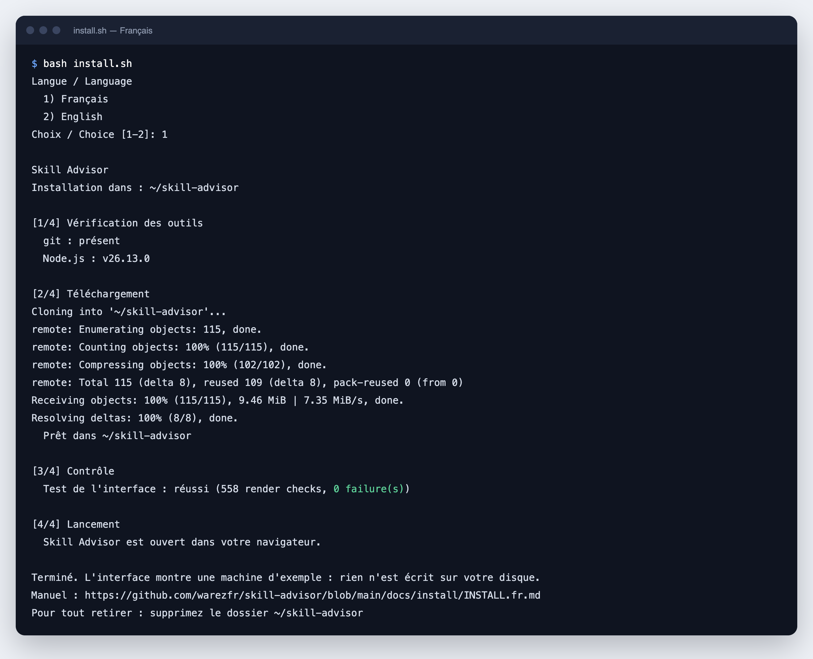
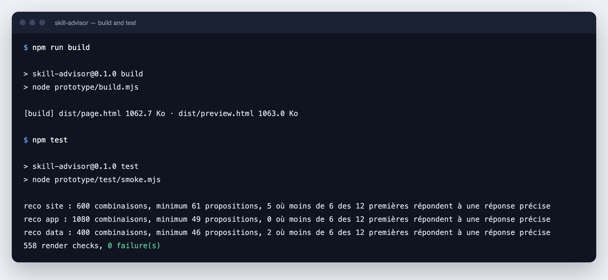
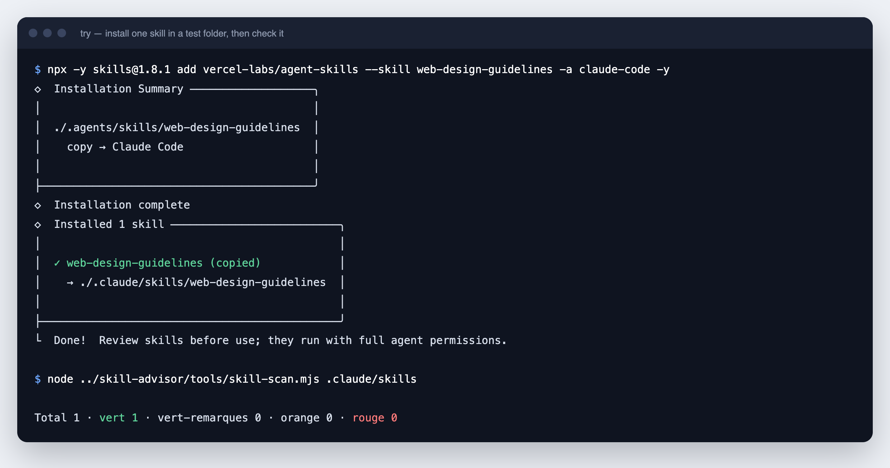

# Manuel d'installation

[English](INSTALL.md) · **Français** · [Español](INSTALL.es.md) · [العربية](INSTALL.ar.md)

Ce manuel vous mène de zéro à un skill vérifié et installé dans votre agent. Chaque étape comporte une action et un résultat attendu. Vous pouvez vous arrêter à n'importe quelle étape : les étapes 1 à 4 demandent seulement un navigateur web.

> [!IMPORTANT]
> Skill Advisor est un prototype. Le script d'installation lance maintenant la vraie application locale : elle lit et modifie les vrais skills de vos agents. La démonstration montre une machine d'exemple et n'écrit rien sur votre disque. Elle reste disponible avec `--demo` (`-Demo` sous Windows). Les étapes 7 et 8 utilisent de vraies commandes qui écrivent de vrais fichiers, et l'étape 9 en écrit avec l'application locale. Chacune de ces étapes le signale. Les captures d'écran de ce manuel montrent encore la démonstration.

## Sommaire

| Étape | Ce que vous faites | Durée | Il faut |
|---|---|---|---|
| 1 | Vérifier ce qu'il vous faut | 2 min | - |
| 2 | Télécharger Skill Advisor | 1 min | Navigateur ou git |
| 3 | Ouvrir la démonstration | 1 min | Navigateur |
| 4 | Parcourir le trajet | 5 min | Navigateur |
| 5 | Construire et tester (facultatif) | 1 min | Node.js |
| 6 | Vérifier un skill | 2 min | Node.js |
| 7 | Essayer un vrai skill dans un dossier de test | 3 min | Node.js, internet |
| 8 | Installer un skill pour tous vos projets | 2 min | Node.js, internet |
| 9 | Sauvegarder un skill et l'appliquer à un autre agent | 5 min | Application locale |

---

## Voie rapide · Le script d'installation

Le script fait les étapes 1 à 3 pour vous : il vérifie vos outils, télécharge Skill Advisor, installe sa seule dépendance et lance l'application locale. Sans Node.js 22.20 ou plus récent et npm, ou avec `--demo`, il ouvre la démonstration à la place. Il demande votre langue, français ou anglais. Il n'installe aucun logiciel système et ne demande aucun droit d'administrateur. Lisez-le avant de le lancer : [install.sh](../../install.sh), [install.ps1](../../install.ps1).

macOS et Linux :

```bash
curl -fsSLO https://raw.githubusercontent.com/warezfr/skill-advisor/main/install.sh
bash install.sh
```

Windows, dans PowerShell :

```powershell
irm https://raw.githubusercontent.com/warezfr/skill-advisor/main/install.ps1 -OutFile install.ps1
powershell -ExecutionPolicy Bypass -File install.ps1
```

L'option `-ExecutionPolicy Bypass` vaut pour ce seul lancement. Elle ne change pas les réglages de votre système.

**Résultat attendu :** cinq étapes numérotées dans le terminal, puis la ligne `Skill Advisor: http://127.0.0.1:<port>/?c=<code>` et l'écran « Ma machine » dans votre navigateur.



*Cette capture montre une version précédente du script, en quatre étapes, qui ouvrait la démonstration.*

| macOS, Linux | Windows | Effet |
|---|---|---|
| `--lang fr`, `--lang en` | `-Lang fr`, `-Lang en` | Choisir la langue sans la question |
| `--dir <dossier>` | `-Dir <dossier>` | Installer dans un autre dossier. Par défaut : `skill-advisor` dans votre dossier personnel |
| `--no-git` | `-NoGit` | Télécharger l'archive même si git est installé |
| `--no-open` | `-NoOpen` | Ne pas ouvrir le navigateur. L'application affiche quand même son adresse |
| `--demo` | `-Demo` | Ouvrir la démonstration seule. Rien n'est installé et l'application ne démarre pas |
| `--no-start` | `-NoStart` | Installer l'application sans la démarrer |

Ce que fait le script :

1. Il regarde si git, Node.js et npm sont présents. Aucun n'est obligatoire : sans Node.js 22.20 ou plus récent et npm, vous obtenez la démonstration.
2. Il télécharge Skill Advisor avec git, ou sous forme d'archive si git est absent.
3. Il installe la seule dépendance, le paquet `skills`, dans le dossier `node_modules`, avec `npm ci --omit=dev --no-audit --no-fund`.
4. Il lance le test de l'interface si Node.js 22 ou plus récent est présent.
5. Il démarre l'application locale avec `node app/server.mjs`. Sans l'application, il ouvre `prototype/dist/preview.html` dans votre navigateur.

Le script a été testé sur macOS, Debian 12 et Windows 11, dans sa version précédente qui ouvrait la démonstration. Relancez-le pour mettre à jour une copie installée avec git. Une copie téléchargée sous forme d'archive, sans git, n'est pas mise à jour par le script : supprimez son dossier, ou choisissez un autre dossier avec `--dir` (`-Dir` sous Windows). Continuez ensuite à l'étape 4. L'étape 4 décrit la démonstration : pour la suivre sans rien écrire, lancez le script avec `--demo`. Dans l'application locale, vos propres skills remplacent les exemples.

---

## L'application locale · Démarrer, utiliser, arrêter

> [!WARNING]
> L'application locale travaille sur votre vraie machine. Ce que vous y installez, supprimez ou désactivez change les dossiers de skills de vos agents, par exemple `~/.claude/skills`.

L'application tourne dans le terminal jusqu'à ce que vous appuyiez sur Ctrl+C. Pour la relancer plus tard, allez dans le dossier d'installation et lancez `npm start`.

macOS et Linux :

```bash
cd ~/skill-advisor
npm start
```

Windows, dans PowerShell :

```powershell
cd $HOME\skill-advisor
npm start
```

**Résultat attendu :** la ligne `Skill Advisor: http://127.0.0.1:<port>/?c=<code>`, puis l'interface dans votre navigateur. Si le navigateur ne s'ouvre pas, copiez-y cette adresse dans les 10 minutes.

Ce que fait l'application :

- **Installer** des skills du catalogue, pour tous vos projets ou pour un seul, dans les agents que vous choisissez.
- **Supprimer** des skills. Avant de supprimer, elle peut garder une sauvegarde dans `~/.skill-advisor/backups`. Vous pouvez restaurer ou effacer chaque sauvegarde.
- **Mettre à jour** des skills. Une mise à jour dont la nouvelle version reçoit le verdict `rouge` est retenue jusqu'à ce que vous la forciez.
- **Désactiver et réactiver** des skills. Un skill désactivé part dans `~/.skill-advisor/disabled` et revient quand vous le réactivez.
- **Gérer 78 agents.** Ajoutez un agent à la main avec son dossier de skills, masquez un agent, videz un agent de ses skills, et choisissez les agents qui reçoivent les installations.

Sécurité :

- L'application écoute sur `127.0.0.1` seulement. Les autres machines ne peuvent pas l'atteindre.
- L'adresse affichée porte un code à usage unique, valable 10 minutes. Une fois utilisé, il n'ouvre plus l'interface : pour la rouvrir, arrêtez l'application avec Ctrl+C et relancez `npm start`. Ne partagez pas cette adresse.
- Rien n'est envoyé ailleurs, sauf les téléchargements des skills depuis GitHub et du catalogue. La télémétrie de l'outil `skills` est coupée. La page charge ses polices depuis Internet.
- Vos réglages sont gardés dans `~/.skill-advisor/settings.json`.

Pour arrêter l'application, appuyez sur Ctrl+C dans son terminal.

---

## Étape 1 · Vérifier ce qu'il vous faut

| Outil | Utile pour | Comment vérifier | Où le trouver |
|---|---|---|---|
| Un navigateur web | Étapes 3 et 4 | - | Déjà sur votre machine |
| Node.js 22 ou plus récent | Étapes 5 à 9. L'application locale, utilisée à l'étape 9, demande 22.20 ou plus récent, avec npm | `node -v` | [nodejs.org](https://nodejs.org) |
| git | Étape 2 (option B). Recommandé pour les étapes 7 et 8 | `git --version` | [git-scm.com](https://git-scm.com) |

Ouvrez un terminal (Terminal sur macOS et Linux, PowerShell sur Windows) et lancez :

```bash
node -v
git --version
```

**Résultat attendu :** deux numéros de version. Le numéro de Node.js commence par 22 ou plus. Les commandes de ce manuel ont été testées avec Node.js 26. Les commandes des étapes 5 à 7 ont été rejouées sur macOS. Les commandes d'installation de l'étape 8 ont été testées sur Windows 11, Linux et macOS.

Pourquoi git est recommandé : sans git, l'installation s'arrête quand GitHub limite les téléchargements anonymes (60 requêtes par heure pour une adresse publique). Avec git, l'installation continue.

## Étape 2 · Télécharger Skill Advisor

Choisissez une option.

**Option A, sans git.** Téléchargez le fichier ZIP et décompressez-le :

<https://github.com/warezfr/skill-advisor/archive/refs/heads/main.zip>

Le dossier décompressé s'appelle `skill-advisor-main`. Renommez-le en `skill-advisor`.

**Option B, avec git.**

```bash
git clone https://github.com/warezfr/skill-advisor.git
```

Entrez ensuite dans le dossier :

```bash
cd skill-advisor
```

**Résultat attendu :** un dossier `skill-advisor` qui contient `prototype`, `catalog`, `tools` et `README.md`.

## Étape 3 · Ouvrir la démonstration

Ouvrez le fichier `prototype/dist/preview.html` dans votre navigateur. Double-cliquez dessus, ou utilisez la commande de votre système.

macOS :

```bash
open prototype/dist/preview.html
```

Windows :

```powershell
start prototype\dist\preview.html
```

Linux :

```bash
xdg-open prototype/dist/preview.html
```

**Résultat attendu :** l'écran « Ma machine ». Le coin en bas à gauche indique « machine d'exemple » : les 50 skills affichés sont des exemples, pas les vôtres.


Remarques :

- La page n'a besoin ni de serveur ni de compte. Elle charge ses polices depuis internet.
- L'interface est en français : vous n'avez rien à traduire.

## Étape 4 · Parcourir le trajet

**4.1 Choisir un objectif.** Cliquez sur « Conseil » dans le menu de gauche, puis sur « Créer un site ».


**4.2 Répondre à quatre questions.** Type de site, technologie, hébergement, besoins. Le panneau de droite se remplit au fil de vos réponses. Cliquez sur « Voir les recommandations ».


**4.3 Lire les recommandations.** Chaque skill a une note sur 100 et une ligne « Pourquoi pour vous ». Cochez les skills que vous voulez. Les skills déjà installés portent la mention « Installé ».


**4.4 Ouvrir le détail d'un skill.** Cliquez sur « Voir le détail ». Vous voyez comment la note est construite : popularité 40, réputation de la source 25, fraîcheur 15, sécurité 20.


**4.5 Vérifier avant d'écrire.** Cliquez sur « Installer 3 skills ». L'écran « Vérifiez avant d'écrire » liste les skills, les agents qui les recevront et la portée : tous les projets ou ce projet seulement.


**4.6 Lire le guide.** Confirmez. Dans la démonstration, rien n'est écrit sur le disque. Dans l'application locale, cette confirmation écrit de vrais fichiers dans les dossiers de vos agents. Le guide explique quand l'agent utilise chaque skill et comment l'appeler.


**4.7 Gérer.** « Mes skills » liste ce qui est installé, avec les mises à jour, les alertes et le coût en contexte. « Agents » montre les agents trouvés sur la machine et l'endroit où chacun garde ses skills.


**4.8 Chercher.** « Recherche » explore toute la base, avec des filtres par type de projet, par installations et par alertes.


**4.9 Essayer les autres états.** Le bouton « Aperçu », en bas à gauche, montre les mêmes écrans dans d'autres états, par exemple sur une machine vide. L'icône de lune passe au thème sombre.


**Résultat attendu :** vous avez vu tout le trajet, de l'objectif jusqu'à un skill installé et géré.

## Étape 5 · Construire et tester (facultatif)

Le fichier `preview.html` est déjà construit. Faites cette étape seulement si vous modifiez les fichiers de `prototype/src/`.

```bash
npm run build
npm test
```

**Résultat attendu :** la construction affiche la taille de deux fichiers, et le test se termine par une ligne de la forme `<n> render checks, 0 failure(s)`.



Ces deux commandes n'installent rien. La construction et le test n'utilisent aucune dépendance.

## Étape 6 · Vérifier un skill

Le contrôle lit les fichiers d'un skill comme du texte et cherche 11 motifs risqués. Il n'exécute jamais le skill. Le dossier `examples/skills` contient deux skills d'exemple : un sûr, un écrit pour échouer.

```bash
node tools/skill-scan.mjs examples/skills
```

**Résultat attendu :** une ligne rouge pour `risky-installer`, et un total de 2 skills : 1 `vert`, 1 `rouge`.


| Verdict | Signification | Ce qu'il faut faire |
|---|---|---|
| `vert` | Aucun motif connu trouvé | Lisez le skill, puis décidez |
| `vert-remarques` (vert avec remarques) | Seulement des constats de gravité faible | Lisez les remarques |
| `orange` | Au moins un constat de gravité moyenne | Lisez chaque constat avant d'installer |
| `rouge` | Un constat de gravité élevée | N'installez pas, sauf si vous comprenez chaque ligne |

Pour voir chaque constat avec son fichier et son numéro de ligne, ajoutez `--json` :

```bash
node tools/skill-scan.mjs examples/skills --json
```

Pour vérifier vos propres skills, donnez le dossier qui contient un sous-dossier par skill. Les skills installés avec l'outil `skills` sont stockés dans `.agents/skills`, dans votre dossier personnel :

```bash
node tools/skill-scan.mjs ~/.agents/skills
```

Sous Windows PowerShell, écrivez `$HOME\.agents\skills` à la place de `~/.agents/skills`.

Le contrôle ignore les dossiers liés. Donnez-lui le dossier qui contient les vrais fichiers.

> [!WARNING]
> Un verdict vert signifie « aucun motif connu trouvé ». Il ne signifie pas « sûr ». Le contrôle ne trouve que les motifs connus.

## Étape 7 · Essayer un vrai skill dans un dossier de test

Cette étape écrit des fichiers, mais seulement dans un dossier de test que vous pouvez supprimer. Elle utilise [`skills`](https://skills.sh), l'outil open source en ligne de commande sur lequel Skill Advisor s'appuie pour installer.

Créez un dossier de test à côté de `skill-advisor` et entrez-y :

```bash
mkdir ../try
cd ../try
```

Installez un skill pour ce dossier seulement, puis vérifiez-le :

```bash
npx -y skills@1.8.1 add vercel-labs/agent-skills --skill web-design-guidelines -a claude-code -y
node ../skill-advisor/tools/skill-scan.mjs .claude/skills
```

**Résultat attendu :** le skill est copié dans `.claude/skills/web-design-guidelines`, à l'intérieur du dossier de test, et le contrôle affiche `Total 1 · vert 1`.



Ce que signifient les options :

| Option | Signification |
|---|---|
| `vercel-labs/agent-skills` | Le dépôt GitHub qui contient le skill |
| `--skill web-design-guidelines` | Le skill à installer depuis ce dépôt |
| `-a claude-code` | L'agent qui le reçoit. Autres valeurs : `cursor`, `gemini-cli` |
| `-y` | Ne pas demander de confirmation |

Pour trouver le dépôt et le nom d'un skill, ouvrez [catalog/CATALOGUE.md](../../catalog/CATALOGUE.md) : chaque ligne donne le skill et sa source.

Pour tout retirer de cette étape, supprimez le dossier `try`.

## Étape 8 · Installer un skill pour tous vos projets

> [!WARNING]
> Cette étape écrit dans vos vrais dossiers d'agent, par exemple `~/.claude/skills`. Faites-la seulement pour un skill que vous avez vérifié à l'étape 7.

Ajoutez `-g` (global) pour installer pour tous vos projets :

```bash
npx -y skills@1.8.1 add vercel-labs/agent-skills --skill web-design-guidelines -g -a claude-code -y
```

Les quatre commandes dont vous avez besoin ensuite :

| Action | Commande |
|---|---|
| Lister ce qui est installé | `npx -y skills@1.8.1 list -g` |
| Chercher des mises à jour | `npx -y skills@1.8.1 check -g` |
| Tout mettre à jour | `npx -y skills@1.8.1 update -g -y` |
| Supprimer un skill | `npx -y skills@1.8.1 remove --skill web-design-guidelines -g -y` |

**Résultat attendu :** `list -g` affiche `web-design-guidelines`. Redémarrez votre agent pour qu'il relise son dossier de skills.

Où vont les fichiers : le skill est stocké une seule fois dans `~/.agents/skills/`, et le dossier de votre agent y pointe. Sur macOS et Linux, le pointeur est un lien symbolique. Sur Windows, c'est une jonction.

## Étape 9 · Sauvegarder un skill et l'appliquer à un autre agent

> [!WARNING]
> Cette étape utilise l'application locale sur votre vraie machine. Appliquer une sauvegarde écrit dans vos vrais dossiers d'agent.

Lancez l'application locale, comme le décrit « L'application locale » plus haut. Skill Advisor garde les sauvegardes dans `~/.skill-advisor/backups`.

**9.1 Faire une sauvegarde.** Choisissez un ou plusieurs skills installés pour tous vos projets et faites-en une sauvegarde. Ajoutez un titre et une note si vous le voulez : 80 et 500 caractères au plus. La sauvegarde contient une copie de chaque skill, les agents qui l'utilisaient et le verdict de son contrôle de sécurité.

**9.2 L'exporter.** Exportez la sauvegarde. Vous obtenez un seul fichier nommé `skill-advisor-<id>.tar.gz`. Copiez-le sur l'autre machine, par exemple avec une clé USB.

**9.3 L'importer.** Sur l'autre machine, lancez Skill Advisor et importez ce fichier. Skill Advisor vérifie de nouveau chaque skill et les range dans une nouvelle sauvegarde. Skill Advisor n'installe encore rien. L'import refuse un fichier qui contient autre chose que des fichiers et des dossiers, un chemin qui sort de la sauvegarde, plus de 200 Mo ou plus de 100 000 entrées. Il refuse aussi un fichier sans manifeste Skill Advisor valide ou avec un nom de skill invalide.

**9.4 L'appliquer à un autre agent.** Choisissez des skills de la sauvegarde et les agents qui les reçoivent. Tout agent connu convient, de même qu'un agent ajouté à la main, pas seulement les agents de la sauvegarde. Choisissez ensuite ce qui se passe quand un agent a déjà le skill :

| Ce que l'agent contient | Passer | Remplacer |
|---|---|---|
| Rien | Skill Advisor copie le skill | Skill Advisor copie le skill |
| Le même contenu | Rien ne change | Rien ne change |
| Une autre version | Elle reste en place | Skill Advisor la sauvegarde, puis la remplace |

Skill Advisor applique un skill dont le verdict est `rouge` seulement après votre confirmation.

Où vont les fichiers : Skill Advisor copie le skill dans `~/.agents/skills/<name>`. Les agents qui ont leur propre dossier y pointent avec un lien, une jonction sur Windows. Un agent ajouté à la main reçoit sa propre copie. Quand la source du skill est connue, Skill Advisor réécrit aussi son entrée dans le fichier de verrouillage de l'outil `skills`.

**Résultat attendu :** le skill apparaît dans l'agent choisi, dans « Mes skills ». Chaque version remplacée a sa propre nouvelle sauvegarde. Redémarrez l'agent pour qu'il relise son dossier de skills.

---

## En cas de problème

| Ce que vous voyez | Cause | Ce qu'il faut faire |
|---|---|---|
| `node: command not found` | Node.js n'est pas installé | Installez-le depuis [nodejs.org](https://nodejs.org), puis ouvrez un nouveau terminal |
| `[SKILLS_GIT_CLONE_FAILED] ... spawn git ENOENT` | GitHub a limité les téléchargements anonymes et git n'est pas installé | Installez git, ou attendez une heure et recommencez |
| `skill-scan.mjs` affiche `ENOENT ... scandir` | Le dossier donné n'existe pas | Donnez un dossier qui contient un sous-dossier par skill |
| Sur Windows, l'installateur indique « symlinked » | L'outil emploie un seul mot pour les deux types de lien | Rien à faire : il a créé une jonction, qui fonctionne sans droits d'administrateur |
| `npm a échoué` à l'étape 3 du script | npm n'atteint pas son registre | Vérifiez la connexion à Internet et relancez le script. En attendant, le script ouvre la démonstration |
| `trop ancien (22.20 ou plus récent requis pour l'application)` | Node.js est plus ancien que 22.20 | Installez un Node.js plus récent depuis [nodejs.org](https://nodejs.org), puis relancez le script |
| Le terminal n'affiche plus rien après l'adresse | L'application tourne | C'est normal. Appuyez sur Ctrl+C pour l'arrêter |

## Supprimer Skill Advisor

Skill Advisor n'installe rien sur votre système. Supprimez le dossier `skill-advisor` et le dossier `~/.skill-advisor`, qui garde les réglages, les sauvegardes et les skills désactivés de l'application locale. Réactivez d'abord vos skills désactivés, sinon ils sont effacés avec ce dossier. Exportez les sauvegardes que vous voulez garder (étape 9). Les skills installés à l'étape 8 ou avec l'application restent en place : retirez-les avec la commande `remove` de l'étape 8 ou dans l'application.

---

[Retour au README](../../README.fr.md) · Site web : [span.observer](https://span.observer)
