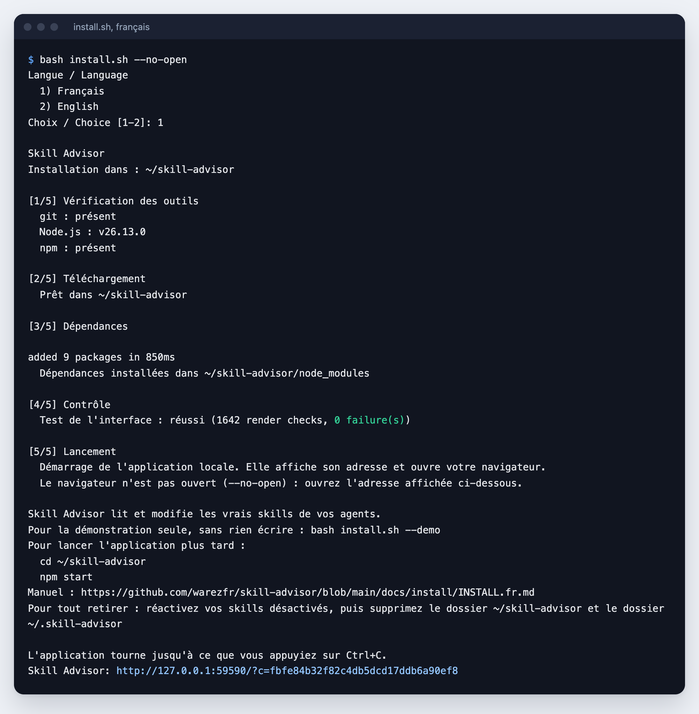
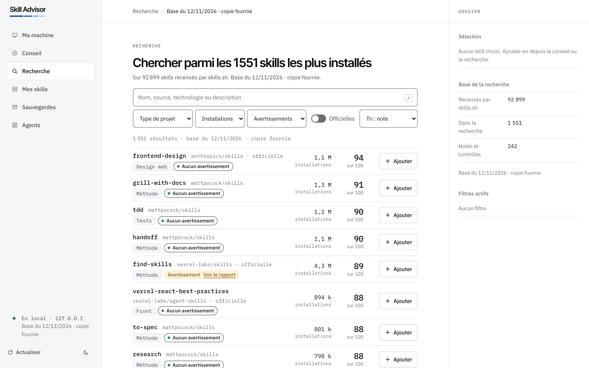

# Manuel d'installation

[English](INSTALL.md) · **Français** · [Español](INSTALL.es.md) · [العربية](INSTALL.ar.md)

Ce manuel vous mène de rien à un skill contrôlé et installé dans vos agents, puis à travers chaque écran de Skill Advisor 1.0. Chaque étape a une action et un résultat attendu.

> [!WARNING]
> Skill Advisor travaille sur votre vraie machine. Ce que vous y installez, mettez à jour, désactivez ou désinstallez modifie les dossiers de skills de vos agents, par exemple `~/.claude/skills` et `~/.agents/skills`. Chaque étape qui écrit le dit.

## Sommaire

| Étape | Ce que vous faites | Durée | Besoin |
|---|---|---|---|
| 1 | Vérifier ce qu'il vous faut | 2 min | Terminal |
| 2 | Installer Skill Advisor | 2 min | Node.js, Internet |
| 3 | Lancer l'application | 1 min | Node.js |
| 4 | Lire « Ma machine » | 1 min | Navigateur |
| 5 | Obtenir un conseil et installer un skill | 5 min | Internet |
| 6 | Gérer vos skills | 3 min | - |
| 7 | Sauvegarder, exporter, importer et appliquer | 5 min | - |
| 8 | Gérer vos agents | 3 min | - |
| 9 | Chercher dans la base | 2 min | - |
| 10 | Contrôler un skill depuis le terminal | 2 min | Node.js |

L'interface est en français. Chaque étape reprend les noms tels qu'ils s'affichent à l'écran.

---

## Voie rapide · Le script d'installation

Le script fait les étapes 1 à 3 pour vous : il vérifie vos outils, télécharge Skill Advisor, installe ses dépendances, lance les tests et démarre l'application. Il vous demande votre langue, français ou anglais. Il n'installe aucun logiciel système et ne demande aucun droit d'administrateur. Lisez-le avant de le lancer : [install.sh](../../install.sh), [install.ps1](../../install.ps1).

macOS et Linux :

```bash
curl -fsSLO https://raw.githubusercontent.com/warezfr/skill-advisor/main/install.sh
bash install.sh
```

Windows, dans PowerShell :

```powershell
irm https://raw.githubusercontent.com/warezfr/skill-advisor/main/install.ps1 -OutFile install.ps1
powershell -ExecutionPolicy Bypass -File install.ps1
```

L'option `-ExecutionPolicy Bypass` vaut pour ce seul lancement. Elle ne change pas les réglages de votre système.

**Résultat attendu :** cinq étapes numérotées dans le terminal, puis la ligne `Skill Advisor: http://127.0.0.1:<port>/?c=<code>` et l'écran « Ma machine » dans votre navigateur. L'application continue de tourner dans ce terminal. Passez à l'étape 4.



*Ici, le script a été lancé avec `--no-open` : le navigateur ne s'est pas ouvert, et l'adresse est affichée à la fin.*

| macOS, Linux | Windows | Effet |
|---|---|---|
| `--lang fr`, `--lang en` | `-Lang fr`, `-Lang en` | Choisir la langue sans la question |
| `--dir <dossier>` | `-Dir <dossier>` | Installer dans un autre dossier. Par défaut : `skill-advisor` dans votre dossier personnel |
| `--no-git` | `-NoGit` | Télécharger l'archive même quand git est installé |
| `--no-open` | `-NoOpen` | Ne pas ouvrir le navigateur. L'application affiche quand même son adresse |
| `--no-start` | `-NoStart` | Installer l'application sans la lancer |
| `--demo` | `-Demo` | Ouvrir seulement la démonstration : une machine d'exemple. Aucune dépendance n'est installée et rien n'est écrit dans vos agents |

Ce que fait le script :

1. Il vérifie si git, Node.js et npm sont présents. L'application demande Node.js 22.20 ou plus récent, avec npm. git est facultatif.
2. Il télécharge Skill Advisor avec git, ou en archive quand git est absent.
3. Il installe les dépendances, les paquets `skills` et `tar`, dans le dossier `node_modules`, avec `npm ci --omit=dev --no-audit --no-fund`.
4. Il lance les tests avec `npm test` quand les dépendances sont installées. Sinon, il lance seulement le test de l'interface.
5. Il démarre l'application avec `node app/server.mjs`.

Sans Node.js 22.20 ou plus récent et npm, le script ne peut pas démarrer l'application. Il ouvre la démonstration à la place, et vous dit où trouver Node.js.

---

## Étape 1 · Vérifier ce qu'il vous faut

| Outil | Sert à | Comment vérifier | Où le trouver |
|---|---|---|---|
| Node.js 22.20 ou plus récent, avec npm | L'application | `node -v`, `npm -v` | [nodejs.org](https://nodejs.org) |
| git | Facultatif. Des mises à jour de Skill Advisor plus simples, et des installations qui continuent quand GitHub limite les téléchargements anonymes | `git --version` | [git-scm.com](https://git-scm.com) |
| Un navigateur web | L'interface | - | Déjà sur votre machine |

Ouvrez un terminal (Terminal sous macOS et Linux, PowerShell sous Windows) et lancez :

```bash
node -v
npm -v
git --version
```

**Résultat attendu :** trois numéros de version. Celui de Node.js vaut v22.20 ou plus, par exemple `v26.13.0`.

## Étape 2 · Installer Skill Advisor

Utilisez le script de la voie rapide, ou installez à la main :

```bash
git clone https://github.com/warezfr/skill-advisor.git
cd skill-advisor
npm ci --omit=dev
```

Sans git, téléchargez <https://github.com/warezfr/skill-advisor/archive/refs/heads/main.zip>, décompressez-le, renommez le dossier `skill-advisor-main` en `skill-advisor`, entrez-y et lancez `npm ci --omit=dev`.

**Résultat attendu :** un dossier `skill-advisor` qui contient `app`, `prototype`, `catalog`, `tools`, `node_modules` et `README.md`. npm affiche une ligne de la forme `added 9 packages`.

## Étape 3 · Lancer l'application

macOS et Linux :

```bash
cd ~/skill-advisor
npm start
```

Windows, dans PowerShell :

```powershell
cd $HOME\skill-advisor
npm.cmd start
```

Sous Windows, lancez `npm.cmd start` : la stratégie d'exécution par défaut de PowerShell peut refuser `npm start`, car elle bloque `npm.ps1`. Si vous avez installé à la main à l'étape 2, allez dans le dossier `skill-advisor` créé par `git clone`, là où vous l'avez lancé.

**Résultat attendu :** la ligne `Skill Advisor: http://127.0.0.1:<port>/?c=<code>`, puis l'interface dans votre navigateur. Si le navigateur ne s'ouvre pas, copiez cette adresse dedans dans les 10 minutes.

À propos de cette adresse :

- Elle marche une fois. L'onglet qui l'a ouverte garde la session, et le recharger marche encore.
- Un autre onglet, ou la même adresse utilisée de nouveau, affiche « Session expirée ». Arrêtez l'application avec Ctrl+C et relancez `npm start` : vous obtenez une nouvelle adresse.
- L'application écoute sur `127.0.0.1` seulement. Les autres machines ne peuvent pas l'atteindre. Ne partagez pas cette adresse.

Pour arrêter l'application, appuyez sur Ctrl+C dans son terminal. Les options de `npm start` sont plus bas, dans « Options de l'application ».

## Étape 4 · Lire « Ma machine »

« Ma machine » compte vos skills et vos agents, les mises à jour disponibles, les skills à relire et le contexte qu'ils coûtent. « Ce qui demande votre attention » liste ce qu'il faut regarder d'abord. Le volet de droite liste les agents qui ont des skills.


Le bas du menu indique « En local · 127.0.0.1 » et la date de la base. « Actualiser » relit vos dossiers. L'application le fait aussi quand vous revenez sur sa fenêtre.

**Résultat attendu :** les skills que vos agents ont déjà, y compris ceux que vous avez copiés à la main (« copie manuelle »).

## Étape 5 · Obtenir un conseil et installer un skill

> [!WARNING]
> L'étape 5.4 écrit dans les vrais dossiers de vos agents.

**5.1 Choisir un objectif.** Cliquez sur « Conseil » dans le menu de gauche. Choisissez un des 17 objectifs, par exemple « Créer un site ».


**5.2 Répondre aux questions.** Pour un site : type de site, technologie, hébergement, besoins. Le volet de droite se remplit au fil des réponses. Cliquez sur « Voir les recommandations ».


**5.3 Lire les recommandations.** Chaque skill a une note sur 100 et une ligne « Pourquoi pour vous ». Les meilleurs sont cochés. Décochez ce que vous ne voulez pas. « Voir le détail » explique la note : popularité 40, réputation de la source 25, fraîcheur 15, sécurité 20. Cliquez sur « Installer ».


**5.4 Vérifier avant d'écrire.** L'écran « Vérifiez avant d'écrire » liste les skills, les agents qui les reçoivent, les dossiers qui seront créés et la portée : « Tous les projets » ou « Ce projet seulement ». Pour un projet, donnez son dossier dans le champ « Dossier du projet ». Cliquez sur « Installer 1 skill dans 4 agents », ou le même bouton avec vos nombres.


Où vont les fichiers :

- Avec le « Dossier partagé » activé, le skill va dans `~/.agents/skills/<nom>`. Les agents qui lisent ce dossier le voient tout de suite ; l'écran les nomme, par exemple « Lu par Cursor, Gemini CLI ». Chaque autre agent choisi reçoit un lien vers lui, une jonction sous Windows.
- Avec le dossier partagé désactivé, chaque agent choisi reçoit sa propre copie, et rien n'est écrit dans le dossier partagé.

Ce qui peut arrêter un skill :

| Ce qui arrive | Ce que vous voyez | Ce que vous pouvez faire |
|---|---|---|
| Le contrôle trouve un motif à risque élevé | Le skill est retenu : rien n'est écrit pour lui | Lisez le rapport. « Installer malgré l'avertissement » l'installe |
| Un skill du même nom est déjà là, copié à la main ou venu d'une autre source | Un conflit : rien n'est écrit pour lui | « Garder l'existant », ou « Remplacer (une sauvegarde est faite) » |
| Pas de connexion, limite de GitHub, source introuvable | Un message en français dit laquelle | Vérifiez la connexion, ou attendez puis réessayez |

**5.5 Lire le guide.** Après l'installation, le guide dit quand l'agent se sert de chaque skill et comment l'appeler. Il reste disponible dans « Mes skills ».

**Résultat attendu :** le skill apparaît dans « Mes skills » avec l'état « À jour ». Relancez votre agent pour qu'il relise son dossier de skills.

## Étape 6 · Gérer vos skills

« Mes skills » liste chaque skill, avec ses agents, son état, le résultat de son contrôle et son coût en contexte. Cliquez sur le nom d'un skill pour ouvrir son détail.


- **Mettre à jour.** Cliquez sur « Rechercher les mises à jour ». Pour un skill qui a une mise à jour, « Ce qui change » liste les fichiers ajoutés, retirés et modifiés, et le contrôle de la nouvelle version. Cliquez ensuite sur « Mettre à jour ». Une nouvelle version qui contient un motif à risque élevé est retenue jusqu'à ce que vous la forciez. Après la mise à jour, les mêmes agents voient le skill.
- **Désactiver et activer.** L'interrupteur de la colonne « Actif » range le skill dans `~/.skill-advisor/disabled` et l'en ressort. Un skill désactivé reste sur le disque, mais l'agent ne le charge plus.
- **Désinstaller.** « Désinstaller » demande une confirmation. La case « Garder une sauvegarde » est cochée par défaut.
- **Plusieurs à la fois.** Cochez plusieurs skills : la barre propose « Désactiver », « Activer », « Sauvegarder » et « Désinstaller ».

Un skill copié à la main (« copie manuelle ») n'est pas mis à jour : pour le mettre à jour, réinstallez-le depuis sa source. Un skill installé pour un projet est affiché, mais vous le gérez depuis le dossier du projet.

**Résultat attendu :** chaque action modifie les dossiers de vos agents, et la liste montre le nouvel état.

## Étape 7 · Sauvegarder, exporter, importer et appliquer

> [!WARNING]
> Restaurer et appliquer une sauvegarde écrivent dans les vrais dossiers de vos agents.

**7.1 Faire une sauvegarde.** Dans « Mes skills », cochez un ou plusieurs skills et cliquez sur « Sauvegarder ». Ajoutez un nom et une note si vous voulez : 80 et 500 caractères au plus. Une désinstallation avec « Garder une sauvegarde » fait aussi une sauvegarde.

**7.2 Lire vos sauvegardes.** « Sauvegardes » les liste, de la plus récente à la plus ancienne, avec leur date, leur origine, leur taille, leurs skills et les résultats de leurs contrôles. Elles sont gardées dans `~/.skill-advisor/backups`.


**7.3 Restaurer.** « Restaurer » remet chaque copie d'où elle vient. Quand quelque chose est déjà à un de ces endroits, rien n'est écrit. Un skill qui contient un motif à risque demande « Restaurer malgré tout ».

**7.4 Exporter et importer.** « Exporter » enregistre la sauvegarde en un seul fichier nommé `skill-advisor-<id>.tar.gz`. Sur une autre machine, « Importer une sauvegarde » lit ce fichier, contrôle de nouveau chaque skill et le range dans une nouvelle sauvegarde. Rien n'est encore installé. L'import refuse un fichier qui contient autre chose que des fichiers et des dossiers, un chemin qui sort de la sauvegarde, plus de 200 Mo ou plus de 100 000 entrées, un fichier sans manifeste Skill Advisor valide, ou un nom de skill invalide.

**7.5 Appliquer à d'autres agents.** « Appliquer à d'autres agents » ouvre un volet. Choisissez les skills, puis les agents : les agents détectés, le dossier partagé, ou tout autre agent connu, trouvé par son nom. Choisissez ensuite ce qui se passe quand un agent a déjà le skill.


| Ce que l'agent contient | « Passer » | « Remplacer » |
|---|---|---|
| Rien | Le skill est copié | Le skill est copié |
| Le même contenu | Rien ne change | Rien ne change |
| Une autre version | Elle reste en place | Elle est sauvegardée, puis remplacée |

Un skill qui contient un motif à risque n'est appliqué que si vous cochez « Appliquer malgré l'avertissement ».

**Résultat attendu :** un message comme `safe-notes : 1 application faite, 0 passée, 0 échec`. Le skill apparaît dans les agents choisis, dans « Mes skills ». Chaque version remplacée a sa propre nouvelle sauvegarde.

## Étape 8 · Gérer vos agents

« Agents » liste les 78 agents que Skill Advisor connaît. Les filtres montrent « Tous », « Détectés », « Ciblés » et « Masqués ».


- **Cibles.** Les interrupteurs choisissent les agents qui reçoivent les installations. Le dossier partagé tient sur une ligne, avec les agents qui le lisent.
- **Ajouter un agent à la main.** « Ajouter un agent » : donnez un nom et le chemin complet de son dossier de skills. Cet agent reçoit sa propre copie de chaque skill. Il ne peut pas recevoir une installation pour un seul projet.
- **Masquer un agent.** « Actions », puis « Masquer ». « Afficher » le fait revenir.
- **Vider un agent.** « Actions », puis « Retirer tous ses skills », avec une sauvegarde au choix. Pour un agent qui lit le dossier partagé, l'application nomme tous les agents qui le lisent et propose « Retirer du dossier partagé pour tous ces agents ».
- **Dossier du projet.** Le champ « Dossier du projet » est aussi sur cet écran.

**Résultat attendu :** le filtre « Tous » compte les 78 agents connus.

## Étape 9 · Chercher dans la base

« Recherche » cherche parmi les 1 551 skills les plus installés des 92 899 recensés par skills.sh, avec des filtres par type de projet, installations et avertissements. La barre de titre montre la date et la source de la base : « Base du 12/11/2026 · copie fournie » désigne la copie livrée avec Skill Advisor. « Ajouter » met un skill dans votre sélection, prêt pour l'étape 5.4.



Le bouton en forme de lune, en bas à gauche, passe au thème sombre. Skill Advisor retient votre choix.


## Étape 10 · Contrôler un skill depuis le terminal

L'application lance ce contrôle pour vous. Vous pouvez aussi le lancer vous-même, depuis le dossier `skill-advisor`. Il lit les fichiers d'un skill comme du texte et cherche 11 motifs à risque. Il n'exécute jamais le skill. Le dossier `examples/skills` contient deux skills d'exemple : un sain, un écrit pour échouer.

```bash
node tools/skill-scan.mjs examples/skills
```

**Résultat attendu :** une ligne rouge pour `risky-installer`, et le total `Total 2 · vert 1 · vert-remarques 0 · orange 0 · rouge 1`.


| Verdict | Dans l'interface | Que faire |
|---|---|---|
| `vert` | Aucun motif connu | Lisez le skill, puis décidez |
| `vert-remarques` | Remarques | Lisez les remarques |
| `orange` | À regarder | Lisez chaque constat avant d'installer |
| `rouge` | Motif à risque | N'installez pas sans comprendre chaque ligne |

Pour voir chaque constat avec son fichier et son numéro de ligne, ajoutez `--json` :

```bash
node tools/skill-scan.mjs examples/skills --json
```

Pour contrôler les skills du dossier partagé :

```bash
node tools/skill-scan.mjs ~/.agents/skills
```

Dans PowerShell sous Windows, écrivez `$HOME\.agents\skills` à la place de `~/.agents/skills`. Le contrôle saute les dossiers liés : donnez-lui le dossier qui contient les vrais fichiers.

> [!WARNING]
> Un verdict vert veut dire « aucun motif connu trouvé ». Il ne veut pas dire « sans risque ». Le contrôle ne trouve que des motifs connus.

---

## Options de l'application

Passez-les après `npm start --`, par exemple `npm start -- --no-open --port 4317`.

| Option | Effet |
|---|---|
| `--port <n>` | Écouter sur ce port. Sans elle, le système choisit un port libre |
| `--no-open` | Ne pas ouvrir le navigateur. L'adresse est quand même affichée |
| `--project <dossier>` | Prendre ce dossier comme dossier du projet |
| `--home <dossier>` | Pour les tests seulement : prendre ce dossier comme dossier personnel |
| `--version` | Afficher la version, puis s'arrêter |
| `--help` | Afficher l'aide, puis s'arrêter |

## Lancer les tests

Les tests demandent les dépendances, installées par `npm ci`. Le script et l'étape 2 les installent déjà. Sous Windows, écrivez `npm.cmd` à la place de `npm`.

```bash
npm ci
npm test
npm run test:e2e
```

`npm test` lance toutes les suites par `test/run-all.mjs`, sans réseau : le serveur et sa bibliothèque, l'interface, et la vérification que `prototype/dist` correspond à ses sources. Les tests utilisent des dossiers jetables dans le dossier temporaire du système, jamais les dossiers de vos agents. Sans git, les tests qui en ont besoin sont sautés.

`npm run test:e2e` lance les essais de bout en bout dans un navigateur sans fenêtre. Il demande Chrome ou Chromium. S'il n'est pas trouvé, donnez son chemin dans la variable `CHROME_PATH`. Sans navigateur, ces essais sont sautés.

**Résultat attendu :** `npm test` se termine par un bloc `=== Bilan ===` : une ligne par suite, `réussi` ou `ÉCHEC`, avec sa durée.

## Arrêter, mettre à jour, désinstaller

**Arrêter.** Appuyez sur Ctrl+C dans le terminal où tourne l'application.

**Mettre à jour.** Relancez le script d'installation. Une copie installée avec git est mise à jour avec `git pull`. Une copie installée sans git est gardée telle quelle, et le script le dit : supprimez d'abord le dossier `skill-advisor`, puis lancez le script, ou installez dans un autre dossier avec `--dir` (`-Dir` sous Windows). Vos réglages et vos sauvegardes, dans `~/.skill-advisor`, restent.

**Désinstaller.** Skill Advisor n'installe rien sur votre système.

1. Réactivez vos skills désactivés, sinon ils sont supprimés avec `~/.skill-advisor`.
2. Exportez les sauvegardes que vous voulez garder (étape 7.4).
3. Désinstallez les skills dont vous ne voulez plus (étape 6). Les autres restent dans vos agents.
4. Supprimez le dossier d'installation et le dossier `~/.skill-advisor`. Sous macOS et Linux :

```bash
rm -rf ~/skill-advisor ~/.skill-advisor
```

Sous Windows, supprimez les dossiers `skill-advisor` et `.skill-advisor` de votre profil utilisateur.

## En cas de problème

| Ce que vous voyez | Cause | Que faire |
|---|---|---|
| `node: command not found` | Node.js n'est pas installé | Installez-le depuis [nodejs.org](https://nodejs.org), puis ouvrez un nouveau terminal |
| `trop ancien (22.20 ou plus récent requis pour l'application)` | Node.js est plus ancien que 22.20 | Installez un Node.js plus récent, puis relancez le script |
| `npm a échoué` à l'étape 3 du script | npm ne joint pas son registre | Vérifiez la connexion à Internet et relancez le script |
| PowerShell refuse `npm start` | La stratégie d'exécution bloque `npm.ps1` | Lancez `npm.cmd start` |
| « Session expirée » | L'adresse a déjà servi, ou date de plus de 10 minutes | Appuyez sur Ctrl+C, relancez `npm start` et ouvrez la nouvelle adresse |
| `Le port <n> est déjà pris` | Un autre programme utilise ce port | Choisissez-en un autre avec `--port`, ou retirez l'option |
| Le terminal n'affiche plus rien après l'adresse | L'application tourne | C'est normal. Appuyez sur Ctrl+C pour l'arrêter |
| Une installation s'arrête sur une limite de GitHub | GitHub limite les téléchargements anonymes | Installez git, ou attendez une heure et réessayez |
| `Dossier introuvable` avec `skill-scan.mjs` | Le dossier donné n'existe pas | Donnez un dossier qui contient un sous-dossier par skill |

## Signaler un problème

Signalez les bogues dans les [tickets GitHub](https://github.com/warezfr/skill-advisor/issues). Pour un problème de sécurité, n'ouvrez pas de ticket public : ouvrez un [avis de sécurité privé](https://github.com/warezfr/skill-advisor/security/advisories/new).

---

[Retour au README](../../README.fr.md) · Site : [span.observer](https://span.observer)
