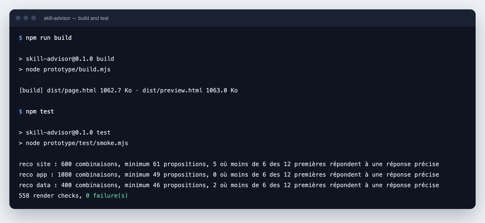
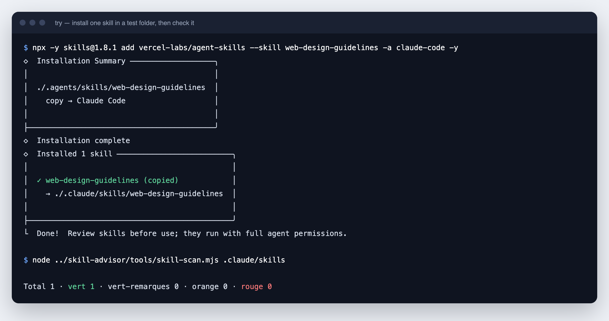

# Installation manual

**English** · [Français](INSTALL.fr.md) · [Español](INSTALL.es.md) · [العربية](INSTALL.ar.md)

This manual takes you from nothing to a checked skill installed in your agent. Each step has one action and one expected result. Stop at any step: steps 1 to 4 need only a web browser.

> [!IMPORTANT]
> Skill Advisor is a prototype. The interface shows an example machine and writes nothing to your disk. Steps 7 and 8 use real commands that write real files. Each of those steps says so.

## Contents

| Step | What you do | Time | Needs |
|---|---|---|---|
| 1 | Check what you need | 2 min | - |
| 2 | Download Skill Advisor | 1 min | Browser or git |
| 3 | Open the demonstration | 1 min | Browser |
| 4 | Walk through the journey | 5 min | Browser |
| 5 | Build and test (optional) | 1 min | Node.js |
| 6 | Check a skill | 2 min | Node.js |
| 7 | Try a real skill in a test folder | 3 min | Node.js, internet |
| 8 | Install a skill for all your projects | 2 min | Node.js, internet |

---

## Step 1 · Check what you need

| Tool | Needed for | How to check | Where to get it |
|---|---|---|---|
| A web browser | Steps 3 and 4 | - | Already on your machine |
| Node.js 22 or later | Steps 5 to 8 | `node -v` | [nodejs.org](https://nodejs.org) |
| git | Step 2 (option B). Recommended for steps 7 and 8 | `git --version` | [git-scm.com](https://git-scm.com) |

Open a terminal (Terminal on macOS and Linux, PowerShell on Windows) and run:

```bash
node -v
git --version
```

**Expected result:** two version numbers. The Node.js number starts with 22 or more. The commands in this manual were tested with Node.js 26. The commands of steps 5 to 7 were replayed on macOS. The installation commands of step 8 were tested on Windows 11, Linux and macOS.

Why git is recommended: without git, an installation stops when GitHub limits anonymous downloads (60 requests per hour for one public address). With git, the installation continues.

## Step 2 · Download Skill Advisor

Choose one option.

**Option A, without git.** Download the ZIP file and unpack it:

<https://github.com/warezfr/skill-advisor/archive/refs/heads/main.zip>

The unpacked folder is named `skill-advisor-main`. Rename it to `skill-advisor`.

**Option B, with git.**

```bash
git clone https://github.com/warezfr/skill-advisor.git
```

Then enter the folder:

```bash
cd skill-advisor
```

**Expected result:** a folder `skill-advisor` that contains `prototype`, `catalog`, `tools` and `README.md`.

## Step 3 · Open the demonstration

Open the file `prototype/dist/preview.html` in your browser. Double-click it, or use the command for your system.

macOS:

```bash
open prototype/dist/preview.html
```

Windows:

```powershell
start prototype\dist\preview.html
```

Linux:

```bash
xdg-open prototype/dist/preview.html
```

**Expected result:** the screen "Ma machine" (My machine). The bottom-left corner says "machine d'exemple" (example machine): the 50 skills shown are examples, not yours.


Notes:

- The page needs no server and no account. It loads its fonts from the internet.
- The interface is in French for now. Step 4 gives the English name of each screen.

## Step 4 · Walk through the journey

**4.1 Choose a goal.** Click "Conseil" (Advice) in the left menu, then "Créer un site" (Create a website).


**4.2 Answer four questions.** Type of site, technology, hosting, needs. The panel on the right fills in as you answer. Click "Voir les recommandations" (See the recommendations).


**4.3 Read the recommendations.** Each skill has a score out of 100 and a line "Pourquoi pour vous" (Why for you). Tick the skills you want. Skills that are already installed are marked "Installé".


**4.4 Open the detail of a skill.** Click "Voir le détail" (See the detail). You see how the score is built: popularity 40, reputation of the source 25, freshness 15, security 20.


**4.5 Verify before writing.** Click "Installer 3 skills". The screen "Vérifiez avant d'écrire" (Verify before writing) lists the skills, the agents that will receive them and the scope: all projects or this project only.


**4.6 Read the guide.** Confirm. In the prototype nothing is written to disk. The guide explains when the agent uses each skill and how to call it.


**4.7 Manage.** "Mes skills" (My skills) lists what is installed, with updates, warnings and the cost in context. "Agents" shows the agents found on the machine and where each one keeps its skills.


**4.8 Search.** "Recherche" (Search) looks in the whole base, with filters by project type, installs and warnings.


**4.9 Try the other states.** The button "Aperçu" (Preview), bottom left, shows the same screens in other states, for example on an empty machine. The moon icon switches to the dark theme.


**Expected result:** you have seen the full journey, from a goal to an installed and managed skill.

## Step 5 · Build and test (optional)

The file `preview.html` is already built. Do this step only if you change the files in `prototype/src/`.

```bash
npm run build
npm test
```

**Expected result:** the build prints the size of two files, and the test ends with `558 render checks, 0 failure(s)`.



These two commands install nothing: the project has no dependency.

## Step 6 · Check a skill

The check reads the files of a skill as text and looks for 11 risky patterns. It never runs the skill. The folder `examples/skills` holds two example skills: one safe, one written to fail.

```bash
node tools/skill-scan.mjs examples/skills
```

**Expected result:** one red line for `risky-installer`, and a total of 2 skills: 1 `vert`, 1 `rouge`.


| Verdict | Meaning | What to do |
|---|---|---|
| `vert` (green) | No known pattern found | Read the skill, then decide |
| `vert-remarques` (green with notes) | Low-severity findings only | Read the notes |
| `orange` | At least one medium-severity finding | Read each finding before you install |
| `rouge` (red) | A high-severity finding | Do not install unless you understand every line |

To see every finding with its file and line number, add `--json`:

```bash
node tools/skill-scan.mjs examples/skills --json
```

To check your own skills, give the folder that contains one sub-folder per skill. Skills installed with the `skills` tool are stored in `.agents/skills` in your home folder:

```bash
node tools/skill-scan.mjs ~/.agents/skills
```

On Windows PowerShell, write `$HOME\.agents\skills` in place of `~/.agents/skills`.

The check skips linked folders. Give it the folder that holds the real files.

> [!WARNING]
> A green verdict means "no known pattern found". It does not mean "safe". The check finds known patterns only.

## Step 7 · Try a real skill in a test folder

This step writes files, but only inside a test folder that you can delete. It uses [`skills`](https://skills.sh), the open-source command-line tool that Skill Advisor relies on to install.

Create a test folder next to `skill-advisor` and enter it:

```bash
mkdir ../try
cd ../try
```

Install one skill for this folder only, then check it:

```bash
npx -y skills@1.8.1 add vercel-labs/agent-skills --skill web-design-guidelines -a claude-code -y
node ../skill-advisor/tools/skill-scan.mjs .claude/skills
```

**Expected result:** the skill is copied to `.claude/skills/web-design-guidelines` inside the test folder, and the check prints `Total 1 · vert 1`.



What the options mean:

| Option | Meaning |
|---|---|
| `vercel-labs/agent-skills` | The GitHub repository that holds the skill |
| `--skill web-design-guidelines` | The skill to install from that repository |
| `-a claude-code` | The agent that receives it. Other values: `cursor`, `gemini-cli` |
| `-y` | Do not ask for confirmation |

To find the repository and the name of a skill, open [catalog/CATALOGUE.md](../../catalog/CATALOGUE.md): each line gives the skill and its source.

To remove everything from this step, delete the folder `try`.

## Step 8 · Install a skill for all your projects

> [!WARNING]
> This step writes to your real agent folders, for example `~/.claude/skills`. Do it only for a skill that you have checked in step 7.

Add `-g` (global) to install for all your projects:

```bash
npx -y skills@1.8.1 add vercel-labs/agent-skills --skill web-design-guidelines -g -a claude-code -y
```

The four commands you need afterwards:

| Action | Command |
|---|---|
| List what is installed | `npx -y skills@1.8.1 list -g` |
| Check for updates | `npx -y skills@1.8.1 check -g` |
| Update everything | `npx -y skills@1.8.1 update -g -y` |
| Remove one skill | `npx -y skills@1.8.1 remove --skill web-design-guidelines -g -y` |

**Expected result:** `list -g` shows `web-design-guidelines`. Restart your agent so that it reads its skills folder again.

Where the files go: the skill is stored once in `~/.agents/skills/`, and your agent folder points to it. On macOS and Linux the pointer is a symbolic link. On Windows it is a junction.

---

## If something goes wrong

| What you see | Cause | What to do |
|---|---|---|
| `node: command not found` | Node.js is not installed | Install it from [nodejs.org](https://nodejs.org), then open a new terminal |
| `[SKILLS_GIT_CLONE_FAILED] ... spawn git ENOENT` | GitHub limited anonymous downloads and git is not installed | Install git, or wait one hour and try again |
| `skill-scan.mjs` prints `ENOENT ... scandir` | The folder you gave does not exist | Give a folder that contains one sub-folder per skill |
| On Windows, the installer says "symlinked" | The tool uses one word for both kinds of link | Nothing to do: it created a junction, which works without administrator rights |

## Remove Skill Advisor

Skill Advisor installs nothing on your system. Delete the folder `skill-advisor`. Skills installed in step 8 stay in place: remove them with the `remove` command of step 8.

---

[Back to the README](../../README.md) · Website: [span.observer](https://span.observer)
