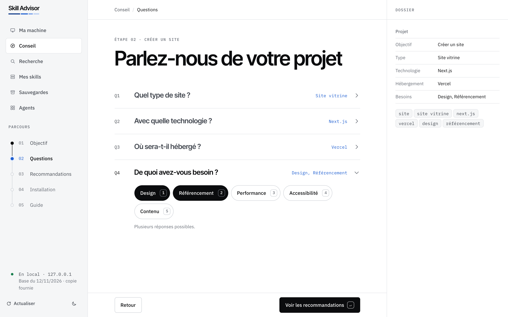
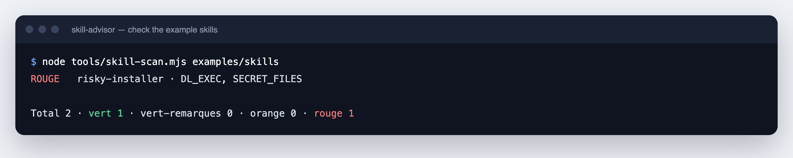

# Installation manual

**English** · [Français](INSTALL.fr.md) · [Español](INSTALL.es.md) · [العربية](INSTALL.ar.md)

This manual takes you from nothing to a checked skill installed in your agents, then through every screen of Skill Advisor 1.0. Each step has one action and one expected result.

> [!WARNING]
> Skill Advisor works on your real machine. What you install, update, disable or uninstall in it changes the skill folders of your agents, for example `~/.claude/skills` and `~/.agents/skills`. Each step that writes says so.

## Contents

| Step | What you do | Time | Needs |
|---|---|---|---|
| 1 | Check what you need | 2 min | Terminal |
| 2 | Install Skill Advisor | 2 min | Node.js, internet |
| 3 | Start the application | 1 min | Node.js |
| 4 | Read "Ma machine" | 1 min | Browser |
| 5 | Get advice and install a skill | 5 min | Internet |
| 6 | Manage your skills | 3 min | - |
| 7 | Back up, export, import and apply | 5 min | - |
| 8 | Manage your agents | 3 min | - |
| 9 | Search the base | 2 min | - |
| 10 | Check a skill from the terminal | 2 min | Node.js |

The interface is in French. Each step gives the English meaning of the names on the screen.

---

## Fast path · The installation script

The script does steps 1 to 3 for you: it checks your tools, downloads Skill Advisor, installs its dependencies, runs the tests and starts the application. It asks for your language, French or English. It installs no system software and needs no administrator rights. Read it before you run it: [install.sh](../../install.sh), [install.ps1](../../install.ps1).

macOS and Linux:

```bash
curl -fsSLO https://raw.githubusercontent.com/warezfr/skill-advisor/main/install.sh
bash install.sh
```

Windows, in PowerShell:

```powershell
irm https://raw.githubusercontent.com/warezfr/skill-advisor/main/install.ps1 -OutFile install.ps1
powershell -ExecutionPolicy Bypass -File install.ps1
```

The option `-ExecutionPolicy Bypass` applies to this one run. It does not change the settings of your system.

**Expected result:** five numbered steps in the terminal, then the line `Skill Advisor: http://127.0.0.1:<port>/?c=<code>` and the screen "Ma machine" (My machine) in your browser. The application keeps running in that terminal. Continue at step 4.


*Here the script was run with `--no-open`: the browser did not open, and the address is printed at the end.*

| macOS, Linux | Windows | Effect |
|---|---|---|
| `--lang fr`, `--lang en` | `-Lang fr`, `-Lang en` | Choose the language without the question |
| `--dir <folder>` | `-Dir <folder>` | Install into another folder. The default is `skill-advisor` in your home folder |
| `--no-git` | `-NoGit` | Download the archive even when git is installed |
| `--no-open` | `-NoOpen` | Do not open the browser. The application still prints its address |
| `--no-start` | `-NoStart` | Install the application but do not start it |
| `--demo` | `-Demo` | Open the demonstration only: an example machine. No dependency is installed and nothing is written to your agents |

What the script does:

1. It checks whether git, Node.js and npm are present. The application needs Node.js 22.20 or later, with npm. git is optional.
2. It downloads Skill Advisor with git, or as an archive when git is absent.
3. It installs the dependencies, the packages `skills` and `tar`, in the folder `node_modules`, with `npm ci --omit=dev --no-audit --no-fund`.
4. It runs the tests with `npm test` when the dependencies are installed. Otherwise it runs the test of the interface only.
5. It starts the application with `node app/server.mjs`.

Without Node.js 22.20 or later and npm, the script cannot start the application. It opens the demonstration instead, and tells you where to get Node.js.

---

## Step 1 · Check what you need

| Tool | Needed for | How to check | Where to get it |
|---|---|---|---|
| Node.js 22.20 or later, with npm | The application | `node -v`, `npm -v` | [nodejs.org](https://nodejs.org) |
| git | Optional. Easier updates of Skill Advisor, and installs that continue when GitHub limits anonymous downloads | `git --version` | [git-scm.com](https://git-scm.com) |
| A web browser | The interface | - | Already on your machine |

Open a terminal (Terminal on macOS and Linux, PowerShell on Windows) and run:

```bash
node -v
npm -v
git --version
```

**Expected result:** three version numbers. The Node.js number is v22.20 or more, for example `v26.13.0`.

## Step 2 · Install Skill Advisor

Use the script of the fast path, or install by hand:

```bash
git clone https://github.com/warezfr/skill-advisor.git
cd skill-advisor
npm ci --omit=dev
```

Without git, download <https://github.com/warezfr/skill-advisor/archive/refs/heads/main.zip>, unpack it, rename the folder `skill-advisor-main` to `skill-advisor`, enter it and run `npm ci --omit=dev`.

**Expected result:** a folder `skill-advisor` that contains `app`, `prototype`, `catalog`, `tools`, `node_modules` and `README.md`. npm prints a line of the form `added 9 packages`.

## Step 3 · Start the application

macOS and Linux:

```bash
cd ~/skill-advisor
npm start
```

Windows, in PowerShell:

```powershell
cd $HOME\skill-advisor
npm.cmd start
```

On Windows, use `npm.cmd start`: the default execution policy of PowerShell can refuse `npm start`, because it blocks `npm.ps1`. If you installed by hand in step 2, go to the folder `skill-advisor` that `git clone` created, wherever you ran it.

**Expected result:** the line `Skill Advisor: http://127.0.0.1:<port>/?c=<code>`, then the interface in your browser. If the browser does not open, copy that address into it within 10 minutes.

About this address:

- It works once. The browser tab that opened it keeps the session, and a reload of that tab still works.
- Another tab, or the same address used again, shows "Session expirée" (Session expired). Stop the application with Ctrl+C and run `npm start` again: you get a new address.
- The application listens on `127.0.0.1` only. Other machines cannot reach it. Do not share the address.

To stop the application, press Ctrl+C in its terminal. The options of `npm start` are in "Options of the application" below.

## Step 4 · Read "Ma machine"

"Ma machine" (My machine) counts your skills and agents, the available updates, the skills to review and the context they cost. "Ce qui demande votre attention" (What needs your attention) lists what to look at first. The panel on the right lists the agents that hold skills.


The bottom of the menu says "En local · 127.0.0.1" (Local) and the date of the base. "Actualiser" (Refresh) reads your folders again. The application also does it when you come back to its window.

**Expected result:** the skills that your agents already have, including the ones you copied by hand ("copie manuelle").

## Step 5 · Get advice and install a skill

> [!WARNING]
> Step 5.4 writes to your real agent folders.

**5.1 Choose a goal.** Click "Conseil" (Advice) in the left menu. Choose one of the 17 goals, for example "Créer un site" (Create a website).


**5.2 Answer the questions.** For a website: type of site, technology, hosting, needs. The panel on the right fills in as you answer. Click "Voir les recommandations" (See the recommendations).



**5.3 Read the recommendations.** Each skill has a score out of 100 and a line "Pourquoi pour vous" (Why for you). The best ones are ticked. Untick what you do not want. "Voir le détail" (See the detail) explains the score: popularity 40, reputation of the source 25, freshness 15, security 20. Click "Installer" (Install).


**5.4 Check before writing.** The screen "Vérifiez avant d'écrire" (Check before writing) lists the skills, the agents that receive them, the folders that will be created and the scope: "Tous les projets" (All projects) or "Ce projet seulement" (This project only). For one project, give its folder in the field "Dossier du projet" (Project folder). Click "Installer 1 skill dans 4 agents" (Install 1 skill in 4 agents), or the same button with your numbers.


Where the files go:

- With "Dossier partagé" (Shared folder) on, the skill goes to `~/.agents/skills/<name>`. The agents that read this folder see it at once; the screen names them, for example "Lu par Cursor, Gemini CLI" (Read by Cursor, Gemini CLI). Each other chosen agent gets a link to it, a junction on Windows.
- With the shared folder off, each chosen agent gets its own copy, and nothing is written to the shared folder.

What can stop a skill:

| What happens | What you see | What you can do |
|---|---|---|
| The check finds a high-risk pattern | The skill is held: nothing is written for it | Read the report. "Installer malgré l'avertissement" (Install despite the warning) installs it |
| A skill of the same name is already there, copied by hand or from another source | A conflict: nothing is written for it | "Garder l'existant" (Keep the existing one), or "Remplacer (une sauvegarde est faite)" (Replace, a backup is made) |
| No connection, GitHub limit, source not found | A message in French says which one | Check the connection, or wait and try again |

**5.5 Read the guide.** After the installation, the guide says when the agent uses each skill and how to call it. It stays available in "Mes skills".

**Expected result:** the skill appears in "Mes skills" with the state "À jour" (Up to date). Restart your agent so that it reads its skills folder again.

## Step 6 · Manage your skills

"Mes skills" (My skills) lists every skill, with its agents, its state, its check result and its cost in context. Click the name of a skill to open its detail.


- **Update.** Click "Rechercher les mises à jour" (Check for updates). For a skill with an update, "Ce qui change" (What changes) lists the added, removed and changed files and the check of the new version. Then click "Mettre à jour" (Update). A new version with a high-risk pattern is held until you force it. After the update, the same agents see the skill.
- **Disable and enable.** The switch in the column "Actif" (Active) moves the skill to `~/.skill-advisor/disabled` and back. A disabled skill stays on the disk, but the agent no longer loads it.
- **Uninstall.** "Désinstaller" (Uninstall) asks for a confirmation. The box "Garder une sauvegarde" (Keep a backup) is ticked by default.
- **Several at once.** Tick several skills: the bar offers "Désactiver", "Activer", "Sauvegarder" and "Désinstaller" (Disable, Enable, Back up, Uninstall).

A skill copied by hand ("copie manuelle") is not updated: to update it, install it again from its source. A skill installed for a project is shown, but you manage it from the project folder.

**Expected result:** each action changes the folders of your agents, and the list shows the new state.

## Step 7 · Back up, export, import and apply

> [!WARNING]
> Restoring and applying a backup write to your real agent folders.

**7.1 Make a backup.** In "Mes skills", tick one or more skills and click "Sauvegarder" (Back up). Add a label and a note if you want: 80 and 500 characters at most. An uninstall with "Garder une sauvegarde" also makes a backup.

**7.2 Read your backups.** "Sauvegardes" (Backups) lists them, newest first, with their date, their origin, their size, their skills and their check results. They are kept in `~/.skill-advisor/backups`.


**7.3 Restore.** "Restaurer" (Restore) puts each copy back where it came from. When something already sits at one of those places, nothing is written. A skill with a risky pattern asks for "Restaurer malgré tout" (Restore anyway).

**7.4 Export and import.** "Exporter" (Export) saves the backup as one file named `skill-advisor-<id>.tar.gz`. On another machine, "Importer une sauvegarde" (Import a backup) reads that file, checks every skill again and stores it as a new backup. Nothing is installed yet. The import refuses a file that holds anything other than files and folders, a path that leaves the backup, more than 200 MB or more than 100,000 entries, a file without a valid Skill Advisor manifest, or an invalid skill name.

**7.5 Apply to other agents.** "Appliquer à d'autres agents" (Apply to other agents) opens a panel. Choose the skills, then the agents: the detected agents, the shared folder, or any other known agent found by its name. Then choose what happens when an agent already holds the skill.


| What the agent holds | "Passer" (Skip) | "Remplacer" (Replace) |
|---|---|---|
| Nothing | The skill is copied | The skill is copied |
| The same content | Nothing changes | Nothing changes |
| A different version | It stays in place | It is backed up, then replaced |

A skill with a risky pattern is applied only when you tick "Appliquer malgré l'avertissement" (Apply despite the warning).

**Expected result:** a message such as `safe-notes : 1 application faite, 0 passée, 0 échec` (1 applied, 0 skipped, 0 failed). The skill appears in the chosen agents in "Mes skills". Each replaced version has its own new backup.

## Step 8 · Manage your agents

"Agents" lists the 78 agents that Skill Advisor knows. The filters show "Tous" (All), "Détectés" (Detected), "Ciblés" (Targets) and "Masqués" (Hidden).


- **Targets.** The switches choose the agents that receive the installations. The shared folder is one line, with the agents that read it.
- **Add an agent by hand.** "Ajouter un agent" (Add an agent): give a name and the full path of its skills folder. That agent gets its own copy of each skill. It cannot receive an installation for one project.
- **Hide an agent.** "Actions", then "Masquer" (Hide). "Afficher" (Show) brings it back.
- **Empty an agent.** "Actions", then "Retirer tous ses skills" (Remove all its skills), with an optional backup. For an agent that reads the shared folder, the application names all the agents that read it and offers "Retirer du dossier partagé pour tous ces agents" (Remove from the shared folder for all these agents).
- **Project folder.** The field "Dossier du projet" (Project folder) is also on this screen.

**Expected result:** the filter "Tous" (All) counts the 78 known agents.

## Step 9 · Search the base

"Recherche" (Search) looks among the 1,551 most installed skills of the 92,899 listed by skills.sh, with filters by project type, installs and warnings. The title bar shows the date and the source of the base: "Base du 12/11/2026 · copie fournie" means the copy shipped with Skill Advisor. "Ajouter" (Add) puts a skill in your selection, ready for step 5.4.


The moon button, bottom left, switches to the dark theme. Skill Advisor remembers your choice.


## Step 10 · Check a skill from the terminal

The application runs this check for you. You can also run it yourself, from the folder `skill-advisor`. It reads the files of a skill as text and looks for 11 risky patterns. It never runs the skill. The folder `examples/skills` holds two example skills: one safe, one written to fail.

```bash
node tools/skill-scan.mjs examples/skills
```

**Expected result:** one red line for `risky-installer`, and the total `Total 2 · vert 1 · vert-remarques 0 · orange 0 · rouge 1`.



| Verdict | In the interface | What to do |
|---|---|---|
| `vert` (green) | Aucun motif connu (No known pattern) | Read the skill, then decide |
| `vert-remarques` (green with notes) | Remarques (Notes) | Read the notes |
| `orange` | À regarder (To review) | Read each finding before you install |
| `rouge` (red) | Motif à risque (Risky pattern) | Do not install unless you understand every line |

To see every finding with its file and line number, add `--json`:

```bash
node tools/skill-scan.mjs examples/skills --json
```

To check the skills of the shared folder:

```bash
node tools/skill-scan.mjs ~/.agents/skills
```

On Windows PowerShell, write `$HOME\.agents\skills` in place of `~/.agents/skills`. The check skips linked folders: give it the folder that holds the real files.

> [!WARNING]
> A green verdict means "no known pattern found". It does not mean "safe". The check finds known patterns only.

---

## Options of the application

Pass them after `npm start --`, for example `npm start -- --no-open --port 4317`.

| Option | Effect |
|---|---|
| `--port <n>` | Listen on this port. Without it, the system chooses a free port |
| `--no-open` | Do not open the browser. The address is still printed |
| `--project <folder>` | Use this folder as the project folder |
| `--home <folder>` | For tests only: use this folder as the home folder |
| `--version` | Print the version, then stop |
| `--help` | Print the help, in French, then stop |

## Run the tests

The tests need the dependencies, installed by `npm ci`. The script and step 2 already install them. On Windows, write `npm.cmd` in place of `npm`.

```bash
npm ci
npm test
npm run test:e2e
```

`npm test` runs every suite through `test/run-all.mjs`, without network: the server and its library, the interface, and the check that `prototype/dist` matches its sources. The tests use throwaway folders in the system temp folder, never your agent folders. Without git, the tests that need it are skipped.

`npm run test:e2e` runs the end-to-end tests in a headless browser. It needs Chrome or Chromium. If it is not found, give its path in the variable `CHROME_PATH`. Without a browser, these tests are skipped.

**Expected result:** `npm test` ends with a block `=== Bilan ===` (Summary): one line per suite, `réussi` (passed) or `ÉCHEC` (failed), with its time.

## Stop, update, uninstall

**Stop.** Press Ctrl+C in the terminal where the application runs.

**Update.** Run the installation script again. A copy installed with git is updated with `git pull`. A copy installed without git is kept as it is, and the script says so: delete the folder `skill-advisor` first, then run the script, or install into another folder with `--dir` (`-Dir` on Windows). Your settings and backups in `~/.skill-advisor` stay.

**Uninstall.** Skill Advisor installs nothing on your system.

1. Enable your disabled skills, or they are deleted with `~/.skill-advisor`.
2. Export the backups that you want to keep (step 7.4).
3. Uninstall the skills that you no longer want (step 6). The others stay in your agents.
4. Delete the installation folder and the folder `~/.skill-advisor`. On macOS and Linux:

```bash
rm -rf ~/skill-advisor ~/.skill-advisor
```

On Windows, delete the folders `skill-advisor` and `.skill-advisor` in your user profile.

## If something goes wrong

| What you see | Cause | What to do |
|---|---|---|
| `node: command not found` | Node.js is not installed | Install it from [nodejs.org](https://nodejs.org), then open a new terminal |
| `too old (22.20 or later needed for the application)` | Node.js is older than 22.20 | Install a newer Node.js, then run the script again |
| `npm failed` in step 3 of the script | npm cannot reach its registry | Check the internet connection and run the script again |
| PowerShell refuses `npm start` | The execution policy blocks `npm.ps1` | Run `npm.cmd start` |
| "Session expirée" (Session expired) | The address was already used, or is older than 10 minutes | Press Ctrl+C, run `npm start` again and open the new address |
| `Le port <n> est déjà pris` (The port is already taken) | Another program uses this port | Choose another one with `--port`, or leave the option out |
| The terminal prints nothing more after the address | The application is running | This is expected. Press Ctrl+C to stop it |
| An installation stops on a GitHub limit | GitHub limits anonymous downloads | Install git, or wait one hour and try again |
| `Dossier introuvable` (Folder not found) from `skill-scan.mjs` | The folder you gave does not exist | Give a folder that contains one sub-folder per skill |

## Report a problem

Report bugs in the [GitHub issues](https://github.com/warezfr/skill-advisor/issues). For a security problem, do not open a public issue: open a [private security advisory](https://github.com/warezfr/skill-advisor/security/advisories/new).

---

[Back to the README](../../README.md) · Website: [span.observer](https://span.observer)
